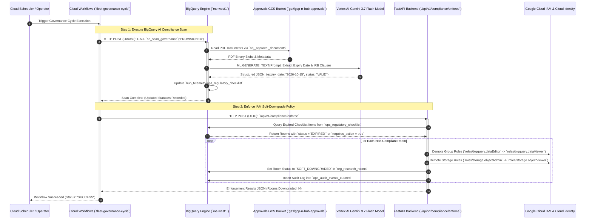
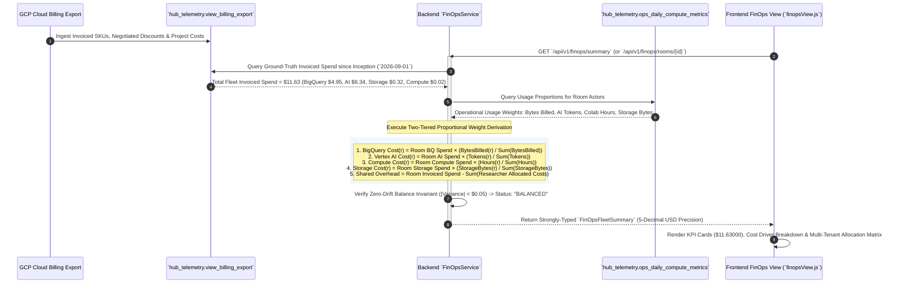
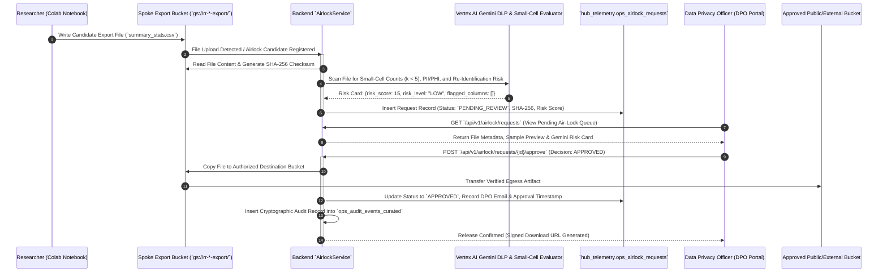
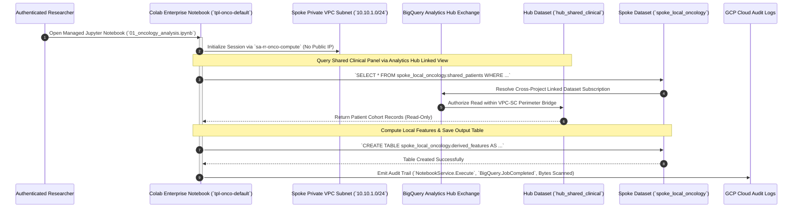

# System Architecture & Technical Specification

**GCP Multi-Tenant Trusted Research Environment (TRE) & Research Room Governance Platform**  
*Comprehensive Technical Manual, Zero-Trust Specification & Detailed Process Flows*  
*Document Version:* `3.1.0 (Production Verified & Deep Audit)`

---

## 1. Executive Summary & Project Mission

The **GCP Health Data Platform & Research Room Management System** is a mission-critical, multi-tenant **Trusted Research Environment (TRE)** designed to host sensitive clinical, genomic, oncological, and epidemiological research datasets on Google Cloud Platform. 

In biomedical and academic healthcare research, institutions face a fundamental tension: **data utility** (giving researchers access to powerful BigQuery SQL engines, high-performance Colab Enterprise/Vertex AI notebooks, and Gemini AI foundation models) versus **regulatory compliance and data loss prevention** (preventing unauthorized exfiltration of Protected Health Information (PHI) and Personally Identifiable Information (PII) under statutory regulations, HIPAA, GDPR, and the Declaration of Helsinki).

### Core Architectural Goals:
1. **Zero-Trust Perimeter Isolation (Hub-and-Spoke Topology)**: Full cryptographic and networking isolation between central governance administrators (`gcp-rr-hub-core`) and tenant research workspaces (`gcp-rr-spoke-*`).
2. **VPC Service Controls (VPC-SC) Boundary Enforcement**: Ingress and egress perimeters that block direct internet access, preventing unauthorized data exfiltration while permitting governed, audited communication between Hub datasets and Spoke compute runtimes.
3. **Automated 2-Loop Statutory Compliance & AI Ethics Gating**: Continuous monitoring of 5-item statutory checklists (Helsinki IRB approvals, Data Transfer Committee reviews, and Data Use Agreements) using Vertex AI Gemini 3.7 Flash over BigQuery Object Tables, coupled with automated IAM "soft-downgrade" enforcement.
4. **Air-Lock Cryptographic Egress Inspection**: Multi-stage, DPO-approved egress pipeline utilizing dual-bucket isolation (`inbound` vs `export`) and AI-assisted small-cell ($k < 5$) and re-identification risk scoring.
5. **Two-Tiered, Inception-to-Date FinOps Engine**: Full multi-tenant cost attribution apportioning ground-truth GCP Billing Export dollars down to individual researchers and shared administrative overhead using exact usage telemetry weights with strict 5-decimal micro-cost precision ($\$0.00000$).

---

## 2. Global High-Level & Detailed System Topology

### 2.1 Multi-Project Architectural Topology

```mermaid
flowchart TD
    subgraph BillingSink["🏢 GCP Billing Export Sink Project (`majestic-energy-353306`)"]
        BillingTable[("Partitioned GCP Billing Export Table<br/>`gcp_billing_export_v1_017F5D_25BB78_C82332`<br/>• Time-partitioned daily billing line items<br/>• SKU IDs, List Prices, Credits, Invoiced Costs")]
    end

    subgraph HubProject["🏢 Central Governance Hub Project (`gcp-rr-hub-core`)"]
        direction TB
        
        subgraph ServingPlane["Cloud Run Serving Plane (Region: `me-west1`)"]
            FrontendSPA["🖥️ Central Admin Portal (Nginx SPA / Tailwind CSS)<br/>• 3 Role Views: Ops Admin, Cloud Engineer, DPO<br/>• Real-time Micro-Cost ($0.00000) & Activity Dashboards"]
            BackendAPI["⚙️ Governance REST API (FastAPI / Python 3.10)<br/>• Endpoints: `/rooms`, `/finops`, `/telemetry`, `/compliance`, `/airlock`<br/>• Enforces `Cache-Control: no-cache` & Zero-Drift Balance"]
        end

        subgraph AutomationPlane["Automated Governance & Telemetry Engines"]
            CloudWorkflow["⚡ Cloud Workflow: `fleet-governance-cycle`<br/>• Step 1: BigQuery AI Scan (`sp_scan_governance` via OAuth2)<br/>• Step 2: Cloud Run IAM Enforcement (`/compliance/enforce` via OIDC)"]
            DTS_Scheduler["⏰ BigQuery DTS Scheduled Queries (`me-west1`)<br/>• 15-min Curation Sync (`sp_sync_curated_audit_events`, `sp_sync_bigquery_queries`, `sp_aggregate_daily_compute_metrics`)<br/>• 24-hr Daily Storage & Rollup (`sp_sync_storage_metrics`, `sp_rollup_monthly_usage`)"]
            TelemetryPoller["🤖 Cloud Run Job: `rr-telemetry-poller`<br/>• Triggered every 15m by Cloud Scheduler (`rr-telemetry-poller-15m`)<br/>• Polls Vertex AI Runtime API (`locations/me-west1/notebookRuntimes`)<br/>• Polls Cloud Monitoring API (`compute.googleapis.com/instance/uptime` & `serviceruntime.googleapis.com/api/request_count`)"]
        end

        subgraph HubDataLayer["BigQuery Central Data, AI & Registry Layer (`me-west1`)"]
            HubRegistry[("Dataset: `hub_registry`<br/>• `reg_institutes` (Affiliated Research Centers)<br/>• `reg_researchers` (Enrolled Investigators)<br/>• `reg_research_rooms` (Spoke Room Registry)<br/>• `reg_room_packages` (Installed Runtime Libs)")]
            
            HubTelemetry[("Dataset: `hub_telemetry`<br/>• `ops_regulatory_checklist` (5-Item Status)<br/>• `ops_airlock_requests` (Egress Logs & Risk Cards)<br/>• `ops_audit_events_curated` (Curated Cloud Audit Trail)<br/>• `ops_notebook_sessions` (Colab Session Hours)<br/>• `ops_ai_usage_metrics` (Vertex AI Token Logs)<br/>• `ops_daily_compute_metrics` (Unified Daily Rollup)<br/>• `ops_monthly_usage_rollup` (Consolidated MTD/YTD)")]
            
            BillingView[("Authorized View: `hub_telemetry.view_billing_export`<br/>• Dynamic Regex Filtering (`LIKE 'gcp-rr-%'` / `'tre-room-%'`)<br/>• Standardizes Spoke Project IDs")]
            
            GeminiRemote["🤖 BigQuery ML Remote Model: `gemini_flash_model`<br/>• Binds BigQuery to Vertex AI `gemini-3.7-flash`<br/>• Cloud Resource Connection: `gemini-connection`"]
            
            ApprovalDocObj[("Object Table: `hub_telemetry.obj_approval_documents`<br/>• Metadata index over unstructured PDF agreements<br/>• Directly queried by Vertex AI Gemini via SQL")]
            
            SharedClinical[("Shared Datasets: `hub_shared_clinical` & `hub_shared_reference`<br/>• Curated Synthetic Cohorts & Genomics Panels<br/>• Published via Analytics Hub Data Exchanges")]
        end

        HubApprovalsBucket[("🪣 Central Approvals GCS Bucket<br/>`gs://gcp-rr-hub-approvals`<br/>• Stores raw DUA, IRB, and Protocol PDFs")]
        LogSinkRouter["📡 Central Cloud Logging Log Sink Router<br/>• Aggregates audit logs from all spoke projects"]
    end

    subgraph SpokeOncology["🔬 Spoke Room: `rr-oncology-01` (`gcp-rr-spoke-oncology-01`)"]
        direction TB
        VPC_Onco["Private VPC Subnet (`10.10.1.0/24`)<br/>• `disable_public_ip = true`<br/>• Cloud NAT for secure package repositories"]
        Colab_Onco["📓 Colab Runtime (`tpl-onco-default`)<br/>• Machine: `e2-standard-4` (Shielded VM)<br/>• Compute SA: `sa-rr-onco-compute`"]
        BQ_Onco[("Local Dataset: `spoke_local_oncology`<br/>Linked Dataset: `hub_shared_clinical`")]
        GCS_In_1[("🪣 Inbound Bucket (Read-Only)<br/>`gs://rr-oncology-01-inbound`")]
        GCS_Out_1[("🪣 Export Quarantine (Write-Only)<br/>`gs://rr-oncology-01-export`")]
        Group_Onco["👥 Cloud Identity Group<br/>`tre-onco-researchers@liatsabag.altostrat.com`<br/>• Active: `roles/bigquery.dataEditor`<br/>• Downgraded: `roles/bigquery.dataViewer`"]
    end

    subgraph SpokeGenomics["🧬 Spoke Room: `rr-genomics-02` (`gcp-rr-spoke-genomics-02`)"]
        direction TB
        VPC_Genom["Private VPC Subnet (`10.10.2.0/24`)<br/>• `disable_public_ip = true`<br/>• Cloud NAT"]
        Colab_Genom["📓 Colab Runtime (`tpl-genom-default`)<br/>• Machine: `n2-highmem-8` (Shielded VM)<br/>• Compute SA: `sa-rr-genom-compute`"]
        BQ_Genom[("Local Dataset: `spoke_local_genomics`<br/>Linked Dataset: `hub_shared_reference`")]
        GCS_In_2[("🪣 Inbound Bucket (Read-Only)<br/>`gs://rr-genomics-02-inbound`")]
        GCS_Out_2[("🪣 Export Quarantine (Write-Only)<br/>`gs://rr-genomics-02-export`")]
        Group_Genom["👥 Cloud Identity Group<br/>`tre-genom-researchers@liatsabag.altostrat.com`"]
    end

    subgraph SpokeCardio["❤️ Spoke Room: `rr-cardio-03` (`gcp-rr-spoke-cardio-03`)"]
        direction TB
        SpokeCardioDetails["Private VPC Subnet (`10.10.3.0/24`), Dual-Buckets, Local Mart & Colab Runtime"]
    end

    subgraph SpokeNeuro["🧠 Spoke Room: `rr-neurology-04` (`gcp-rr-spoke-neurology-04`)"]
        direction TB
        SpokeNeuroDetails["Private VPC Subnet (`10.10.4.0/24`), Dual-Buckets, Local Mart & Colab Runtime"]
    end

    %% Wiring & Data/Control Connections
    FrontendSPA -->|Reverse Proxy `/api/v1`| BackendAPI
    BackendAPI --> HubDataLayer
    CloudWorkflow -->|Step 1: Execute SQL AI Scan| HubDataLayer
    CloudWorkflow -->|Step 2: Trigger IAM Soft-Downgrade| BackendAPI
    DTS_Scheduler -->|Triggers SQL Stored Procedures| HubTelemetry

    BillingTable --> BillingView
    BillingView --> BackendAPI

    HubApprovalsBucket --> ApprovalDocObj
    ApprovalDocObj --> GeminiRemote

    SharedClinical -.->|Analytics Hub Data Exchange Subscription| BQ_Onco & BQ_Genom
    
    SpokeOncology & SpokeGenomics & SpokeCardio & SpokeNeuro -->|Audit Logs Sink Stream| LogSinkRouter
    LogSinkRouter --> HubTelemetry
```



---

## 3. Zero-Trust Security & VPC Service Controls (VPC-SC) Deep-Dive

Security in the Research Room platform is implemented in concentric layers: **Network Perimeters**, **IAM Federation**, and **Data Boundaries**.

```
  +-----------------------------------------------------------------------------------+
  |                  VPC SERVICE CONTROLS SERVICE PERIMETER                           |
  |                                                                                   |
  |   +--------------------------+             +----------------------------------+   |
  |   |   CENTRAL HUB PROJECT    |             |       SPOKE ROOM PROJECT         |   |
  |   |    (gcp-rr-hub-core)     |  PERIMETER  |    (gcp-rr-spoke-oncology-01)    |   |
  |   |                          |   BRIDGE    |                                  |   |
  |   |  - BigQuery Hub Datasets |<===========>|  - Private Spoke VPC Subnet      |   |
  |   |  - Analytics Hub Exch.   |             |  - Colab Notebook (No Public IP) |   |
  |   |  - Telemetry Marts       |             |  - Inbound Bucket (Read-Only)    |   |
  |   |  - Approvals Bucket      |             |  - Export Bucket (Write-Only)    |   |
  |   +--------------------------+             +----------------------------------+   |
  |                 |                                          |                      |
  |                 | RESTRICTED SERVICES:                     |                      |
  |                 | • bigquery.googleapis.com                |                      |
  |                 | • storage.googleapis.com                 |                      |
  |                 | • aiplatform.googleapis.com              |                      |
  |                 | • logging.googleapis.com                 |                      |
  +-----------------+------------------------------------------+----------------------+
```

### 3.1 VPC-SC Ingress & Egress Architecture
1. **Restricted Services**: BigQuery (`bigquery.googleapis.com`), Cloud Storage (`storage.googleapis.com`), Vertex AI (`aiplatform.googleapis.com`), and Cloud Logging (`logging.googleapis.com`) are locked inside the security perimeter.
2. **Access Levels**: Ingress into the Hub is restricted to authenticated Cloud Identity researcher identities belonging to corporate IP blocks or verified device tiers.
3. **Perimeter Bridges**: Cross-project BigQuery reads between Spoke Colab runtimes and Hub shared clinical datasets are permitted strictly via explicit Analytics Hub listings and perimeter bridges, eliminating arbitrary data copying.
4. **Private IP & Private Google Access**: Spoke Colab runtime templates configure `disable_public_ip = true`. All calls to Google APIs resolve to `restricted.googleapis.com` (`199.36.153.4/30`).
5. **Outbound Internet Control**: Outbound internet egress is strictly blocked except through Cloud NAT for approved package registries (PyPI / CRAN mirrors), preventing direct egress to untrusted internet endpoints.

---

## 4. End-to-End Backend Process Flows & Sequence Diagrams

### 4.1 Process 1: Automated 2-Loop Statutory Compliance & Soft-Downgrade

This flow continuously verifies Helsinki Ethics (IRB) dates and Data Use Agreements (DUA) across all active research rooms using Vertex AI Gemini, and automatically restricts room permissions if an approval lapses.



#### Involved Cloud Resources:
* **Cloud Workflows**: `fleet-governance-cycle` orchestrates sequential execution with OAuth2 and OIDC authentication.
* **BigQuery Stored Procedure**: `hub_telemetry.sp_scan_governance` queries `obj_approval_documents`.
* **Vertex AI**: Remote model `gemini_flash_model` invokes `gemini-3.7-flash` in `me-west1`.
* **GCS Approvals Bucket**: `gs://gcp-rr-hub-approvals` stores raw legal PDFs.
* **FastAPI Backend on Cloud Run**: Evaluates compliance thresholds and executes granular IAM role transitions.

---

### 4.2 Process 2: Real-Time Telemetry Ingestion, Curation & Ground-Truth Polling

This process captures all researcher interactions, BigQuery query metrics, Colab Enterprise session durations, Vertex AI model requests, and GCS storage footprints, compiling them into day-partitioned analytical marts via direct ground-truth APIs rather than audit parsing.

```mermaid
sequenceDiagram
    autonumber
    participant Researcher as Researcher / Colab Notebook
    participant SpokeServices as Spoke GCP Services (BQ, GCS, Colab)
    participant Logging as Cloud Logging Log Sinks
    participant BQ_Audit as BigQuery `cloudaudit_googleapis_com_*`
    participant DTS as BigQuery Data Transfer Service
    participant Poller as Cloud Run Job (`rr-telemetry-poller`)
    participant Monitoring as Cloud Monitoring & Vertex AI APIs
    participant StorageInsights as GCS Storage Insights
    participant TelemetryMarts as `hub_telemetry` Analytical Marts

    Researcher->>SpokeServices: Execute BigQuery Query / Open Colab Notebook / Call Gemini Model
    SpokeServices->>Logging: Emit Cloud Audit Logs (Security, IAM, Object Creation)
    Logging->>BQ_Audit: Real-Time Stream to Hub Log Sink

    par Every 15 Minutes (DTS Curation & BQ Job Sync)
        DTS->>TelemetryMarts: CALL `sp_sync_curated_audit_events()`
        TelemetryMarts->>TelemetryMarts: Curate security audit trail into `ops_audit_events_curated`
        DTS->>SpokeServices: CALL `sp_sync_bigquery_queries()`
        SpokeServices-->>TelemetryMarts: Query `region-me-west1.INFORMATION_SCHEMA.JOBS_BY_PROJECT` into `ops_bigquery_usage_15m`
    and Every 15 Minutes (Cloud Run Poller via Cloud Scheduler)
        Poller->>Monitoring: Query Vertex AI Runtime API (`locations/me-west1/notebookRuntimes`)
        Poller->>Monitoring: Query Cloud Monitoring VM Uptime (`compute.googleapis.com/instance/uptime`)
        Monitoring-->>Poller: Active runtime hours per instance/user
        Poller->>TelemetryMarts: MERGE into `ops_notebook_sessions`
        Poller->>Monitoring: Query Vertex AI Request Count (`serviceruntime.googleapis.com/api/request_count`)
        Monitoring-->>Poller: Inferences count & inferred token volumes
        Poller->>TelemetryMarts: MERGE into `ops_ai_usage_metrics`
    and Once Daily (Nightly Storage Insights Inventory & Unified Aggregation)
        StorageInsights->>TelemetryMarts: Export daily physical bucket inventory into `raw_storage_inventory`
        DTS->>TelemetryMarts: CALL `sp_sync_storage_metrics()`
        TelemetryMarts->>TelemetryMarts: Join inventory with `storage.objects.create` audit events to attribute ownership into `ops_storage_daily`
        DTS->>TelemetryMarts: CALL `sp_aggregate_daily_compute_metrics()`
        TelemetryMarts->>TelemetryMarts: Consolidate 24h collections (Storage, BQ queries, Notebooks, AI) into unified `ops_daily_compute_metrics`
        DTS->>TelemetryMarts: CALL `sp_rollup_monthly_usage()`
        TelemetryMarts->>TelemetryMarts: Roll up MTD/YTD totals into `ops_monthly_usage_rollup`
    end
        DTS->>TelemetryMarts: CALL `sp_rollup_monthly_usage()`
        TelemetryMarts->>TelemetryMarts: Roll up MTD/YTD totals into `ops_monthly_usage_rollup`
    end
```

#### Involved Cloud Resources:
* **BigQuery Scheduled Queries (DTS)**: Runs regional transfer jobs in `me-west1` (`rr-telemetry-15min-curation-sync` calling `sp_sync_curated_audit_events` and `sp_sync_bigquery_queries` every 15 minutes; `rr-telemetry-daily-finops-rollup` calling `sp_sync_storage_metrics`, `sp_aggregate_daily_compute_metrics`, and `sp_rollup_monthly_usage` once a night).
* **Autonomous Telemetry Poller Cloud Run Job**: `rr-telemetry-poller` triggered every 15 minutes by Cloud Scheduler (`rr-telemetry-poller-15m`) polling Vertex AI Runtime and Cloud Monitoring APIs.
* **GCS Storage Insights**: Automated daily inventory reports deposited into BigQuery external table `raw_storage_inventory` and correlated with creator identities by `sp_sync_storage_metrics`.
* **Analytical BigQuery Marts**: Partitioned by `usage_date` and clustered by `room_id, user_email` (`ops_bigquery_usage_15m`, `ops_notebook_sessions`, `ops_ai_usage_metrics`, `ops_storage_daily`, `ops_daily_compute_metrics`, `ops_monthly_usage_rollup`).

---

### 4.3 Process 3: Two-Tiered FinOps Attribution & Micro-Cost Reconciliation

This process takes raw financial spend from the Google Cloud Detailed Billing Export and performs exact multi-tenant cost attribution to individual researchers and shared room overhead with zero drift.



#### Mathematical Formulas & Invariants:
1. **BigQuery Allocation Weight**:
   $$W_{r, \text{BQ}} = \frac{\text{Bytes Billed}(r)}{\sum_{i \in \text{Room}} \text{Bytes Billed}(i)}$$
2. **Vertex AI Allocation Weight**:
   $$W_{r, \text{AI}} = \frac{\text{Token Count}(r)}{\sum_{i \in \text{Room}} \text{Token Count}(i)}$$
3. **Compute Allocation Weight**:
   $$W_{r, \text{Compute}} = \frac{\text{Runtime Hours}(r)}{\sum_{i \in \text{Room}} \text{Runtime Hours}(i)}$$
4. **Shared Administrative Overhead**:
   $$\text{Cost}_{\text{Overhead}} = \text{Total Invoiced Spoke Spend} - \sum_{r \in \text{Researchers}} \text{Allocated Cost}(r)$$
5. **Zero-Drift Balance Invariant**:
   $$\text{Total Invoiced} \equiv \sum_{r} \text{Allocated Cost}(r) + \text{Cost}_{\text{Overhead}} \quad (\text{Variance} \equiv \$0.0000)$$

---

### 4.4 Process 4: Air-Lock Egress Review & Cryptographic Release Workflow

This process governs all data exfiltration attempts. Files produced by researchers in their notebooks are quarantined, evaluated by AI risk classifiers for PII/PHI and small-cell counts, and reviewed by a Data Privacy Officer (DPO) before cryptographic release.



---

### 4.5 Process 5: Governed Colab Enterprise Execution & Analytics Hub Data Sharing

This process illustrates how researchers interact with governed Colab Enterprise / Vertex AI Workbench environments, query shared clinical panels across project boundaries without direct IAM grants, and trigger automated usage logging.



---

## 5. Traffic Generation, Workload Simulation & Cost Dynamics

### 5.1 Dynamic Usage-Based Cost Model vs Fixed Projections
A common point of confusion is whether the platform costs are static or dynamic:
* **Costs are 100% Usage-Driven**: Google Cloud does not charge a fixed flat fee for research rooms. Costs are incurred dynamically based on:
  1. **BigQuery Analysis**: Total bytes scanned by user queries ($\$6.25$ per TB on on-demand pricing).
  2. **Vertex AI / Gemini**: Input and output tokens consumed by researchers and automated DUA scans.
  3. **Colab Enterprise / Notebook VMs**: Per-second compute instance runtime hours (e.g. `e2-standard-4` at $\approx \$0.134$/hour).
  4. **Cloud Storage**: Gigabyte-months of stored research data ($\approx \$0.02$/GB/month in `me-west1`) plus network egress.
  5. **Cloud Run**: Serverless container execution time for Backend and Frontend HTTP requests.

### 5.2 How Traffic is Generated & Ingested

The repository provides three specialized workload generation utilities in `scripts/`:

```
+---------------------------------------------------------------------------------------------------------+
|                                    WORKLOAD GENERATION SUITE                                            |
+------------------------------------+------------------------------------+-------------------------------+
|  1. LIVE RESEARCHER TRAFFIC        |  2. INTERACTIVE RESEARCHER         |  3. SCALED SPOKE ACTIVITY     |
|     `generate_live_researcher_`    |     `interactive_researcher_`     |     `generate_scaled_spoke_`  |
|     `traffic.py`                   |     `executor.py`                  |     `activity.py`             |
|                                    |                                    |                               |
| • Executes multi-tenant BQ joins   | • Authenticates as a specific      | • Scales multi-room traffic   |
| • Generates live Colab sessions    |   genuine Google user identity     |   with customizable weights   |
| • Calls Gemini Flash models        | • Creates real Colab sessions &    | • Generates multi-MB storage  |
| • Ingests live storage files       |   exports via gcloud CLI & REST    |   uploads across researchers  |
+------------------------------------+------------------------------------+-------------------------------+
```

#### Step-by-Step Instructions to Generate Live Traffic:

```bash
# 1. Generate live multi-tenant researcher traffic across all rooms
python3 scripts/generate_live_researcher_traffic.py --scans 5 --tokens 2000

# 2. Run scaled activity generator with proportional researcher weighting
python3 scripts/generate_scaled_spoke_activity.py --cycles 3

# 3. Trigger telemetry poller Cloud Run job (or via Cloud Scheduler)
gcloud run jobs execute rr-telemetry-poller --region=me-west1 --project=gcp-rr-hub-core --wait

# 4. Trigger BigQuery curation and rollup stored procedures
bq query --use_legacy_sql=false "CALL \`gcp-rr-hub-core.hub_telemetry.sp_sync_curated_audit_events\`();"
bq query --use_legacy_sql=false "CALL \`gcp-rr-hub-core.hub_telemetry.sp_sync_bigquery_queries\`();"
bq query --use_legacy_sql=false "CALL \`gcp-rr-hub-core.hub_telemetry.sp_sync_storage_metrics\`();"
bq query --use_legacy_sql=false "CALL \`gcp-rr-hub-core.hub_telemetry.sp_aggregate_daily_compute_metrics\`();"
bq query --use_legacy_sql=false "CALL \`gcp-rr-hub-core.hub_telemetry.sp_rollup_monthly_usage\`();"
```

### 5.3 Billing Export Latency vs Test Verification
* **GCP Billing Export Cycle**: Google Cloud Detailed Billing Export streams records in micro-batches with an ingestion latency of **4 to 24 hours**.
* **End-to-End Test Harness (`scripts/verify_finops_e2e.py`)**: Validates the mathematical engine against the ground-truth billing baseline ($11.63 total spend) currently recorded in `view_billing_export`, ensuring that after any traffic generation cycle, the attribution engine preserves zero-drift invariants ($\sum \text{Researchers} + \text{Shared Overhead} \equiv \text{Project Invoice}$).

---

## 6. Comprehensive Component Registry & Physical File Map

| Subsystem | File Path | Primary Responsibilities | Input / Output Contract | Error Handling & Fallback Behavior |
| :--- | :--- | :--- | :--- | :--- |
| **FinOps Service** | `backend/app/services/finops.py` | Universal service categorization, proportional weight derivation ($W_r$), and zero-drift micro-cost reconciliation. | **In**: `view_billing_export`, `ops_daily_compute_metrics`<br>**Out**: `FinOpsFleetSummary`, `RoomFinOpsDetail` | Falls back to cached data if BigQuery is down; pools unassigned compute into shared overhead. |
| **Telemetry Service** | `backend/app/services/telemetry.py` | Query audit parsing, researcher-filtered activity aggregation, and Colab session metrics. | **In**: `ops_audit_events_curated`, `INFORMATION_SCHEMA`<br>**Out**: `FleetOverviewMetrics`, `RoomActivitySummary` | Dual-fallback: queries live `INFORMATION_SCHEMA` first, falling back to persisted daily marts. |
| **Airlock Service** | `backend/app/services/airlock.py` | Cryptographic egress hashing, Gemini DLP small-cell scanning, and DPO approval boards. | **In**: `gs://rr-*-export/`<br>**Out**: Signed URLs, SHA-256 audit logs, approved GCS transfers | Blocks release on high risk score; logs all rejections to BigQuery audit trail. |
| **Compliance Service** | `backend/app/services/compliance.py` | 5-item statutory checklist evaluation and IAM soft-downgrade enforcement. | **In**: `ops_regulatory_checklist`<br>**Out**: IAM Policy Bindings, `RoomActionResponse` | Graceful retry on IAM API rate limits; records audit entries for failed downgrades. |
| **Reports Service** | `backend/app/services/reports.py` | Consolidated CSV/JSON governance and FinOps report serialization. | **In**: `FinOpsService.get_summary()`<br>**Out**: Serialized CSV/JSON reports | Consumes single source of truth to ensure 100% numerical parity with UI cards. |
| **Fleet Service** | `backend/app/services/fleet.py` | Spoke project catalog lookup, room detail spend synchronization, and Cloud Identity group bindings. | **In**: `reg_research_rooms`, `view_billing_export`<br>**Out**: `ResearchRoomDetail` DTOs | Directly queries `view_billing_export` to eliminate historical $0.00 spend discrepancies. |

---

## 7. Cloud Infrastructure Asset Inventory

```
+-----------------------------------------------------------------------------------------------------------------+
|                                     DEPLOYED GCP INFRASTRUCTURE ASSET MAP                                       |
+------------------------------+---------------------------+-----------------------+------------------------------+
| RESOURCE TYPE                | RESOURCE NAME / ID        | PROJECT / REGION      | OPERATIONAL PURPOSE          |
+------------------------------+---------------------------+-----------------------+------------------------------+
| Cloud Run Backend            | `gcp-rr-hub-backend`      | `gcp-rr-hub-core`     | FastAPI REST Engine          |
|                              | (Rev: `00036-gvb`)        | `me-west1`            | (Cache-Control: no-cache)    |
| Cloud Run Frontend           | `gcp-rr-hub-frontend`     | `gcp-rr-hub-core`     | Nginx SPA Portal             |
|                              | (Rev: `00007-cjp`)        | `me-west1`            | (Strict 5-Decimal USD)       |
| Cloud Workflow               | `fleet-governance-cycle`  | `gcp-rr-hub-core`     | 2-Step Automated Governance  |
|                              |                           | `me-west1`            | (BQ Scan -> IAM Downgrade)   |
| BigQuery DTS Scheduled Query | `15min-curation-sync`     | `gcp-rr-hub-core`     | 15-min Telemetry & Session   |
|                              |                           | `me-west1`            | Synchronization              |
| BigQuery DTS Scheduled Query | `daily-finops-rollup`     | `gcp-rr-hub-core`     | 24-hr Daily & Monthly Mart   |
|                              |                           | `me-west1`            | Aggregation Rollup           |
| BigQuery ML Remote Model     | `gemini_flash_model`      | `gcp-rr-hub-core`     | Vertex AI `gemini-3.7-flash` |
|                              |                           | `me-west1`            | Automated Legal PDF Scans    |
| BigQuery Object Table        | `obj_approval_documents`  | `gcp-rr-hub-core`     | Unstructured DUA / IRB       |
|                              |                           | `me-west1`            | PDF Metadata Index           |
| BigQuery Analytics Hub       | `rr_shared_clinical_exch` | `gcp-rr-hub-core`     | Governed Cross-Project Data  |
|                              |                           | `me-west1`            | Exchange & Subscriptions     |
| Colab Runtime Templates      | `tpl-onco-default`        | Spoke Projects        | Private IP Vertex Workbench  |
|                              | `tpl-genom-default`       | `me-west1`            | Runtimes with Cloud NAT      |
| Dual-Bucket GCS Storage      | `gs://rr-*-inbound`       | Spoke Projects        | Read-Only Inbound Data       |
| Dual-Bucket GCS Storage      | `gs://rr-*-export`        | Spoke Projects        | Write-Only Quarantine Egress |
| Central Approvals Bucket     | `gs://gcp-rr-hub-approvals`| `gcp-rr-hub-core`    | Central DUA & IRB Repository |
+------------------------------+---------------------------+-----------------------+------------------------------+
```
