# System Architecture & Technical Specification

**GCP Multi-Tenant Trusted Research Environment (TRE) & Research Room Governance Platform**  
*Master Technical Manual & Reference Architecture*  
*Document Version:* `4.3.0`

---

## 1. Project Goal, Core Capabilities & Platform Value

### 1.1 Goal & Primary Objective
The goal of this platform is to provide a centralized administrative control plane to deploy, govern, monitor, and financially manage isolated research environments ("Research Rooms") on Google Cloud.

There is high demand for such solutions across public sector entities and regulated environments, including health authorities, government ministries, higher education and research consortia, and financial institutions.

The primary objective of a **Trusted Research Environment (TRE)**—often referred to as a **Secure Data Environment (SDE)**—is to enable authorized researchers to conduct analysis on sensitive, regulated datasets (such as clinical cohorts, EHR records, genomics, and government registries) while ensuring that data remains strictly under custodian control and within defined organizational boundaries.

#### Alignment with the "Five Safes" Framework
To achieve this objective in an understandable and auditable manner, the platform aligns with the internationally recognized **Five Safes** principles:
* **Safe People**: Ensuring only verified, authorized researchers gain access through Cloud Identity groups, multi-factor authentication, and Context-Aware Access.
* **Safe Projects**: Ensuring data use is restricted to approved scientific protocols, with automated monitoring of Institutional Review Board (IRB) ethics approvals and Data Use Agreements (DUAs).
* **Safe Settings**: Providing a secure analytical perimeter (VPC Service Controls, private subnets without public IPs, and Identity-Aware Proxy) that prevents unauthorized data exfiltration.
* **Safe Data**: Ensuring datasets are protected through automated column-level policy tagging, dynamic masking, and zero-copy data sharing.
* **Safe Outputs**: Screening analytical results, aggregate tables, and models through an automated privacy airlock ($k < 5$ small-cell count detection) before digital release by a Data Protection Officer (DPO).

---

### 1.2 Required TRE Capabilities & Native GCP Building Blocks
A complete research environment requires several foundational analytical capabilities. Google Cloud provides powerful, native building blocks to support each:

1. **Zero-Copy Data Sharing**:
   * *Requirement*: Sharing large-scale curated datasets across distinct projects without duplicating physical storage or incurring synchronization overhead.
   * *Native GCP Building Blocks*: [BigQuery Analytics Hub](https://cloud.google.com/bigquery/docs/analytics-hub-introduction) for publishing and subscribing to data exchanges, and [BigQuery Data Clean Rooms](https://cloud.google.com/bigquery/docs/data-clean-rooms) for privacy-preserving, multi-party SQL analysis without raw data exchange.
2. **Collaborative Compute & Data Science Tooling**:
   * *Requirement*: Providing researchers with standard programming environments (Python, R, SQL) and reproducible runtimes inside private network boundaries, augmented by conversational AI.
   * *Native GCP Building Blocks*: [BigQuery Studio Notebooks powered by Colab](https://cloud.google.com/bigquery/docs/create-notebooks-bigquery-studio), [Colab Enterprise](https://cloud.google.com/colab/docs/introduction), and [Vertex AI Workbench](https://cloud.google.com/vertex-ai/docs/workbench/introduction), delivering managed, secure Jupyter notebook instances. These runtimes integrate **Gemini-powered Data Science Agent capabilities** that actively assist researchers with natural language SQL/Python generation, automated exploratory data analysis (EDA), multi-step statistical workflow synthesis, intelligent chart plotting, and in-line code troubleshooting directly within the workspace.
3. **Scalable In-Database Analytics & AI/ML**:
   * *Requirement*: Running high-throughput queries, multimodal analysis, and machine learning models directly within the data warehouse to eliminate external compute transfers.
   * *Native GCP Building Blocks*: [BigQuery](https://cloud.google.com/bigquery/docs/introduction) provides serverless, petabyte-scale SQL analytics, real-time transformations, and multimodal analysis over structured tables and unstructured assets (PDF clinical reports, medical images, audio) using BigLake object tables. Native integration with Vertex AI brings [BigQuery AI functions](https://cloud.google.com/bigquery/docs/generate-text) (such as `ML.GENERATE_TEXT` and vector embeddings with Gemini) directly into SQL queries. Furthermore, [BigQuery ML (BQML)](https://cloud.google.com/bigquery/docs/bqml-introduction) allows researchers to train and evaluate statistical and machine learning models (classification, regression, clustering, time-series forecasting) or deploy imported custom TensorFlow, XGBoost, and ONNX models directly inside the warehouse.
4. **Perimeter Isolation & Exfiltration Prevention**:
   * *Requirement*: Enforcing a cryptographic boundary around cloud storage and APIs so data cannot be moved outside authorized projects, while enforcing zero-trust user and device posture policies.
   * *Native GCP Building Blocks*: [VPC Service Controls (VPC-SC)](https://cloud.google.com/vpc-service-controls/docs/overview) to define security perimeters, [BeyondCorp Enterprise](https://cloud.google.com/beyondcorp-enterprise/docs/overview) with [Context-Aware Access](https://cloud.google.com/access-context-manager/docs/overview) and [Identity-Aware Proxy (IAP)](https://cloud.google.com/iap/docs/concepts-overview) for device-verified, zero-trust researcher ingress without open public ports, [Private Google Access](https://cloud.google.com/vpc/docs/private-google-access) for private Google API routing, and [Cloud Storage (GCS)](https://cloud.google.com/storage/docs) for encrypted object storage.

---

### 1.3 Blueprints and the Operational Challenge
Google Cloud offers multiple reference architectures and automated blueprints to help implement these building blocks securely (such as the *Secure Data Warehouse Blueprint*, the *Vertex AI Workbench Perimeter Blueprint*, and reference patterns for [secure, scalable research environments on Google Cloud](https://cloud.google.com/blog/topics/public-sector/secure-scalable-discoverable-research-environment-simplified-chargeback?e=48754805)).

However, operating a multi-tenant research environment in practice requires additional operational controls:
* **Centralized Governance & Fleet Orchestration**: Managing lifecycle states across multiple independent research workspaces.
* **Continuous Compliance & Policy Enforcement**: Tracking IRB permits and DUAs and automatically restricting access when permits lapse.
* **Automated Data Protection & Egress Control**: Inspecting egress files for PII and small cohort disclosure before export.
* **Multi-Tenant Cost Attribution (FinOps)**: Reconciling complex cloud billing exports down to specific research rooms and individual researchers.

While Google Cloud provides comprehensive infrastructure services to support these requirements—such as [Sensitive Data Protection / Cloud DLP](https://cloud.google.com/sensitive-data-protection/docs), [Cloud Logging](https://cloud.google.com/logging/docs), [Cloud Monitoring](https://cloud.google.com/monitoring/docs), [Cloud Billing Exports](https://cloud.google.com/billing/docs/how-to/export-data-bigquery), and [IAM](https://cloud.google.com/iam/docs)—**these are general-purpose cloud infrastructure services rather than a domain-specific research operations platform**. From the perspective of a Research Operations Administrator, Data Custodian, or Data Protection Officer, there is no out-of-the-box research console. Navigating, configuring, and correlating these disparate cloud services requires deep cloud engineering expertise and custom integration scripts.

#### The Visibility & Management Gap
For example, if a healthcare authority, government agency, or university wants to answer essential operational questions:
* *Which research rooms are currently active, and what datasets are they accessing?*
* *Are all active research rooms compliant with current ethics approvals, or have any IRBs expired?*
* *What exact portion of the monthly cloud bill was derived by a specific researcher across BigQuery SQL queries, Colab notebook sessions, Vertex AI tokens, and storage?*

Answering these questions without a unified platform requires manually cross-referencing disparate log sinks, constructing ad-hoc SQL queries over raw billing exports, auditing IAM policies across multiple projects, and navigating separate administrative consoles.

---

### 1.4 The Purpose & Value of this Platform
This project provides a **kickstart reference platform that bridges these native GCP building blocks and blueprints into a unified TRE management solution**. 

By establishing a centralized control plane, the platform delivers:
* **Unified Hub-and-Spoke Management**: A single management hub (`gcp-rr-hub-core`) that orchestrates and monitors decentralized tenant research rooms (`gcp-rr-spoke-*`).
* **Automated AI Compliance & Soft-Downgrades**: Continuous scheduled verification of IRB and DUA documents using Gemini AI, with automatic IAM soft-downgrades (demoting write/compute permissions to read-only) upon approval expiration.
* **Governed Egress Air-Lock**: A dual-bucket quarantine workflow with automated small-cell ($k < 5$) and PII risk scoring, followed by DPO digital release.
* **Two-Tiered Proportional FinOps**: An automated attribution engine that maps invoiced Google Cloud Billing exports directly to individual researchers based on telemetry weights (scanned bytes, AI tokens, compute hours, storage footprint) with verified zero financial drift.
* **Lightweight Administrative UI**: A single-pane-of-glass management portal providing tailored views for Operations Administrators, Cloud Engineers, and Data Protection Officers.

---

## 2. Master Target Architecture & Global Topology

### 2.1 Master Target Architecture Diagram
The architecture organizes the Google Cloud environment into a **Hub-and-Spoke topology**. The Central Governance Hub manages fleet governance, compliance, and cost attribution across isolated Tenant Spoke Rooms protected inside a unified VPC Service Controls security perimeter.


---

### 2.2 Global Resource Spaces & Boundaries

1. **Central Governance Hub Project (`gcp-rr-hub-core`)**:
   * **Management Portal**: Cloud Run service hosting the unified web administration interface and governance API.
   * **Central Data & Sharing Layer**: BigQuery datasets for platform registries, curated telemetry, and zero-copy Analytics Hub data exchanges.
   * **Central Storage**: Dedicated Cloud Storage bucket for statutory agreements and compliance documentation.
   * **Central Log Router**: Aggregated Cloud Logging receiver collecting audit telemetry across all tenant rooms.

2. **Tenant Research Room Spoke Projects (`gcp-rr-spoke-*`)**:
   * **Private Network Subnet**: Dedicated VPC subnet (`10.10.x.0/24`) with `disable_public_ip = true`, Cloud NAT, and Private Google Access.
   * **Governed Compute**: Colab Enterprise / Vertex AI workbench environments with integrated Gemini Data Science Agent.
   * **In-Room Analytical Store**: Local BigQuery dataset combined with zero-copy linked subscriptions from the Hub.
   * **Dual Storage Buckets**: Inbound bucket (read-only curated source data) and Export bucket (quarantined drop-zone for results).
   * **Audit Log Sink**: Continuous real-time streaming of workspace audit events to the Hub.

3. **Billing Export Sink Project**:
   * Houses the central Google Cloud Billing Export table, queried securely from the Hub via an authorized view.

4. **Security Perimeter (VPC Service Controls)**:
   * Encloses the Hub data layer and all Spoke projects to restrict BigQuery, Cloud Storage, Vertex AI, and Logging APIs, preventing data exfiltration to unauthorized projects or the public internet.

---

### 2.3 User Personas & Data Flows

* **User Flows**:
  * **Operations & Privacy Administrators (DPO)** connect via HTTPS through Cloud Identity-Aware Proxy (IAP) to the Central Management Portal.
  * **Biomedical Researchers** connect via BeyondCorp Enterprise and IAP tunnels directly to their assigned notebook runtimes without public IPs.

* **Data & Telemetry Flows**:
  * **Inbound Data Flow**: Master cohorts and reference datasets are published via Analytics Hub in the Hub and linked read-only in tenant rooms.
  * **In-Room Analysis**: Researchers query data and run analytics in-place via BigQuery and Colab notebooks.
  * **Governed Outbound Egress**: Export artifacts are deposited in the quarantine bucket, evaluated by the airlock compliance scanner, reviewed by the DPO, and released upon approval.
  * **Telemetry & Billing Streams**: Workspace audit logs stream to the Hub for telemetry marts, while billing export data feeds the proportional cost attribution engine.

---

## 3. Tenant Workspaces, Security Perimeter & Workloads

### 3.1 Multi-Project Tenant Isolation
Each research study operates within a dedicated GCP Spoke Project (`gcp-rr-spoke-*`). This provides:
* **Hard Resource Isolation**: Compute instances, scratch storage, and ephemeral datasets are strictly segregated between studies.
* **Autonomous IAM Boundaries**: Permissions granted in one room do not carry over to another study.
* **Direct Cost Encapsulation**: Cloud resource usage is tagged with the project ID at the infrastructure layer, enabling precise FinOps attribution.

---

### 3.2 Roles & Personas Matrix

Platform access is organized around four core user personas with clear separation of duties and minimum required operational boundaries:

| Persona | Primary Focus & Domain | Key Responsibilities & Capabilities |
| :--- | :--- | :--- |
| **Researcher** | Spoke Research Rooms (`gcp-rr-spoke-*`) | • Executes interactive analytical queries and data science workloads in Colab Enterprise and BigQuery Studio.<br/>• Ingests and stages reference datasets from the Inbound GCS bucket into local study datasets.<br/>• Builds derived cohort tables, models, and analytical aggregates within the project's local BigQuery sandbox.<br/>• Queries shared institutional datasets via zero-copy Analytics Hub listings.<br/>• Stages candidate export artifacts (summary tables, model weights, figures) into the write-only quarantine bucket for egress evaluation. |
| **Operations Admin** | Central Hub (`gcp-rr-hub-core`) | • Provisions, configures, and manages the lifecycle of tenant research rooms and researcher accounts.<br/>• Monitors fleet-wide infrastructure health, runtime availability, and daily operational telemetry.<br/>• Triggers and inspects automated governance and data-sync cycles (Cloud Workflows, scheduled queries).<br/>• Analyzes cost allocations, budget consumption, and proportional FinOps attribution across spoke projects. |
| **Data Protection Officer (DPO)** | Central Hub & Compliance Management | • Monitors institutional ethics approvals, data sharing agreements (DSA), IRB/Helsinki certifications, and document expiration statuses.<br/>• Executes on-demand manual compliance scans and AI risk assessments over agreement documents and study configurations.<br/>• Dynamically downgrades room access levels (e.g., enforcing soft-downgrade / read-only status) upon compliance anomalies or agreement expirations.<br/>• Inspects quarantined egress candidates, reviews AI/DLP privacy scan cards, and formally approves or rejects cryptographic export release. |
| **Data Engineer** | Central Hub & Data Exchanges | • Designs, builds, and maintains central master clinical and reference data pipelines.<br/>• Publishes curated institutional data exchanges via BigQuery Analytics Hub listings for zero-copy spoke room subscription.<br/>• Manages schema evolutions, ELT pipeline transformations, and data quality standards across platform datasets. |

---

### 3.3 Security Architecture & VPC-SC Perimeter

#### Defense-in-Depth Architecture & Researcher Access Flow


*Zoom-in on platform security controls and the complete researcher protection lifecycle: Local Client Device with Chrome Enterprise → Zero-Trust Ingress (IAP & Jumper VM) → VPC Service Controls (VPC-SC) Boundary → Isolated Spoke Research Room Enclave & Central Hub.*

#### Core Security Components & Defense-in-Depth Guidelines

* **Verified Researcher Persona & Authentication**:
  All platform access requires authenticated Google Cloud Identity accounts mapped to least-privilege spoke IAM roles. Anonymous or public access is blocked by default across all platform APIs and consoles.
* **Context-Aware Access (CAA) & Managed Devices `[Recommended to add]`**:
  Layering **Context-Aware Access (CAA)** via BeyondCorp / Cloud Identity Premium ensures access is restricted exclusively to corporate-managed, encrypted devices on approved IP ranges, blocking logins from personal or unmanaged endpoints even with valid credentials.
* **VPC Service Controls (VPC-SC) Perimeter & Multi-Tenant IAM Boundary**:
  * **API Perimeter Enforcement**: Enforces a strict boundary across both the Central Hub and all Spoke projects for sensitive Google APIs (`bigquery.googleapis.com`, `storage.googleapis.com`, `aiplatform.googleapis.com`, `notebooks.googleapis.com`). Unmanaged transfers, cross-perimeter exports, or copying data to external/unauthorized Google Cloud projects are strictly blocked at the API layer.
  * **Shared Perimeter & Spoke Isolation**: While spokes share the perimeter, IAM remains strictly scoped per project. Tenants in Spoke A have no IAM permissions in Spoke B, preventing any cross-tenant data access.
  * **Frictionless Hub Operations**: Placing the Central Hub and Spokes in the same perimeter enables Hub service accounts (e.g., Air-Lock scanner, Cloud Workflows) to run compliance evaluations and lifecycle operations across spokes without perimeter boundary friction.
* **Dual-Bucket Storage Architecture**:
  * **Inbound Bucket (`gs://rr-*-inbound`)**: Provisioned as read-only for researchers. Contains approved reference data, raw genomic/clinical sequences, and permitted scripts.
  * **Export Quarantine Bucket (`gs://rr-*-export`)**: Write-only staging area where researchers place candidate files (model weights, summary charts, aggregated tables). Files remain strictly locked inside the perimeter until evaluated and cleared by the Air-Lock service and signed off by the DPO.
* **Restricting BigQuery Query Result Downloads**:
  In BigQuery Studio, users can typically query data and download results locally. To prevent unauthorized mass exports at the console layer, Google Cloud BigQuery supports disabling query result downloads (see [Restricting Downloading Query Results](https://docs.cloud.google.com/bigquery/docs/export-file#restrict_downloading_query_results)). This option can be enforced organization-wide so researchers can only explore data within the managed BigQuery environment and cannot bypass storage quarantine via direct browser file downloads.
* **Device-Side Protection with Chrome Enterprise Core / Premium `[Recommended to add]`**:
  While VPC Service Controls prevents network-level and API-level data exfiltration between cloud projects and to external storage endpoints, it does not inspect or restrict client-side interactions on the researcher's local device (such as copying data to clipboard, print-screen, taking screenshots, or browser cut/paste). Enforcing **Chrome Enterprise** on approved researcher workstations closes this gap by disabling clipboard transfers, disallowing file downloads to local disks, enforcing watermark overlays, and restricting URL navigation exclusively to approved TRE console endpoints.
* **Zero-Trust Access with Identity-Aware Proxy (IAP) & Jumper VMs `[Recommended to add]`**:
  To ensure that all access originates solely from approved devices and verified corporate IP ranges, it is recommended to front the research environment with **Identity-Aware Proxy (IAP)** and managed **Jumper / Bastion VMs** with Context-Aware Access (CAA). This eliminates public IP exposure (`disable_public_ip = true`), binds access to verified device certificates, and provides a fully audited access gateway into the platform.

---

### 3.4 Governed Compute & Data Workloads

1. **BigQuery Studio & Colab Enterprise Notebooks**:
   * Researchers execute interactive SQL, Python, and R workflows within secure managed runtimes configured without public external IP addresses.
   * Internal egress travels via Private Google Access (`restricted.googleapis.com`), ensuring communication remains entirely on Google's private network.
2. **Local Research Datasets & Inbound Ingestion**:
   * Each Spoke Research Room includes dedicated **local BigQuery datasets**.
   * Researchers can freely upload and stage data from their Inbound GCS bucket into local tables, generate derived analytical cohorts, and execute intermediate data processing directly in their isolated study sandbox.
3. **Zero-Copy Analytics Hub Data Sharing & Extensibility**:
   * Curated clinical and institutional datasets from the Central Hub are exposed to Spoke Rooms as Analytics Hub shared listings.
   * Spoke projects query these shared listings as linked datasets with zero physical data duplication or egress overhead.
   * **Extensible Security Layers**: To extend this implementation for sensitive studies, additional granular controls can be configured directly on the shared BigQuery views and listings:
     * **Row-Level Security (RLS)** to filter cohorts based on researcher institute or IRB approval scope.
     * **Column-Level Access & Policy Tags** (via Dataplex) to mask or redact specific sensitive fields (e.g., patient MRNs, dates of birth).
4. **Air-Lock Quarantine & Governed Export**:
   * Output artifacts destined for external publication are written to the local quarantine bucket.
   * The automated governance engine and DPO review workflow evaluate the candidate files against compliance policies before any release outside the environment is granted.

---

## 4. Platform Entity Data Model & Schema

### 4.1 Relational Entity Architecture
The central governance plane tracks institutes, researchers, rooms, installed runtime packages, and operational compliance ledgers across the `hub_registry` and `hub_telemetry` datasets.

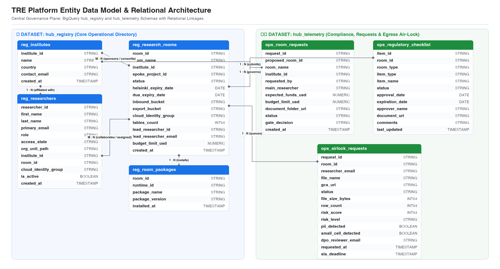

*Detailed Relational Data Model (`gcp_tre_entity_model.png`) organizing the central governance registry (`hub_registry`) and telemetry/compliance ledgers (`hub_telemetry`).*

---

### 4.2 Core Registry & Operations Schemas

#### 1. `hub_registry.reg_institutes`
Stores registered healthcare and academic organizations sponsoring research rooms.
* `institute_id` (STRING, PK): Short identifier (e.g., `broad`, `mskcc`, `hopkins`).
* `name` (STRING): Legal institutional title.
* `country` (STRING): Jurisdiction of incorporation.
* `contact_email` (STRING): Administrative sponsor contact.
* `created_at` (TIMESTAMP): Institutional onboarding timestamp.

#### 2. `hub_registry.reg_researchers`
Maintains verified researchers and their identity group mappings.
* `researcher_id` (STRING, PK): Unique investigator identifier (e.g., `res-1021`).
* `first_name`, `last_name` (STRING): Investigator identity names.
* `primary_email` (STRING): Cloud Identity email address matching authenticated IAM principal.
* `role` (STRING): Assigned research role (e.g., `Principal Investigator`, `Fellow`, `Analyst`).
* `access_state` (STRING): Current authorization state (`ACTIVE`, `SOFT_DOWNGRADED`, `REVOKED`).
* `org_unit_path` (STRING): Google Workspace / Cloud Identity organizational unit path.
* `institute_id` (STRING, FK): References `reg_institutes.institute_id`.
* `room_id` (STRING, FK): Primary active research room assignment.
* `cloud_identity_group` (STRING): Assigned Google Workspace group for group-based access control (GBAC).
* `is_active` (BOOLEAN): Active account flag.
* `created_at` (TIMESTAMP): Account registration timestamp.

#### 3. `hub_registry.reg_research_rooms`
Tracks the global state, budgets, and security configurations of all tenant research rooms.
* `room_id` (STRING, PK): Primary room code (e.g., `rr-oncology-01`).
* `room_name` (STRING): Human-readable room title.
* `institute_id` (STRING, FK): Sponsoring institution referencing `reg_institutes.institute_id`.
* `spoke_project_id` (STRING): Dedicated GCP project ID hosting the room enclave.
* `status` (STRING): Room lifecycle status (`ACTIVE`, `SOFT_DOWNGRADED`, `PROVISIONING`, `DECOMMISSIONED`).
* `helsinki_expiry_date` (DATE): Ethics approval expiration deadline.
* `dua_expiry_date` (DATE): Data Use Agreement expiration deadline.
* `inbound_bucket`, `export_bucket` (STRING): Dual-bucket Cloud Storage endpoints (`gs://rr-*-inbound`, `gs://rr-*-export`).
* `cloud_identity_group` (STRING): Dedicated room Google Workspace security group.
* `tables_count` (INT64): Count of active analytical tables hosted in the room local BigQuery dataset.
* `lead_researcher_id`, `lead_researcher_email` (STRING): Principal Investigator contact information.
* `budget_limit_usd` (NUMERIC): Hard monthly budget ceiling in USD.
* `created_at` (TIMESTAMP): Room provisioning timestamp.

#### 4. `hub_registry.reg_room_packages`
Catalogs verified analytical libraries and runtimes pinned to specific research rooms.
* `room_id` (STRING, FK): Target research room ID referencing `reg_research_rooms.room_id`.
* `runtime_id` (STRING): Colab Enterprise runtime template identifier.
* `package_name` (STRING): Python (PyPI) or R (CRAN) library package name.
* `package_version` (STRING): Pinned semantic version string.
* `installed_at` (TIMESTAMP): Installation timestamp.

#### 5. `hub_telemetry.ops_regulatory_checklist`
Maintains the compliance ledger for regulatory verification across active and onboarding rooms.
* `item_id` (STRING, PK): Item reference (e.g., `rr-cardio-01-HELSINKI_IRB`).
* `room_id` (STRING, FK): Target research room ID.
* `room_type` (STRING): Environment context (`PROVISIONED` vs `PENDING_REQUEST`).
* `item_type` (STRING): Statutory category (`RESEARCH_PROTOCOL`, `HELSINKI_IRB`, `DATA_TRANSFER`, `EXTRACTION_PROTOCOL`, `DUA`).
* `item_name` (STRING): Descriptive document name.
* `status` (STRING): Evaluated state (`APPROVED`, `PENDING_REVIEW`, `EXPIRED`, `MISSING`).
* `approval_date`, `expiration_date` (DATE): Verified validity dates.
* `approver_name` (STRING): Designated institutional authority who approved the document.
* `document_uri` (STRING): Secure GCS URI pointing to the source PDF agreement.
* `comments` (STRING): Contextual compliance notes and AI evaluation feedback.
* `last_updated` (TIMESTAMP): Record evaluation timestamp.

#### 6. `hub_telemetry.ops_room_requests`
Maintains pre-flight room onboarding proposals, funding limits, and automated AI gating decisions.
* `request_id` (STRING, PK): Onboarding request identifier (e.g., `req-neuro-02`).
* `proposed_room_id` (STRING): Requested tenant room identifier.
* `room_name` (STRING): Proposed research study title.
* `institute_id` (STRING, FK): Requesting institution referencing `reg_institutes.institute_id`.
* `requested_by` (STRING): Submitting investigator email address.
* `main_researcher` (STRING): Lead researcher name.
* `purpose_of_research` (STRING): Executive study overview and protocol abstract.
* `location` (STRING): Geographic study deployment region.
* `expected_funds_usd` (NUMERIC): Sponsoring grant or project funding allocation.
* `budget_limit_usd` (NUMERIC): Proposed monthly operational budget ceiling.
* `expected_time_range` (STRING): Scheduled study duration.
* `document_folder_uri` (STRING): Secure GCS folder containing prospective regulatory PDFs.
* `status` (STRING): Lifecycle state (`PENDING`, `APPROVED`, `REJECTED`).
* `gate_decision` (STRING): Automated AI verification verdict (`APPROVED`, `REJECTED`, `WARNING`).
* `missing_items`, `expired_items`, `warning_items` (STRING): Comma-delimited findings identified by the compliance scanner.
* `summary_reason` (STRING): Detailed natural-language governance evaluation rationale.
* `scanned_at` (TIMESTAMP): Timestamp of the last AI compliance scan.
* `created_at` (TIMESTAMP): Request submission timestamp.

#### 7. `hub_telemetry.ops_airlock_requests`
Tracks file export candidates staged in quarantine buckets through DLP/privacy scanning and DPO approval.
* `request_id` (STRING, PK): Export request identifier (e.g., `airlock-exp-8841`).
* `room_id` (STRING, FK): Originating Spoke Research Room ID.
* `researcher_email` (STRING): Researcher requesting export.
* `file_name` (STRING): Name of the candidate artifact file.
* `gcs_uri` (STRING): Full GCS path in the spoke quarantine bucket.
* `status` (STRING): Review status (`PENDING`, `APPROVED`, `REJECTED`).
* `file_size_bytes` (INT64): Size of the quarantined artifact in bytes.
* `row_count` (INT64): Number of data rows (for tabular exports).
* `risk_score` (INT64): Computed composite privacy risk score ($0\text{--}100$).
* `risk_level` (STRING): Categorical risk rating (`LOW`, `MEDIUM`, `HIGH`).
* `pii_detected` (BOOLEAN): Cloud DLP indicator of identified direct or indirect identifiers.
* `small_cell_detected` (BOOLEAN): Frequency distribution check flag for small cohort cells ($< 5$).
* `gemini_assessment` (STRING): Gemini AI risk evaluation report and contextual privacy summary.
* `dpo_reviewer_email` (STRING): Assigned Data Protection Officer reviewer.
* `review_comments` (STRING): DPO sign-off or rejection commentary.
* `requested_at` (TIMESTAMP): Export submission timestamp.
* `reviewed_at` (TIMESTAMP): Timestamp of final DPO review action.
* `sla_deadline` (TIMESTAMP): Regulatory compliance review SLA deadline.

---

## 5. Central Telemetry & Automated Ingestion Pipelines

Platform telemetry operates across a multi-modal ingestion plane, continuously collecting usage, performance, storage, and security telemetry from the distributed research room fleet into centralized BigQuery analytical marts (`hub_telemetry`).

The architecture implements a decoupled **Two-Speed Telemetry Engine**:
1. **15-Minute Operational Loop**: Near real-time operational sync across three distinct pipelines:
   * **BigQuery Queries**: Ingested directly from spoke `INFORMATION_SCHEMA.JOBS_BY_PROJECT` into `ops_bigquery_usage_15m` via BigQuery Scheduled Query (`sp_sync_bigquery_queries`).
   * **Colab Notebooks & Vertex AI Metrics**: Polled directly from the Vertex AI Runtimes API (`runtimeUser`) and Cloud Monitoring API by an autonomous Cloud Run Job (`rr-telemetry-poller`) triggered every 15 minutes by Cloud Scheduler into `ops_notebook_sessions` and `ops_ai_usage_metrics`.
   * **Audit & Security Stream**: Streamed via Log Router sinks into raw audit tables, then curated into `ops_audit_events_curated` exclusively for audit trail visualization and GCS object creation attribution.
2. **Daily Unified FinOps Mart & Rollup Loop**: Daily physical storage inventory snapshot via GCS Storage Insights into `ops_storage_daily` (correlated with audit logs for creator identity), followed by a daily rollup stored procedure (`sp_aggregate_daily_compute_metrics`) at 01:00 UTC that performs non-destructive, idempotent joins into `ops_daily_compute_metrics` and monthly rollup views (`ops_monthly_usage_rollup`) for zero-drift financial reconciliation against GCP Billing.

---

### 5.1 Telemetry Sources & Ingestion Matrix

The platform synthesizes telemetry across four foundational GCP sources:

| Service / Domain | Measured Metric(s) | True Ground Source | Frequency | Collection Process & Runner | Target Schema / Table |
| :--- | :--- | :--- | :--- | :--- | :--- |
| **BigQuery Analytics** | Query count, total bytes billed/processed, slot millisecond runtime | Spoke Project BigQuery `INFORMATION_SCHEMA.JOBS_BY_PROJECT` | Every 15 min | BigQuery Stored Procedure (`sp_sync_bigquery_queries`) triggered via BigQuery Scheduled Query | `hub_telemetry.ops_bigquery_usage_15m` |
| **Colab Enterprise (BigQuery Studio)** | Active session hours, session starts/stops, notebook names, machine shapes (`e2-standard-4`, `n2-highmem-8`), `runtimeUser` | Vertex AI Notebook Runtimes API (`aiplatform.notebookRuntimes.list`) + Cloud Monitoring VM uptime | Every 15 min | Autonomous Telemetry Poller Cloud Run Job (`rr-telemetry-poller`) triggered via Cloud Scheduler (`rr-telemetry-poller-15m`) | `hub_telemetry.ops_notebook_sessions` |
| **Vertex AI & Gemini APIs** | Total inference calls, successful/failed calls, input/output token counts | Cloud Monitoring API (`aiplatform.googleapis.com/prediction/online/token_count`) | Every 15 min | Autonomous Telemetry Poller Cloud Run Job (`rr-telemetry-poller`) triggered via Cloud Scheduler (`rr-telemetry-poller-15m`) | `hub_telemetry.ops_ai_usage_metrics` |
| **Cloud Storage (GCS)** | Physical bytes stored, object/file counts per bucket & researcher | GCS Storage Insights daily inventory export (CSV/Parquet in GCS) correlated with `storage.objects.create` for creator identity | Daily (Inventory drop); Merged at 01:00 UTC | Automated GCS Storage Insights &rarr; BigQuery External Table (`ops_storage_daily`) & Ownership Correlation (`sp_sync_storage_metrics`) | `hub_telemetry.ops_storage_daily` |
| **Platform Audit & Governance** | Data access, IAM modifications, egress scans, user identity attribution | Cloud Audit Logs (`protoPayload.@type = AuditLog`) | Real-time stream (sink); Curated every 15 min | GCP Log Router Sinks (`sk-rr-audit-to-hub`) &rarr; 15-min Curation Procedure (`sp_sync_curated_audit_events`) | `hub_telemetry.ops_audit_events_curated` |
| **Unified Daily Mart** | Unified compute, storage, query slot hours, AI inference, and storage bytes per researcher | `ops_bigquery_usage_15m`, `ops_notebook_sessions`, `ops_ai_usage_metrics`, `ops_storage_daily` | Daily (01:00 UTC) | Scheduled BigQuery Stored Procedure (`sp_aggregate_daily_compute_metrics`) | `hub_telemetry.ops_daily_compute_metrics` |
| **Monthly FinOps Rollup** | Monthly query volume (TB), slot hours, notebook hours, average active researchers per room/institute | `ops_daily_compute_metrics` | Monthly (1st of month) | Scheduled BigQuery Stored Procedure (`sp_rollup_monthly_usage`) | `hub_telemetry.ops_monthly_usage_rollup` |

---

### 5.2 Two-Speed Pipeline Architecture

The following architecture diagram illustrates how the refactored telemetry engine collects data across decoupled cadences (the 15-minute operational loop and the daily FinOps reconciliation loop):

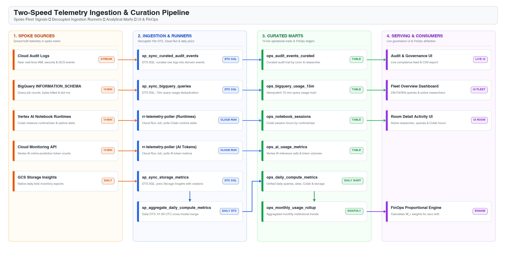

*Figure 5.1: Two-Speed Telemetry Ingestion, Curation, Analytical Mart Organization, and Downstream UI/FinOps Serving Plane (`gcp_tre_telemetry_pipeline.png`).*

---

### 5.3 Detailed Pipeline Mechanics: How It Actually Works

#### 5.3.1 Raw Audit Stream Collection: Cloud Logging Sinks to BigQuery
* **Provisioning Mechanism (`scripts/provisioning/provision_log_sinks.py`)**:
  During tenant room provisioning, a GCP Log Router Sink named `sk-rr-audit-to-hub` is created across each spoke project via `gcloud logging sinks create` with the filter:
  ```text
  protoPayload.@type="type.googleapis.com/google.cloud.audit.AuditLog"
  ```
* **Destination & Permissions**:
  The sink points directly to the Hub dataset: `bigquery.googleapis.com/projects/gcp-rr-hub-core/datasets/hub_telemetry`.
  The script automatically retrieves the sink's unique `writerIdentity` service account and grants it `roles/bigquery.dataEditor` on `hub_telemetry`.
* **Underlying Service & Ingestion**:
  Google Cloud Logging directly streams logs into BigQuery partition tables (`cloudaudit_googleapis_com_data_access`, `cloudaudit_googleapis_com_activity`, `cloudaudit_googleapis_com_system_event`) in near real-time with sub-minute latency without requiring an intermediate message broker.

#### 5.3.2 15-Minute BigQuery Query Usage Sync (`sp_sync_bigquery_queries`)
* **Execution & Source**:
  Executed every 15 minutes by BigQuery Scheduled Queries. Scans `INFORMATION_SCHEMA.JOBS_BY_PROJECT` across all active spoke projects.
* **Lookback Window & Boundary Deduplication**:
  To guarantee complete capture across distributed job completion times and scheduled trigger jitter, the query scans a **30-minute lookback window** (`creation_time >= TIMESTAMP_SUB(CURRENT_TIMESTAMP(), INTERVAL 30 MINUTE)`).
* **Idempotent Merge**:
  Results are merged into `hub_telemetry.ops_bigquery_usage_15m` using an idempotent `MERGE` keyed on `(usage_date, room_id, user_email)`:
  * When matched, metrics are updated with the latest cumulative totals.
  * When not matched, a new record is inserted.
  * **Result**: Zero duplicate rows, zero query job omissions.

#### 5.3.3 Colab Enterprise (BigQuery Studio) Runtime Attribution (`telemetry_poller.py` via Cloud Run Job)
* **The Attribution Challenge**:
  Researchers launch and run Colab Enterprise notebooks hosted inside BigQuery Studio. Cloud labels cannot be reliably enforced upon notebook creation or runtime assignment by ad-hoc user action.
* **Resolution via Direct API Polling**:
  1. **Runtime User Attribution**: In Colab Enterprise, Vertex AI automatically sets the `runtimeUser` field on the underlying Compute Engine instance / notebook runtime to the researcher's authenticated email (e.g. `dr.eitan.rosen@example.health.org`).
  2. **Direct Vertex AI API Ingestion**: The autonomous Telemetry Poller Cloud Run Job (`rr-telemetry-poller`) directly queries the Vertex AI Notebook Runtime API (`aiplatform.notebookRuntimes.list`) and Cloud Monitoring VM uptime across each spoke project every 15 minutes, fetching active runtime names, status, and machine shapes (`e2-standard-4`, `n2-highmem-8`).
  3. **Autonomous Scheduling Deployment**:
     * **Container**: `me-west1-docker.pkg.dev/gcp-rr-hub-core/cloud-run-source-deploy/telemetry-poller:latest`
     * **Compute Runner**: Serverless Cloud Run Job `rr-telemetry-poller` (1 CPU, 1GiB RAM) running under service account `<HUB_PROJECT_NUMBER>-compute@developer.gserviceaccount.com`.
     * **Scheduler**: Triggered every 15 minutes (`*/15 * * * *`) by Cloud Scheduler job `rr-telemetry-poller-15m` via authenticated HTTP POST with OAuth identity verification.
  4. **Target Table**: Idempotently merged directly into `hub_telemetry.ops_notebook_sessions` keyed by `(session_date, room_id, user_email, runtime_id)`.

#### 5.3.4 Vertex AI & Gemini Inference Tracking (`telemetry_poller.py` via Cloud Run Job)
* **Execution & Source**:
  Executed every 15 minutes by the `rr-telemetry-poller` Cloud Run Job.
* **Metric Polling**:
  Directly polls the Google Cloud Monitoring API for `aiplatform.googleapis.com/prediction/online/token_count` across each active spoke project.
* **Target Mart**:
  Persisted directly into `hub_telemetry.ops_ai_usage_metrics` (partitioned by `usage_date`, clustered by `room_id, user_email`).

#### 5.3.5 Physical Cloud Storage Attribution & Ownership Correlation (`sp_sync_storage_metrics`)
* **Ownership Correlation Engine**:
  GCS Storage Insights inventory files report physical object sizes, paths, and storage classes, but do *not* record file creator identities. The platform resolves ownership through a two-step correlation:
  1. **Daily Inventory Drop**: GCS Storage Insights generates a daily snapshot of all physical blobs, storage classes, and bytes per bucket, landing automatically in BigQuery as `ops_storage_daily`.
  2. **Audit Log Join for Ownership Attribution**: The stored procedure `sp_sync_storage_metrics` correlates the active Storage Insights inventory with `storage.objects.create` events from `cloudaudit_googleapis_com_data_access` using `(bucket_name, object_name)`. The authenticated `principalEmail` is extracted as the immutable creator of that object.
  3. **Fallback Attribution**: Objects created by automated ETL pipelines or system accounts default to `shared-system-overhead`, guaranteeing that 100% of physical bucket bytes are accounted for without misattributing project costs.

#### 5.3.6 Daily Compute Aggregation & Monthly Rollups (`sp_aggregate_daily_compute_metrics` & `sp_rollup_monthly_usage`)
* **Idempotent Telemetry Rollup Pipeline**:
  The daily aggregation procedure executes an **atomic, idempotent `MERGE`** across BigQuery queries, notebook sessions, AI tokens, and storage metrics:
  ```sql
  MERGE `hub_telemetry.ops_daily_compute_metrics` T
  USING combined_daily_sources S
  ON T.usage_date = S.usage_date 
     AND T.room_id = S.room_id 
     AND T.user_email = S.user_email
  WHEN MATCHED THEN
      UPDATE SET
          query_count = S.query_count,
          total_bytes_billed = S.total_bytes_billed,
          total_slot_hours = S.total_slot_hours,
          notebook_runtime_hours = S.notebook_runtime_hours,
          ai_inference_count = S.ai_inference_count,
          ai_token_count = S.ai_token_count,
          -- Preserves current storage count without resetting to zero
          storage_bytes = COALESCE(S.storage_bytes, T.storage_bytes, 0)
  WHEN NOT MATCHED THEN
      INSERT (
          usage_date, room_id, user_email, institute_id,
          query_count, total_bytes_billed, total_slot_hours,
          notebook_runtime_hours, ai_inference_count, ai_token_count,
          storage_bytes
      )
      VALUES (
          S.usage_date, S.room_id, S.user_email, S.institute_id,
          S.query_count, S.total_bytes_billed, S.total_slot_hours,
          S.notebook_runtime_hours, S.ai_inference_count, S.ai_token_count,
          COALESCE(S.storage_bytes, 0)
      );
  ```
* **Daily Aggregation Schedule (`sp_aggregate_daily_compute_metrics`)**:
  Executes daily at 01:00 UTC via BigQuery Scheduled Query `rr-telemetry-daily-finops-rollup`. Joins the 15-minute operational marts with `ops_storage_daily` to produce the definitive single row per `(usage_date, room_id, user_email)`.
* **Monthly Rollups (`sp_rollup_monthly_usage`)**:
  Aggregates daily marts into monthly institutional trends:
  * Computes average active researchers: $\frac{\text{Count Distinct}(user\_email)}{\text{Count Distinct}(usage\_date)}$.
  * Total query volume in Terabytes: $\frac{\sum total\_bytes\_billed}{1024^4}$.
  * Total notebook hours and total slot hours per room and sponsoring institute.
  * Populates `hub_telemetry.ops_monthly_usage_rollup` (partitioned by `usage_month`, clustered by `room_id, institute_id`).

---

### 5.4 Consuming Applications: Serving UI Endpoints & FinOps Engine

The curated telemetry marts power both real-time operational user interfaces and the downstream financial accounting model:

1. **Audit & Governance UI (`/api/v1/telemetry/audit-feed`)**:
   Serves `ops_audit_events_curated` directly to the Governance & Audit Dashboard (`auditView.js`), providing administrators with real-time filtering by category, researcher, room, and severity, with one-click CSV export for external ethics and compliance auditors.
2. **Room Activity & Live Inventory (`/api/v1/telemetry/rooms/{id}/activity`)**:
   Queries `ops_daily_compute_metrics` and `ops_notebook_sessions` to display live room statistics, active researcher names, last active session timestamps, cumulative queries, and notebook execution hours (`roomDetailView.js`).
3. **Fleet Overview & Real-Time Monitoring (`/api/v1/telemetry/overview`)**:
   Combines live queries from spoke `INFORMATION_SCHEMA.JOBS_BY_PROJECT` and `ops_bigquery_usage_15m` with `ops_daily_compute_metrics` to display 24-hour, 7-day, and 30-day active researcher counts, query counts, and byte scan volumes.
4. **FinOps Proportional Cost Attribution Engine (Chapter 6)**:
   Extracts `ops_daily_compute_metrics` to derive exact proportional researcher resource weights ($W_{r,\text{BQ}}$, $W_{r,\text{Compute}}$, $W_{r,\text{Storage}}$, $W_{r,\text{AI}}$) for zero-drift financial reconciliation against GCP invoiced billing.

---

## 6. Proportional FinOps Attribution & Financial Reconciliation Engine

### 6.1 FinOps Attribution Flow

The FinOps engine connects real Google Cloud invoiced charges with actual researcher usage across four reporting levels: **Fleet**, **Institute**, **Research Room**, and **Researcher**. It operates on two distinct data planes:

1. **Financial Spend (Ground-Truth Invoiced USD)**: Derived strictly from Google Cloud Billing exports (`view_billing_export`), capturing exact dollar spend across platform projects.
2. **Operational Usage Telemetry (Attribution Weights)**: Collected from Cloud Audit Logs, BigQuery jobs, Colab Enterprise runtimes, and Vertex AI logs (`ops_daily_compute_metrics`) to determine each researcher's proportional share.

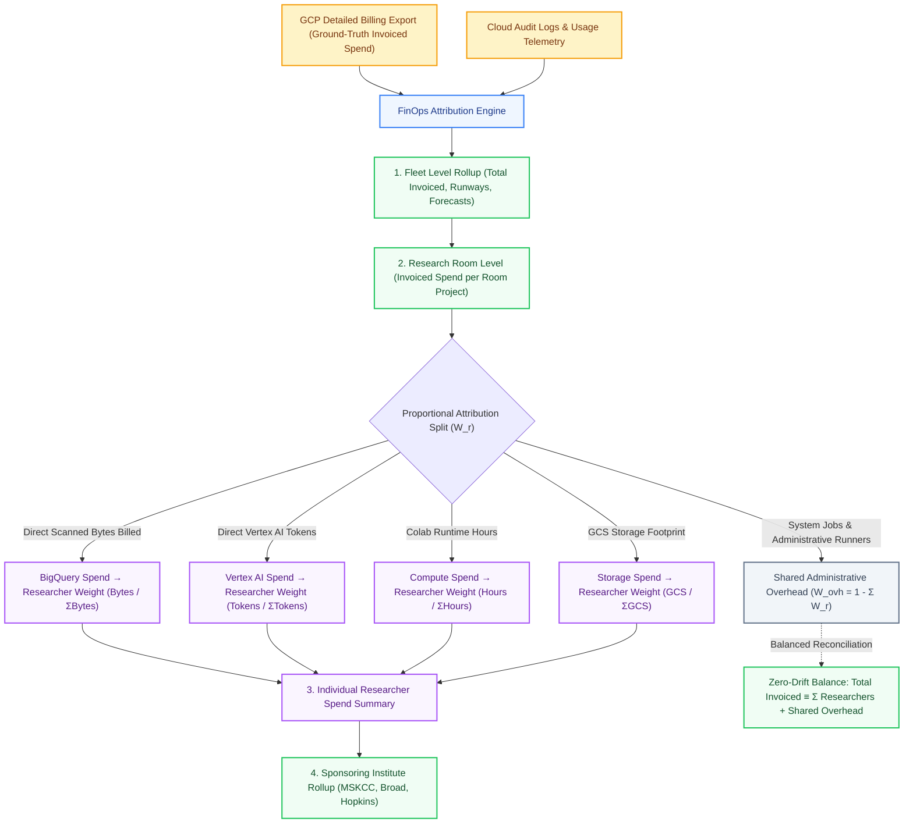

#### Four-Level Hierarchical Rollup:
* **Fleet Level**: Overall platform spend, total grant budget, average daily burn rate, remaining runway days, and month-to-date run-rate forecast.
* **Institute Level**: Aggregates costs for affiliated researchers across all rooms sponsored by an academic or medical center (e.g. MSKCC, Broad Institute, Johns Hopkins).
* **Research Room Level**: Project-level breakdown of the 5 standard cloud cost drivers, tracked capacity metrics, and room reconciliation status.
* **Researcher Level**: Sums an individual researcher's allocated costs across every research room they participate in:
  $$\text{Total Spend}(r) = \sum_{R \in \text{Rooms}(r)} \text{Allocated Cost}(r, R)$$

---

### 6.2 Billing Ingestion Pipeline & Tenant Isolation

#### Organization-Wide Export Sink vs. Platform Isolation
In enterprise Google Cloud environments, Cloud Detailed Billing Export is enabled at the Billing Account level. Consequently, raw billing records land in an organization-wide BigQuery dataset (e.g. `billing.gcp_billing_export_v1`) that contains spending data for hundreds of unrelated enterprise projects, rather than just the Trusted Research Environment (TRE).

To maintain strict tenant isolation and follow the principle of least privilege, the platform never grants researchers or Spoke workspaces access to the organization's billing project. Instead, it deploys an **Authorized View** in the central Hub telemetry dataset:

```
[ GCP Billing Account ]
        │ (Continuous Detailed Billing Export)
        ▼
[ Organization Billing BigQuery Dataset: billing.gcp_billing_export_v1 ]
        │ (Enterprise-wide spend across all org projects)
        ▼
[ Authorized View: hub_telemetry.view_billing_export ]
        │ • Filters strictly: project.id LIKE 'gcp-rr-%' OR project.id LIKE 'tre-room-%'
        │ • Normalizes spoke project identifiers
        │ • Computes Net Cost: cost + SUM(credits)
        │ • Extracts SKU IDs, service names, and usage units
        ▼
[ FinOps Attribution Engine (Backend Service) ]
```

#### Core Capabilities of `view_billing_export`:
1. **Tenant Project Filtering**: Restricts rows exclusively to the central Hub (`gcp-rr-hub-core`) and registered Spoke projects (`gcp-rr-spoke-*`).
2. **Project ID Normalization**: Maps any historical or provisioned project aliases (e.g., `tre-room-cardio-353306` $\to$ `gcp-rr-spoke-cardio-03`) into canonical room project IDs.
3. **Credit Reconciliation**: Incorporates promotional credits, sustained use discounts, and committed use discounts into the net total cost per SKU line item:
   $$\text{Net Cost} = \text{cost} + \sum \text{credit.amount}$$

---

### 6.3 Analytical Marts & Time-Window Aggregations

To balance historical performance tracking with real-time billing accuracy, the platform uses a clean two-path model:

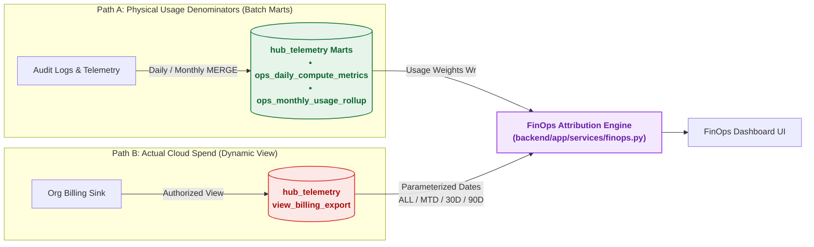

| Component | Storage Type | Update Frequency | Purpose |
| :--- | :--- | :--- | :--- |
| **`ops_daily_compute_metrics`** | Table (partitioned by date) | Daily batch (`MERGE`) | Tracks user-level query bytes, VM hours, and tokens ($W_r$ denominator). |
| **`ops_monthly_usage_rollup`** | Table (partitioned by month) | Monthly batch (`MERGE`) | Capacity planning, active user counts, and long-term compute trends. |
| **`view_billing_export`** | Authorized View | Real-time on query | Computes net dollar spend per SKU dynamically across selected time windows (`ALL`, `MTD`, `30D`, `90D`) with zero drift from retroactive credits. |

---

### 6.4 Service Classification & Proportional Weights

The engine (`backend/app/services/finops.py`) classifies raw billing line items into 5 standard cost drivers. Within each room, costs are shared among researchers based on their direct usage:

| Standard Cost Driver | Matching GCP Services & SKUs | Usage Metric Used for Attribution Weight ($W_{r}$) |
| :--- | :--- | :--- |
| **BigQuery SQL** | `BigQuery Analysis`, on-demand queries | **Total Scanned Bytes Billed** (`total_bytes_billed`) |
| **Compute Engine** | GCE instances, Cloud Run, Colab runtimes | **Active Notebook Session Runtime Hours** (`notebook_runtime_hours`) |
| **Cloud Storage** | GCS buckets, Artifact Registry, BQ storage | **Active Storage Volume Bytes** (`storage_bytes`) |
| **Vertex AI / Gemini** | Generative AI models, Gemini APIs, inference | **Total Input + Output AI Tokens** (`ai_token_count`) |
| **Shared Overhead** | Cloud Logging, Monitoring, NAT, setup queries | **100% Shared Administrative Overhead** |

#### Weight Calculation Rules:
1. **Direct Proportion**: For any active service (e.g. BigQuery), each researcher's weight is simply their recorded usage divided by the total usage of all researchers in that room:
   $$W_r = \frac{\text{Usage}(r)}{\sum_{\text{Room}} \text{Usage}}$$
2. **Administrative Overhead**: Cloud spend from background system jobs, service accounts, or services with zero researcher activity (such as network egress or idle infrastructure) flows directly to **Shared Overhead**:
   $$W_{\text{ovh}} = 1 - \sum_{r} W_r$$

---

### 6.5 Zero-Drift Financial Reconciliation

The engine guarantees that every single cent invoiced by Google Cloud is accounted for without rounding drift:

* **Room-Level Balance**: Inside every spoke room, the sum of all researcher allocations plus room shared overhead matches the room invoice exactly:
  $$\text{Room Invoiced Cost} = \sum_{r \in \text{Room}} \text{Allocated Cost}(r) + \text{Shared Overhead}$$
* **Fleet-Wide Balance**: Across the entire platform, total invoiced cost equals all researcher spend, plus all room overheads, plus central hub platform infrastructure (`gcp-rr-hub-core`):
  $$\text{Total Fleet Invoiced} = \sum_{\text{all } r} \text{Allocated Cost}(r) + \sum_{\text{all } R} \text{Shared Overhead}(R) + \text{Central Hub Infrastructure Cost}$$

The platform validates this equation on every calculation, confirming a **`BALANCED`** status ($|\text{Variance}| < \$0.05$, with actual test variance at $\$0.000000$).

---

### 6.6 Budget Runways, Anomaly Alerts & Performance Caching

1. **Grant Budget Runway**:
   * Each research room has an assigned grant budget limit (default: **$5,000 USD**).
   * The platform calculates the daily burn rate and projects the remaining runway days before funds are exhausted:
     $$\text{Daily Burn Rate} = \frac{\text{Cumulative Spend}}{\text{Days Elapsed}}, \quad \text{Remaining Runway Days} = \frac{\text{Budget Limit} - \text{Cumulative Spend}}{\text{Daily Burn Rate}}$$
   * Rooms display a health status: **HEALTHY** (<80%), **WARNING** (80%–99%), or **OVERRUN** ($\ge 100\%$).

2. **Automated Anomaly Detection**:
   * **Budget Alert**: Triggers a warning alert when spend reaches 80% of grant budget, and a critical alert at 100%.
   * **Idle Compute Alert**: Flags VMs running for more than 50 hours with zero BigQuery scan activity to prevent wasted cloud compute.

3. **In-Memory TTL Caching**:
   * FinOps calculations are cached in memory for **45 seconds** (`@cached_endpoint`). This prevents repetitive, expensive BigQuery queries while ensuring dashboard views remain snappy and responsive.

---

### 6.7 Downstream API & UI Consumption Layer

The calculations produced by the FinOps engine are consumed across the platform through standardized REST API endpoints and intuitive frontend visualizations:

```
[ BigQuery Billing View & Marts ]
                │
                ▼
[ FinOpsService (backend/app/services/finops.py) ]
  • @cached_endpoint(ttl_seconds=45)
  • In-memory weight matrix & zero-drift reconciliation
                │
                ▼
[ FastAPI REST Endpoints (backend/app/api/v1/finops.py) ]
  ├── GET /api/v1/finops/summary?invoice_month=...&start_date=...&end_date=...
  ├── GET /api/v1/finops/rooms/{room_id}
  ├── GET /api/v1/finops/researchers/{email}/spend
  ├── GET /api/v1/finops/institutes/{institute_id}
  ├── GET /api/v1/finops/matrix
  └── GET /api/v1/finops/forecast
                │
                ▼
[ Frontend Governance Portal (frontend/js/components/finopsView.js) ]
  ├── Time Window Filters: [ALL (Inception)] [MTD] [30D] [90D]
  ├── Executive KPI Cards: Invoiced Spend, Grant Budget, Burn Rate, Runway Days
  ├── 5 Cost Driver Badges: BQ, Compute, Storage, AI, Network
  └── 4 Exploration Tabs:
        • By Room: Budget utilization bars, cost drivers, reconciliation status
        • By SKU: Fleet-wide deduplicated SKU breakdown (including Hub infrastructure)
        • By Researcher: Cross-room spend, queries, runtime hours, tokens
        • By Institute: Aggregated partner institution billing & average cost/user
```

---

## 7. Automated AI Compliance & Soft-Downgrade Engine

### 7.1 Statutory Checklist & Document Intelligence
The platform tracks five mandatory regulatory prerequisites:
1. **Research Protocol**: Valid approved scientific protocol attachment.
2. **Helsinki (IRB) Ethics Approval**: Expiration date and official ethics certificate.
3. **Data Transfer Committee Approval**: Statutory data exchange authorization.
4. **Data Extraction Protocol**: Formal extraction query and schema definition.
5. **Data Use Agreement (DUA)**: Executed legal terms and non-disclosure commitments.

Unstructured PDF documents stored in `gs://gcp-rr-hub-approvals` are indexed by BigQuery Object Tables (`obj_approval_documents`). The BQ ML remote model (`gemini_flash_model`) evaluates clauses and extracts expiration dates directly via SQL `ML.GENERATE_TEXT` calls, populating `hub_telemetry.ops_regulatory_checklist`.

---

### 7.2 Automated Compliance Workflow & Soft-Downgrade Policy

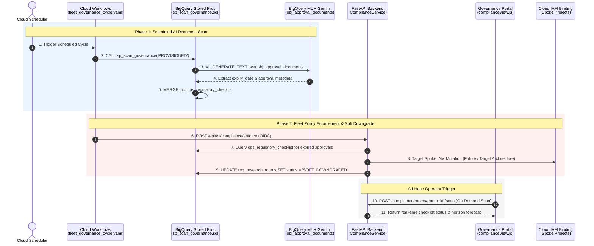

#### Detailed Pipeline Execution Lifecycle & Technical Implementation:

The compliance and governance engine is composed of concrete Google Cloud orchestration scripts, stored procedures, machine learning inference routines, backend services, and portal controls:

1. **Scheduled Orchestrator**:
   * **Component**: Cloud Scheduler job targeting Cloud Workflows (`scripts/workflows/fleet_governance_cycle.yaml`).
   * **Execution Flow**: Step 1 makes an authorized OAuth2 REST call to the BigQuery API (`me-west1`) executing `CALL sp_scan_governance('PROVISIONED')`. Step 2 makes an OIDC-authenticated HTTP `POST` to the Cloud Run backend (`/api/v1/compliance/enforce`).

2. **BigQuery AI Document Intelligence & Stored Procedure**:
   * **Stored Procedure**: `gcp-rr-hub-core.hub_telemetry.sp_scan_governance` (`scripts/sql/sp_scan_governance.sql`).
   * **Object Table**: `hub_telemetry.obj_approval_documents` indexes raw unstructured PDFs stored in `gs://gcp-rr-hub-approvals/*`.
   * **Inference Routine**: The procedure invokes `ML.GENERATE_TEXT` using the remote connection to `hub_telemetry.gemini_flash_model` (Vertex AI Gemini Flash) with zero temperature to parse legal clauses, approval officials, and expiration dates (`YYYY-MM-DD`).
   * **Checklist Materialization**: The procedure maps all 5 statutory items (`Research_Protocol`, `Helsinki_IRB`, `Data_Transfer`, `Extraction_Protocol`, `DUA`) and performs an idempotent `MERGE` into `hub_telemetry.ops_regulatory_checklist` marking statuses as `APPROVED`, `EXPIRED`, or `MISSING`.

3. **Backend Evaluation Service**:
   * **Service**: `ComplianceService` (`backend/app/services/compliance.py`) and router (`backend/app/api/v1/compliance.py`).
   * **Validation Logic**: `get_room_compliance(room_id)` queries `ops_regulatory_checklist` for the 5 prerequisite records, calculates `days_remaining`, and determines room status:
     - `COMPLIANT`: All 5 items valid with $>30$ days remaining.
     - `EXPIRING_SOON`: Valid items with $\le 30$ days remaining.
     - `NON_COMPLIANT`: Any item is `EXPIRED` or `MISSING`.

4. **UI Governance Portal & On-Demand Scanning**:
   * **Frontend Component**: `complianceView.js` (`frontend/js/components/complianceView.js`).
   * **On-Demand Scan**: Administrators and DPOs can trigger an immediate verification on any room by clicking the **"Scan"** button (`btn-scan-room-compliance`), which hits `POST /api/v1/compliance/rooms/{room_id}/scan` without waiting for the nightly Cloud Scheduler trigger.
   * **Onboarding Gate Evaluation**: A dedicated button (`btn-eval-request-gate`) tests pre-flight onboarding gates (`POST /compliance/requests/{id}/gate`) before any Cloud resources are provisioned.

5. **Soft-Downgrade Implementation Status & Target IAM Mutation**:
   * **Current State**: The backend soft-downgrade flow is fully implemented at the database and application levels: `_update_room_registry_status()` updates the live room registry (`reg_research_rooms.status = 'SOFT_DOWNGRADED'`), flags researcher records (`reg_researchers.access_state = 'DOWNGRADED_READONLY'`), and emits audit events into `ops_audit_events_curated`.
   * **Target Architecture (Live IAM Demotion)**: Live Cloud IAM policy binding demotion (`roles/bigquery.dataEditor` $\rightarrow$ `roles/bigquery.dataViewer` and `roles/storage.objectAdmin` $\rightarrow$ `roles/storage.objectViewer` via Cloud Resource Manager API) is architected in `FleetGovernanceService._apply_spoke_iam_mutation`, but in the current deployment phase, live spoke IAM mutations are held in dry-run / stub mode to avoid unintended lockout during integration testing. Full automated IAM policy rewriting is scheduled for production promotion once cross-project spoke service accounts are bound.

---

## 8. Governed Egress Air-Lock Flow

### 8.1 Step-by-Step Egress Air-Lock Workflow

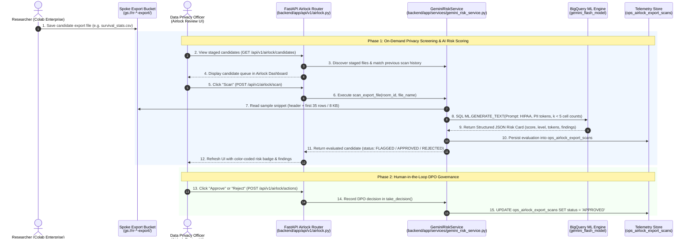

#### Detailed Pipeline Breakdown & Architecture:

The platform uses a dedicated **Gemini-powered Air-Lock Governance Pipeline** implemented across Cloud Storage, BigQuery ML, FastAPI, and an interactive review UI:

1. **Staging & Storage Layer**:
   * **Isolated Export Buckets**: Each spoke room features a private export bucket (`gs://gcp-rr-spoke-*-export/`). Colab runtimes and VM service accounts have permission to write candidate export artifacts into this bucket, but are strictly blocked by VPC Service Controls from egressing data across public internet endpoints.
   * **Discovery & Listing**: `GeminiRiskService.list_candidates()` queries `hub_registry.reg_research_rooms` to discover all active spoke export buckets, inspects blobs via Google Cloud Storage client, and correlates them with existing scan history in `hub_telemetry.ops_airlock_export_scans`.

2. **AI Privacy Screening Pipeline (`GeminiRiskService`)**:
   * **Component**: `backend/app/services/gemini_risk_service.py` exposed through `backend/app/api/v1/airlock.py`.
   * **Scanning Trigger (On-Demand)**: Scanning is currently executed **on demand** from the Airlock Review UI (or via API). When the DPO or operator clicks the **"Scan"** button on an unscanned or updated candidate export, the frontend triggers `POST /api/v1/airlock/scan`.
   * **Target Architecture (Event-Driven Automated Scanning)**: In the planned enterprise evolution, a Cloud Storage Object Finalize event notification (via Pub/Sub or Eventarc) will automatically trigger `scan_export_file()` the moment a researcher drops a file into `gs://rr-*-export/`, pre-populating the risk score before the DPO opens the portal.
   * **Snippet Extraction**: Downloads the file header and first 35 rows (up to 8 KB) to inspect schema definitions, column headers, and data distributions without loading massive analytical matrices into application memory.
   * **Inference Engine**: Executes `ML.GENERATE_TEXT` against the remote model `hub_telemetry.gemini_flash_model` (Vertex AI Gemini Flash) via BigQuery SQL. The prompt enforces HIPAA Safe Harbor principles, medical privacy standards, and re-identification deterrence.
   * **Structured Output Schema**:
     ```json
     {
       "risk_score": 0-100,
       "risk_level": "LOW | MEDIUM | HIGH | CRITICAL",
       "pii_tokens_detected": ["token_or_column_names"],
       "k_anonymity_violation": true | false,
       "findings": ["finding 1", "finding 2"],
       "recommendation": "APPROVE | FLAG_FOR_REVIEW | REJECT",
       "reason": "Executive summary explanation"
     }
     ```
   * **Audit Materialization**: Inserts the scan results into `hub_telemetry.ops_airlock_export_scans`, capturing `scan_id`, `risk_score`, `pii_tokens`, `k_anonymity_violation`, and timestamps.

3. **Gemini AI vs. Cloud Sensitive Data Protection (SDP / DLP) Pipeline**:
   * **Why Gemini AI was Chosen Over Traditional SDP**:
     - **Contextual Understanding & Small-Cell Counts**: Traditional Google Cloud Sensitive Data Protection (Cloud DLP / SDP) relies on regexes, dictionaries, and infoType detectors (e.g. `US_SOCIAL_SECURITY_NUMBER`, `EMAIL_ADDRESS`). While effective for pattern matching, SDP cannot easily reason about aggregate tabular distributions or small-cell count disclosures (e.g., detecting if a cell has $1 \le k < 5$ rare disease patients in an otherwise anonymous statistical frequency table).
     - **Holistic Reasoning**: Gemini evaluates the semantic combination of quasi-identifiers (such as 3-digit ZIP + age $>89$ + diagnosis) and distinguishes between safe aggregate metrics (mean, standard deviation, model weights) versus row-level micro-data leaks.
     - **Zero External Pipelines**: By using BigQuery ML's remote model integration (`ML.GENERATE_TEXT`), evaluation occurs directly within the central BigQuery analytical engine without needing Dataflow jobs, Pub/Sub triggers, or complex external DLP inspection templates.
   * **Hybrid Evolution**: For production environments processing millions of bulk unstructured files, the target architecture pairs Cloud DLP (for high-throughput byte-level regex filtering) with Gemini AI (for semantic re-identification risk scoring and small-cell suppression verification).

4. **Human-in-the-Loop Review & Release**:
   * **Review UI**: `frontend/js/components/airlockView.js` displays Candidate Export Cards with real-time risk badges (`LOW`, `MEDIUM`, `HIGH`, `CRITICAL`), identified PII token pills, and AI recommendation rationale.
   * **Decision Action**: DPOs can review the findings and approve or reject the file via `POST /api/v1/airlock/actions`. Approved files update the database state and trigger authorized release.

---

### 8.2 Privacy Screening & $k$-Anonymity Verification Engine
The automated screening service (`backend/app/services/gemini_risk_service.py`) evaluates egress candidates against strict statistical re-identification rules:

1. **Small-Cell Count Suppression ($k < 5$)**:
   * Inspects frequency distribution columns. If any cell has an aggregated count $1 \le n < 5$, the file is flagged for small-cell privacy disclosure.
2. **Direct Identifier & Quasi-Identifier Detection**:
   * Scans for National ID numbers, Social Security numbers, telephone patterns, email addresses, and unstructured clinical notes.
3. **Risk Scoring Formulation**:
   * Evaluates aggregate risk: $\text{Score} = \min(100, \sum \text{Weights}(\text{Flag}_i))$. Files with scores $\ge 60$ receive a `HIGH` risk rating with automatic warning prompts surfaced to the DPO.
4. **Cryptographic Checksum Verification**:
   * Calculates a SHA-256 digest at quarantine. When approved, the release handler verifies that the checksum in the destination bucket matches the approved digest.

---

## 9. Fleet Provisioning & Workspace Deployment (Future Implementation)

### 9.1 Target Architecture: Declarative Terraform Fleet Management
In the target enterprise architecture, fleet management and research room provisioning will rely entirely on **declarative Infrastructure-as-Code (Terraform)** driven by GitOps and central governance automation:

* **Automated GCP Project Factory**: Declarative creation of isolated spoke projects under institutional folder hierarchies, attaching billing, quotas, and organizational guardrails.
* **Hermetic Network & Perimeter Enrolment**: Automated Shared VPC subnet allocation and programmatic enrolment into the VPC Service Controls (VPC-SC) security perimeter.
* **Standardized Workspace Infrastructure**: Declarative provisioning of spoke BigQuery analytical datasets, scoped Cloud Storage buckets (inbound drop and airlock export), and IAM least-privilege role bindings.
* **Curated Notebook Runtime Templates**: Automated deployment of pre-baked Vertex AI / Colab Enterprise runtime templates with institutional conda packages, locked network interfaces, and idle shutdowns.

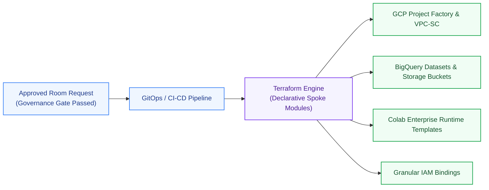

### 9.2 Current Working Prototype vs. Future Vision
* **Current Working Prototype**: To accelerate validation and development, the current platform provisions spoke resources using Python Admin SDK automation scripts (`scripts/provision_*.py`). Initial software package inventories are cataloged in `hub_registry.reg_room_packages`.
* **Future Implementation**: Spoke workspace lifecycle management will transition fully to a declarative Terraform pipeline triggered automatically upon formal governance approval of room onboarding requests, with runtime startup hooks dynamically auditing live packages back into the registry.

---

## 10. Central Governance REST API Plane

### 10.1 Backend Microservice Architecture
The backend is built with **FastAPI (Python 3.10)**, structured across dedicated router modules under `backend/app/api/v1/` and service modules under `backend/app/services/`. It utilizes asynchronous execution, Pydantic v2 data validation schemas (`backend/app/models/`), in-memory LRU caching (`backend/app/core/cache.py`), and native Google Cloud client libraries (`google-cloud-bigquery`, `google-cloud-storage`, `google-cloud-workflows`, `google-cloud-monitoring`).

---

### 10.2 API Service Catalog

The backend exposes 51 endpoints organized into 8 functional services. The table below summarizes the core resource paths and primary actions:

| Service Domain | Router | Primary Base Paths | Methods | Core Responsibilities |
| :--- | :--- | :--- | :--- | :--- |
| **Fleet & Rooms** | `rooms.py` | `/api/v1/rooms`<br/>`/api/v1/rooms/{id}/*` | `GET`, `POST` | Room catalog, metadata, researcher roster, package inventory, status transitions, manual soft-downgrade & reactivation. |
| **Institutes** | `institutes.py` | `/api/v1/institutes`<br/>`/api/v1/institutes/{id}` | `GET` | Sponsoring institutional partners, affiliated room rollups, and active researcher counts. |
| **Compliance** | `compliance.py` | `/api/v1/compliance/*`<br/>`/api/v1/horizons`<br/>`/api/v1/requests/*` | `GET`, `POST` | 5-point statutory checklist verification, on-demand AI document scan, pre-flight onboarding gates, scheduled IAM demotion engine, and 30/60/90-day expiration horizons. |
| **FinOps** | `finops.py` | `/api/v1/finops/summary`<br/>`/api/v1/finops/rooms/{id}`<br/>`/api/v1/finops/institutes/{id}`<br/>`/api/v1/finops/researchers/*`<br/>`/api/v1/finops/matrix`<br/>`/api/v1/finops/forecast` | `GET` | Multi-level spend attribution (Fleet $\rightarrow$ Institute $\rightarrow$ Room $\rightarrow$ Researcher), 30-day burn-rate forecasting, proportional weights ($W_r$), and zero-drift billing reconciliation. |
| **Air-Lock Egress** | `airlock.py` | `/api/v1/airlock/candidates`<br/>`/api/v1/airlock/scan`<br/>`/api/v1/airlock/action` | `GET`, `POST` | Discovers staged export files in spoke buckets, executes on-demand Gemini AI privacy scans (PII, HIPAA, $k < 5$), and records DPO approval/quarantine decisions. |
| **Telemetry** | `telemetry.py` | `/api/v1/telemetry/overview`<br/>`/api/v1/telemetry/audit-feed`<br/>`/api/v1/telemetry/queries`<br/>`/api/v1/telemetry/metrics/*`<br/>`/api/v1/telemetry/rooms/{id}/*`<br/>`/api/v1/telemetry/sync` | `GET`, `POST` | Real-time audit log stream (`ops_audit_events_curated`), BigQuery execution jobs, notebook sessions, daily/monthly marts, and stored procedure sync trigger. |
| **Resources** | `resources.py` | `/api/v1/resources/overview`<br/>`/api/v1/resources/buckets/*`<br/>`/api/v1/resources/datasets`<br/>`/api/v1/resources/templates` | `GET`, `POST` | Global inventory of shared datasets, runtime templates (`e2-standard-4`, etc.), and Cloud Storage bucket lifecycle linking/detaching. |
| **Reports & Health** | `reports.py`<br/>`main.py` | `/api/v1/reports/*`<br/>`/api/v1/health` | `GET` | Exportable governance reports (Horizons, Exceptions, Cost, Egress Audit, Inventory) in JSON/CSV, plus root discovery and health checks. |

---

## 11. Unified Management Portal

### 11.1 Frontend Architecture
The management portal is a lightweight single-page application (SPA) built with Semantic HTML5, Tailwind CSS, ES6 JavaScript modules, and Chart.js. It connects directly to the FastAPI backend via JSON REST APIs. In deployment, the compiled frontend assets are mounted directly by FastAPI at `/`, providing a unified, serverless single-container deployment on Cloud Run.

### 11.2 Core View Components & Operational Tabs
The portal orchestrates 10 specialized views coordinated by `frontend/js/app.js` and rendered by modular components in `frontend/js/components/`:

1. **Overview & Fleet KPI Dashboard (`overviewView.js`, `kpis.js`)**:
   * Fleet health KPI banner displaying counts of Active, Expiring, and Soft-Downgraded research rooms.
   * Rolling 30-day compute burn rate, active researcher counts, and institutional distribution charts.
2. **Research Room Fleet Catalog (`roomsView.js`, `modals.js`)**:
   * Interactive room catalog showing room lead, linked datasets, budget utilization gauges, and status badges.
   * Onboarding modal allowing administrators to register new research rooms and initialize project parameters.
3. **Research Room Detail Explorer (`roomDetailView.js`, `roomDetailCards.js`, `roomDetailAssets.js`)**:
   * Deep-dive inspection: software package inventory from `hub_registry.reg_room_packages`, linked Cloud Storage buckets, active researcher memberships, and room-level telemetry.
   * Live operational metrics: count of BigQuery tables, Cloud Storage volume, active notebook sessions, and recent queries.
   * Manual IAM governance triggers: one-click soft-downgrade and reactivation controls.
4. **Researcher Directory & Spend Profiles (`researchersView.js`)**:
   * Fleet-wide directory of all accredited researchers across participating academic medical centers.
   * Individual researcher spend cards displaying aggregated multi-room spend, primary cost drivers, and active room memberships.
5. **Regulatory Compliance & Onboarding Gate (`complianceView.js`)**:
   * 5-point statutory checklist visualization (`Research_Protocol`, `Helsinki_IRB`, `Data_Transfer`, `Extraction_Protocol`, `DUA`) per room.
   * Pre-flight onboarding gate inspection: evaluating candidate project requests and staged approval documents before cloud provisioning.
   * 30/60/90-day expiration horizons and on-demand room compliance scanning.
6. **FinOps Cost Attribution & Reconciliation (`finopsView.js`)**:
   * Multi-level cost drill-down: Fleet $\rightarrow$ Institute $\rightarrow$ Research Room $\rightarrow$ Individual Researcher.
   * Proportional usage breakdown tables: Scanned Bytes ($W_{\text{BQ}}$), Notebook Runtime ($W_{\text{Compute}}$), AI Tokens ($W_{\text{AI}}$), and GCS Storage ($W_{\text{Storage}}$).
   * Exact zero-drift dollar reconciliation balancing invoiced GCP billing against attributed usage and shared platform overhead.
7. **Air-Lock Egress Privacy Screening (`airlockView.js`)**:
   * Discovery queue of candidate export artifacts staged in spoke export buckets (`gs://rr-*-export/`).
   * Gemini Flash AI privacy review card: risk score ($0\text{--}100$), PII token pills, small-cell count ($k < 5$) disclosure warnings, and remediation guidance.
   * Human-in-the-loop DPO governance: one-click approval or rejection with audit logging.
8. **Audit & Activity Telemetry (`auditView.js`, `telemetryView.js`)**:
   * Real-time audit log stream from `hub_telemetry.ops_audit_events_curated` with severity filtering, researcher filtering, and CSV export.
   * BigQuery query execution history and active Colab Enterprise notebook session monitoring.
9. **Infrastructure Resources Management (`resourcesView.js`)**:
   * Central catalog of shared analytical datasets, Cloud Storage buckets, and Vertex AI runtime templates.
   * Storage bucket lifecycle management: one-click linking and detaching of GCS buckets to specific research rooms.
10. **Governance & Compliance Reports (`reportsView.js`)**:
    * Catalog of pre-configured reports: Approval Horizons, Compliance Exceptions, FinOps Cost Rollups, Egress Audit Trails, and Fleet Inventory.
    * One-click download in JSON and CSV formats for institutional review boards (IRBs) and compliance oversight committees.

---

### 11.3 Production Portal Snapshots

The screenshots below capture key operational views from the live deployed administrative portal, demonstrating fully hydrated telemetry, deep-dive drill-downs, bottom-of-page resource inventories, and the automated Gemini AI airlock risk inspection:

#### 1. Fleet Overview Dashboard (Executive & Detailed Rollups)
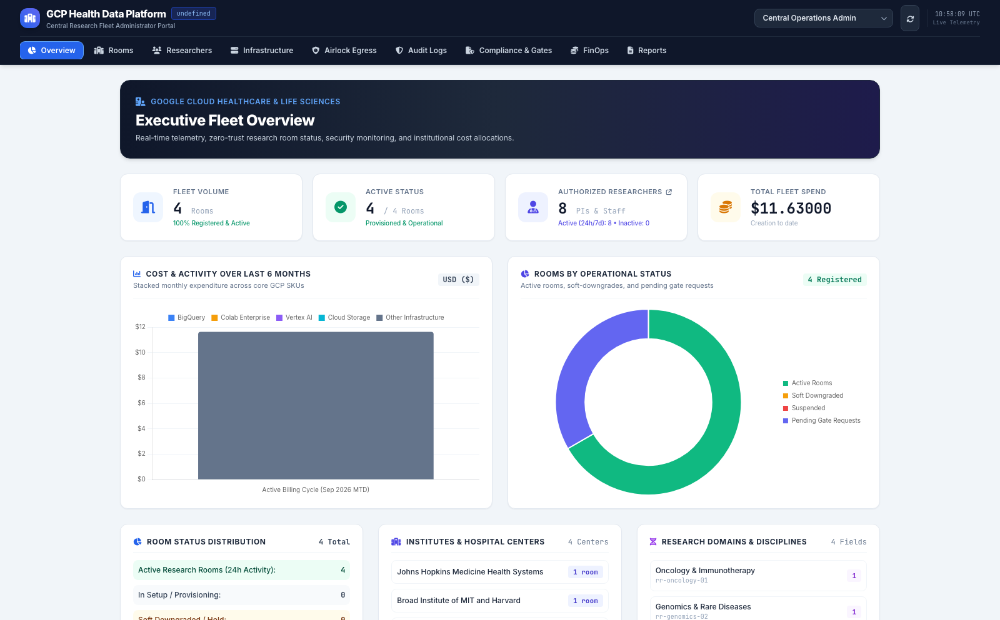
*Figure 11.1a: Fleet Overview (Top) displaying real-time platform KPIs (Active Rooms, Authorized Researchers, Storage Footprint), institutional affiliations, and operational posture banners.*

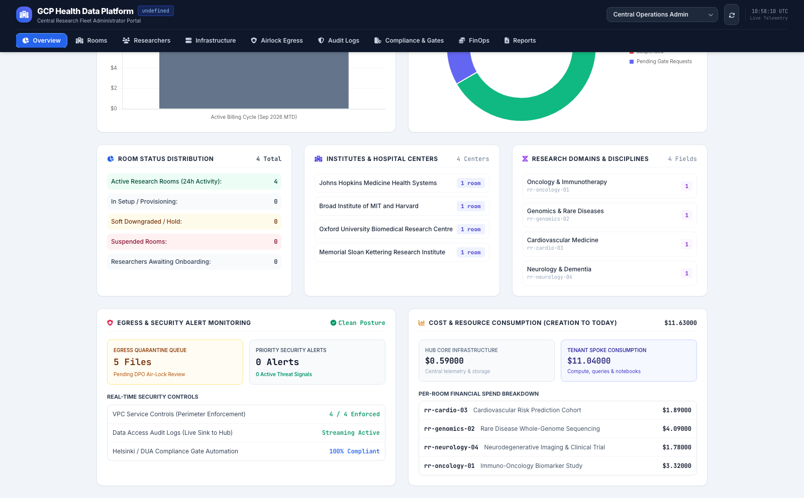
*Figure 11.1b: Fleet Overview (Bottom) highlighting 30-day BigQuery query velocity, rolling compute cost trajectories, and clinical domain research room segmentation.*

#### 2. Research Rooms Fleet Catalog (Filters & Full Fleet Table)

*Figure 11.2a: Fleet Rooms Catalog (Top) featuring live status metric counters (Total, Active, Downgraded, Suspended), instant search, and operational state filtering.*

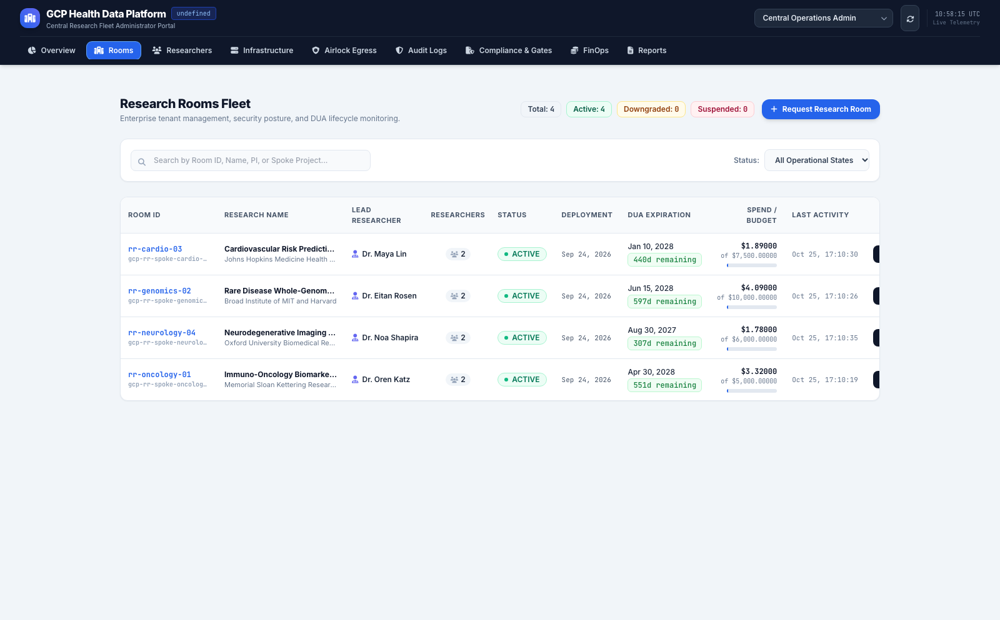
*Figure 11.2b: Fleet Rooms Catalog (Bottom) detailing lead researchers, DUA countdown pills, budget utilization meters, and administrative action buttons (View, Soft-Downgrade, Suspend).*

#### 3. Dedicated Room Deep-Dive & Asset Explorer (Header & Full Assets Stack)
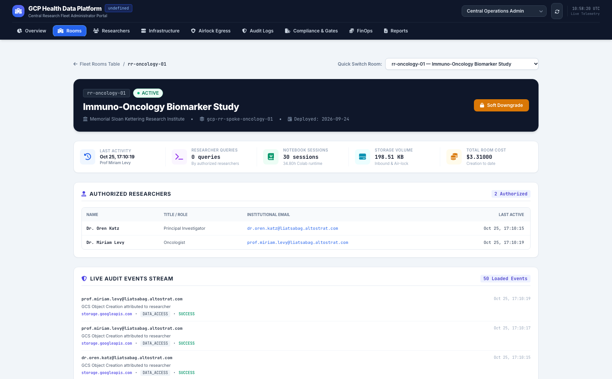
*Figure 11.3a: Dedicated Room View (Top) for `rr-oncology-01`, illustrating spoke project bindings, one-click IAM Soft-Downgrade toggle, and top 5 telemetry meters (Last Activity, Researcher Queries, Colab Sessions, Storage Volume, Total Room Cost).*

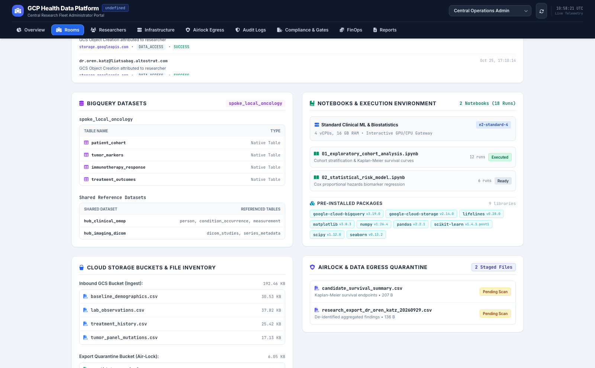
*Figure 11.3b: Dedicated Room View (Bottom) displaying authorized researcher rosters, curated audit activity streams, BigQuery clinical tables, Cloud Storage buckets, Colab Enterprise notebooks, and the airlock export quarantine container.*

#### 4. Authorized Researchers Directory & Granular Spend Profile
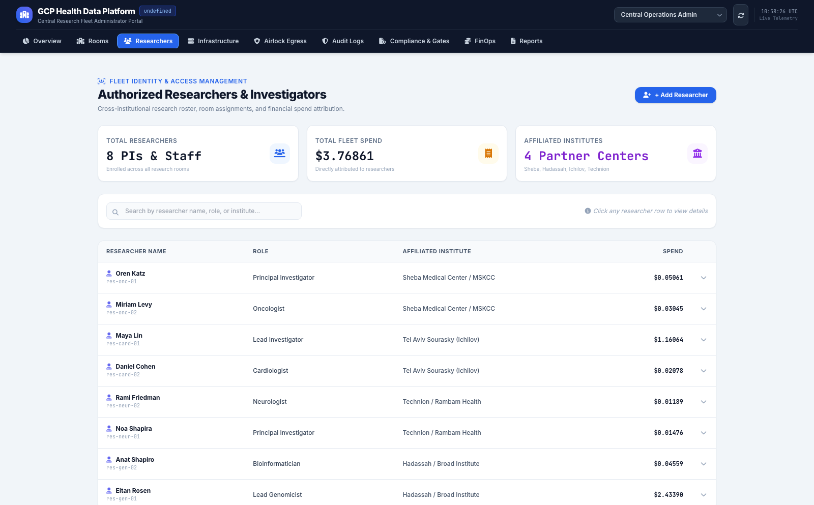
*Figure 11.4a: Researchers Directory displaying cross-institutional investigator roster across partner medical centers (Sheba, Hadassah, Ichilov, Technion) and cumulative spend rollups.*

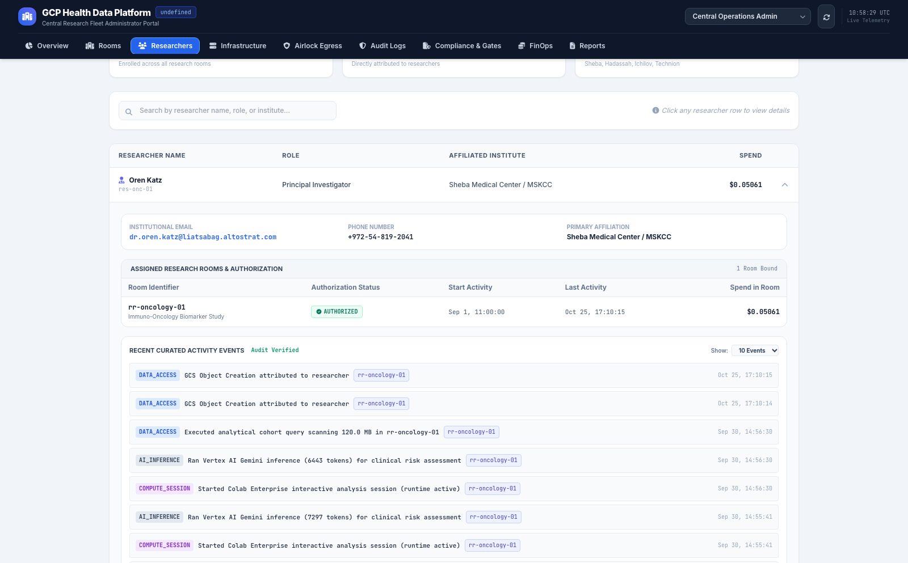
*Figure 11.4b: Detailed Researcher Profile drill-down showing investigator contact metadata, assigned room authorizations, itemized compute spend attribution, and audit-verified curated activity logs.*

#### 5. Air-Lock Egress Governance & Gemini Privacy Risk Evaluation
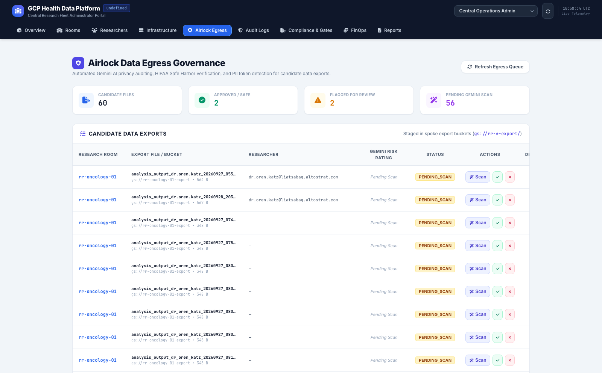
*Figure 11.5a: Airlock Egress Governance queue staging candidate export files from spoke buckets (`gs://rr-*-export/`) with Gemini AI risk meters and status indicators.*

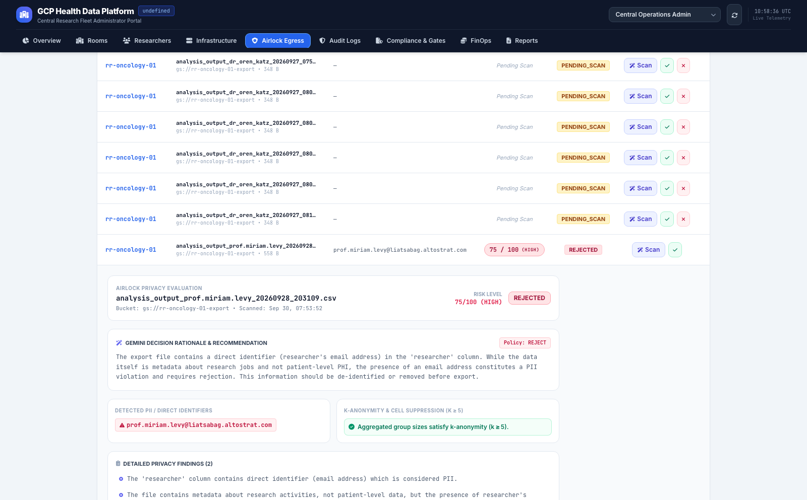
*Figure 11.5b: Expanded Gemini AI Privacy Assessment Card for candidate export `analysis_output_prof.miriam.levy_...csv`, highlighting a HIGH Risk score (75/100), detected PII email token (`prof.miriam.levy@example.health.org`), decision rationale, and automated policy REJECT recommendation.*

#### 6. Regulatory Compliance, Onboarding Gates & FinOps Reconciliation
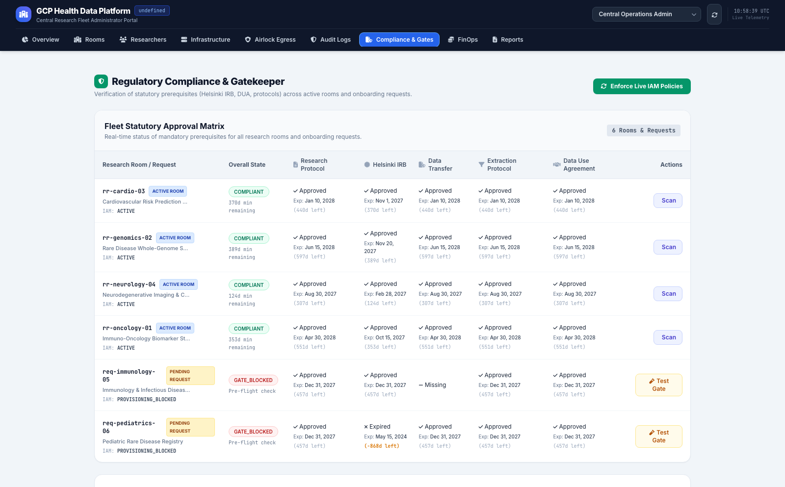
*Figure 11.6: 5-point statutory checklist matrix (DUA, IRB, HIPAA, IAM, CMEK), on-demand automated compliance scanner, and pre-flight room onboarding evaluation.*

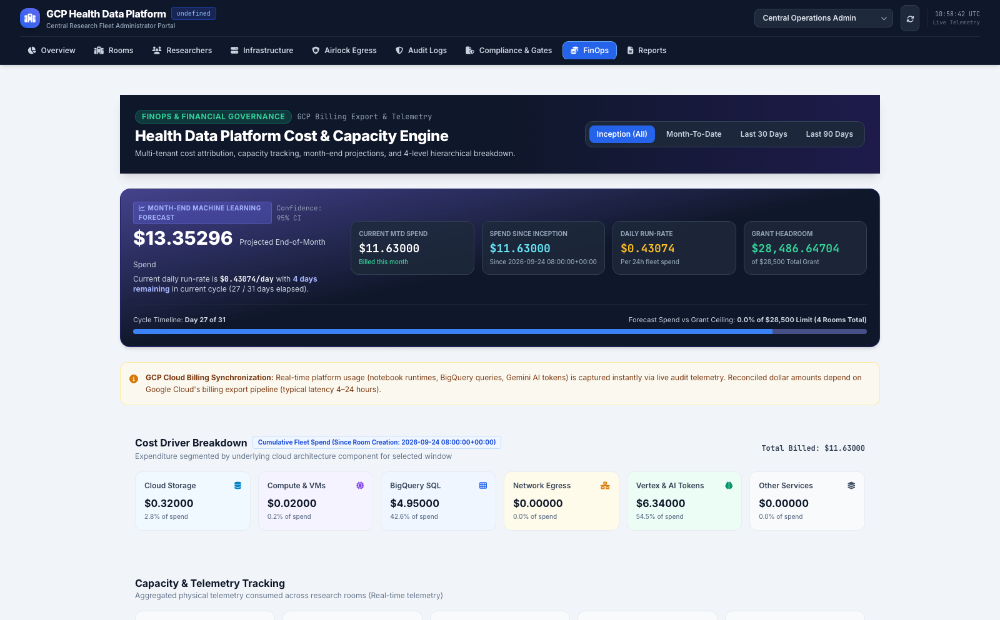
*Figure 11.7: Proportional compute attribution breakdown, hub infrastructure cost sharing, and zero-drift reconciliation against Google Cloud Invoiced Billing.*

#### 7. Infrastructure Management & Governance Reporting Engine
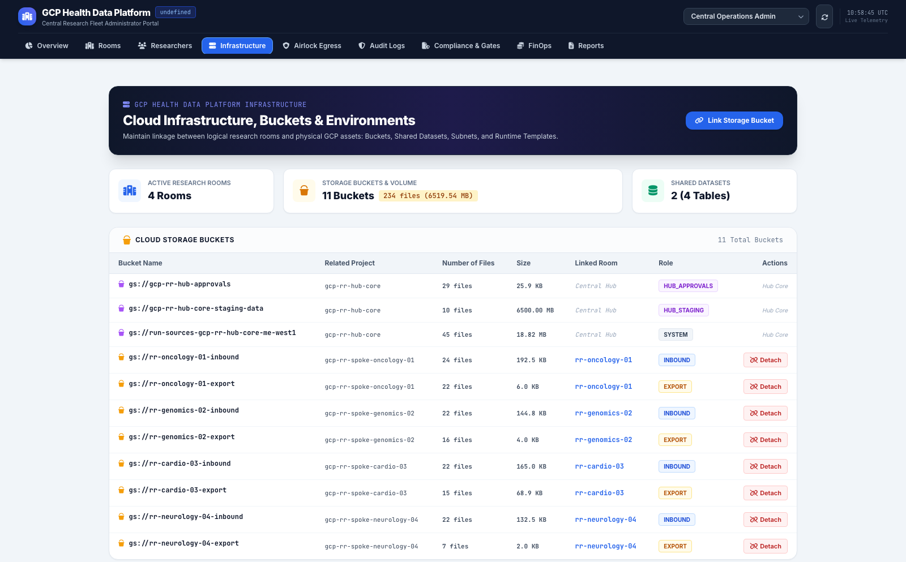
*Figure 11.8: Centrally shared analytical datasets, Cloud Storage bucket lifecycle bindings, and Vertex AI Colab runtime templates.*

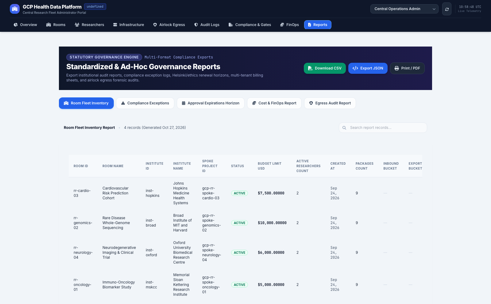
*Figure 11.9: Pre-configured regulatory exception, approval horizon, and audit reports with one-click JSON/CSV download for IRBs and DPOs.*

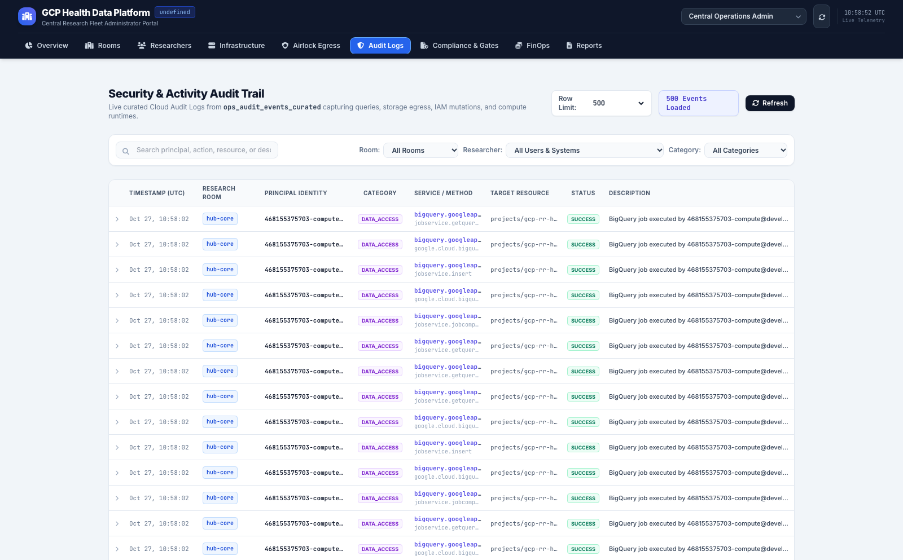
*Figure 11.10: Real-time Cloud Logging audit event stream capturing researcher interactive sessions, analytical queries, and airlock export attempts.*

