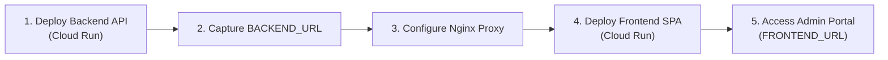

# Zero-to-Production Deployment Runbook & Operations Manual

**GCP Multi-Tenant Trusted Research Environment (TRE) & Research Room Management System**  
*Step-by-Step Provisioning, Automation Scripts, Serverless Workloads, and UI Deployment*  
*Document Version:* `5.1.0 (Streamlined Deployment Specification)`

---

## 1. Pre-Deployment Requirements & Configuration

### 1.1 Local CLI Tools & Permissions
* **Tools**: `gcloud` (480.0.0+), `bq` (2.1.0+), `python3` (3.10+), `jq`, and `curl`.
* **IAM Permissions**: Folder/Org Admin or Owner over Hub and Spoke projects, with Billing User privileges.

### 1.2 Configuration Setup (5 Minutes)

1. **Configure Environment Variables (`.env`)**:
   ```bash
   cp .env.example .env
   ```
   *Edit `.env` to set your central project ID (`GCP_PROJECT_ID`), region (`me-west1`), and billing configuration.*

2. **Verify Fleet Topology (`scripts/fixtures/fleet_topology.json`)**:
   *Check that `organization.folder_id`, `billing_account_id`, and `research_rooms` match your target GCP structure.*

3. **Install Dependencies & Authenticate**:
   ```bash
   python3 -m venv .venv
   source .venv/bin/activate
   pip install -r requirements.txt

   gcloud auth login
   gcloud auth application-default login
   ```

---

## 2. Complete Step-by-Step Deployment Runbook

### Phase 1: Deploy Foundational Infrastructure (Automated)

#### Step 1.1: Enable All Hub & Spoke Cloud APIs
Enable the full suite of APIs required across Hub and Spoke projects:
```bash
# Hub Project APIs
gcloud services enable \
    compute.googleapis.com bigquery.googleapis.com bigquerydatatransfer.googleapis.com \
    bigqueryconnection.googleapis.com analyticshub.googleapis.com aiplatform.googleapis.com \
    run.googleapis.com workflows.googleapis.com workflowexecutions.googleapis.com \
    logging.googleapis.com storage.googleapis.com cloudbuild.googleapis.com \
    artifactregistry.googleapis.com cloudscheduler.googleapis.com monitoring.googleapis.com \
    --project=gcp-rr-hub-core

# Spoke Projects APIs
for SPID in gcp-rr-spoke-oncology-01 gcp-rr-spoke-genomics-02 gcp-rr-spoke-cardio-03 gcp-rr-spoke-neurology-04; do
    gcloud services enable \
        compute.googleapis.com bigquery.googleapis.com storage.googleapis.com \
        aiplatform.googleapis.com notebooks.googleapis.com logging.googleapis.com \
        monitoring.googleapis.com --project="${SPID}"
done
```

#### Step 1.2: Run Master Bootstrap Script
Provisions projects, IAM roles, buckets, BigQuery datasets, Analytics Hub, notebooks, and Colab runtimes in one execution:
```bash
python3 scripts/provisioning/bootstrap_gcp.py --all
```

#### Step 1.3: Deploy Billing Export View & Real Live Inventory Sync
Connects the FinOps telemetry engine to the Google Cloud Billing Export and synchronizes live storage bucket footprints:
```bash
# 1. Deploy authorized view mapping the native GCP billing export table into hub_telemetry:
bq query --use_legacy_sql=false --project_id=gcp-rr-hub-core < scripts/sql/view_billing_export.sql

# 2. Synchronize real storage volume across spoke buckets into telemetry:
python3 scripts/etl/sync_storage_metrics.py
```

> [!NOTE]
> **Why are there seed scripts in `scripts/etl/`?**
> * **`scripts/etl/seed_billing_export.py`**: In a freshly created GCP environment, Google Cloud Billing Export takes **24–48 hours** to generate its first export partition into BigQuery. If you are doing an immediate demo or sandbox test and cannot wait 24–48 hours for Google's billing pipeline to start, you can optionally run `python3 scripts/etl/seed_billing_export.py` to populate initial billing rows. In production with active billing export, this script is **never needed**.
> * **`scripts/seed_storage_insights.py`**: Google Cloud Storage Insights daily inventory reports also run on a 24-hour asynchronous batch schedule. `scripts/etl/sync_storage_metrics.py` replaces the need to seed by scanning live GCS bucket sizes directly via the Storage API.

---

### Phase 2: Deploy Serverless Workloads, ML & Workflows

#### Step 2.1: BigQuery ML Connection & Vertex AI Gemini Model
Establishes the connection between BigQuery SQL and Vertex AI Gemini 3.7 Flash for automated regulatory scanning:
```bash
# 1. Create Regional Cloud Resource Connection
bq mk --connection --location=me-west1 --project_id=gcp-rr-hub-core --connection_type=CLOUD_RESOURCE gemini-connection

# 2. Extract Connection Service Account and grant permissions
CONNECTION_SA=$(bq show --format=json --connection gcp-rr-hub-core.me-west1.gemini-connection | jq -r '.cloudResource.serviceAccountId')

gcloud projects add-iam-policy-binding gcp-rr-hub-core \
    --member="serviceAccount:${CONNECTION_SA}" \
    --role="roles/aiplatform.user"

gcloud storage buckets add-iam-policy-binding gs://gcp-rr-hub-approvals \
    --member="serviceAccount:${CONNECTION_SA}" \
    --role="roles/storage.objectViewer"

# 3. Create BigQuery Object Table & Gemini Remote Model
bq query --use_legacy_sql=false --project_id=gcp-rr-hub-core "
CREATE OR REPLACE EXTERNAL TABLE \`gcp-rr-hub-core.hub_telemetry.obj_approval_documents\`
WITH CONNECTION \`gcp-rr-hub-core.me-west1.gemini-connection\`
OPTIONS (object_metadata = 'SIMPLE', uris = ['gs://gcp-rr-hub-approvals/*']);

CREATE OR REPLACE MODEL \`gcp-rr-hub-core.hub_telemetry.gemini_flash_model\`
REMOTE WITH CONNECTION \`gcp-rr-hub-core.me-west1.gemini-connection\`
OPTIONS (ENDPOINT = 'gemini-3.7-flash');
"
```

#### Step 2.2: Cross-Project Audit Log Sinks
Streams audit logs from all spoke projects into the central `hub_telemetry` dataset:
```bash
python3 scripts/provisioning/provision_log_sinks.py
```

#### Step 2.3: Scheduled Queries & Telemetry Poller
Sets up continuous background metric collection (15-minute operational syncs and 24-hour FinOps rollups):
```bash
# 1. Deploy BigQuery DTS Scheduled Queries
python3 scripts/provisioning/provision_scheduled_queries.py

# 2. Build and Deploy Telemetry Poller Cloud Run Job
gcloud builds submit deploy/telemetry-poller \
    --tag gcr.io/gcp-rr-hub-core/rr-telemetry-poller:latest \
    --project=gcp-rr-hub-core

gcloud run jobs deploy rr-telemetry-poller \
    --image gcr.io/gcp-rr-hub-core/rr-telemetry-poller:latest \
    --region me-west1 \
    --set-env-vars HUB_PROJECT=gcp-rr-hub-core,GCP_REGION=me-west1 \
    --project gcp-rr-hub-core

# 3. Schedule Telemetry Poller every 15 minutes
HUB_PROJECT_NUMBER=$(gcloud projects describe gcp-rr-hub-core --format="value(projectNumber)")
HUB_COMPUTE_SA="${HUB_PROJECT_NUMBER}-compute@developer.gserviceaccount.com"

# Grant Spoke Monitoring Viewer to Hub Compute SA
for SPID in gcp-rr-spoke-oncology-01 gcp-rr-spoke-genomics-02 gcp-rr-spoke-cardio-03 gcp-rr-spoke-neurology-04; do
    gcloud projects add-iam-policy-binding "${SPID}" --member="serviceAccount:${HUB_COMPUTE_SA}" --role="roles/monitoring.viewer"
    gcloud projects add-iam-policy-binding "${SPID}" --member="serviceAccount:${HUB_COMPUTE_SA}" --role="roles/aiplatform.viewer"
done

gcloud scheduler jobs create http rr-telemetry-poller-15m \
    --location=me-west1 \
    --schedule="*/15 * * * *" \
    --uri="https://me-west1-run.googleapis.com/apis/run.googleapis.com/v1/namespaces/gcp-rr-hub-core/jobs/rr-telemetry-poller:run" \
    --http-method=POST \
    --oauth-service-account-email="${HUB_COMPUTE_SA}" \
    --project=gcp-rr-hub-core || true
```

---

### Phase 3: Deploy Backend API & Frontend UI

Follow these steps to deploy the API and UI to Cloud Run:



#### Step 3.1: Deploy Backend API (Cloud Run)
Builds and deploys the FastAPI backend container to Cloud Run:
```bash
# 1. Build and push container image
gcloud builds submit backend \
    --tag gcr.io/gcp-rr-hub-core/gcp-rr-hub-backend:latest \
    --project=gcp-rr-hub-core

# 2. Deploy to Cloud Run
gcloud run deploy gcp-rr-hub-backend \
    --image gcr.io/gcp-rr-hub-core/gcp-rr-hub-backend:latest \
    --region me-west1 \
    --platform managed \
    --allow-unauthenticated \
    --set-env-vars GCP_PROJECT_ID=gcp-rr-hub-core,GCP_REGION=me-west1,ADMIN_DOMAIN=example-tre.org,BILLING_PROJECT_ID=gcp-billing-export-sink,BILLING_DATASET_ID=billing,BILLING_EXPORT_TABLE=gcp_billing_export_v1,HUB_REGISTRY_DATASET=hub_registry,HUB_TELEMETRY_DATASET=hub_telemetry,VERTEX_AI_MODEL=gemini-3.7-flash,VERTEX_AI_LOCATION=me-west1 \
    --project gcp-rr-hub-core

# 3. Capture Backend URL
BACKEND_URL=$(gcloud run services describe gcp-rr-hub-backend --region=me-west1 --project=gcp-rr-hub-core --format='value(status.url)')
echo "Backend URL: ${BACKEND_URL}"
```

#### Step 3.2: Deploy Frontend UI (Cloud Run)
Configures the Nginx reverse proxy to point to the live Backend API, builds the frontend SPA, and deploys it:
```bash
# 1. Update frontend/nginx.conf with live Backend URL
BACKEND_HOST=$(echo "${BACKEND_URL}" | sed -e 's|^https://||' -e 's|/.*$||')
sed -i.bak -e "s|proxy_pass https://[^/]*|proxy_pass ${BACKEND_URL}|g" \
           -e "s|proxy_set_header Host [^;]*|proxy_set_header Host ${BACKEND_HOST}|g" \
           frontend/nginx.conf
rm -f frontend/nginx.conf.bak

# 2. Build and push container image
gcloud builds submit frontend \
    --tag gcr.io/gcp-rr-hub-core/gcp-rr-hub-frontend:latest \
    --project=gcp-rr-hub-core

# 3. Deploy to Cloud Run
gcloud run deploy gcp-rr-hub-frontend \
    --image gcr.io/gcp-rr-hub-core/gcp-rr-hub-frontend:latest \
    --region me-west1 \
    --platform managed \
    --allow-unauthenticated \
    --project gcp-rr-hub-core

# 4. Capture Frontend URL
FRONTEND_URL=$(gcloud run services describe gcp-rr-hub-frontend --region=me-west1 --project=gcp-rr-hub-core --format='value(status.url)')
```

#### How to Access the Provisioned UI
Open the printed `FRONTEND_URL` in any modern web browser:
```text
https://gcp-rr-hub-frontend-xxxxxxxxxx-me.a.run.app
```
* **Dashboard**: Live multi-tenant overview, active research rooms, and budget dials.
* **FinOps**: Real-time micro-cost billing ($0.00000), storage footprints, and BQ scan metrics.
* **Governance**: DUA document review, automated risk checks, and egress approvals.
* **Audit Trail**: Real-time log sink streams and researcher activity history.

---

### Phase 4: Deploy Cloud Workflows (Governance Cycle)

Deploys the automated compliance workflow linking BigQuery AI regulatory scans with backend compliance enforcement:
```bash
# 1. Update workflow configuration with live Backend URL
sed -i.bak -e "s|defaultBackendUrl: .*|defaultBackendUrl: \"${BACKEND_URL}\"|g" \
           scripts/workflows/fleet_governance_cycle.yaml
rm -f scripts/workflows/fleet_governance_cycle.yaml.bak

# 2. Deploy Cloud Workflow
gcloud workflows deploy fleet-governance-cycle \
    --source=scripts/workflows/fleet_governance_cycle.yaml \
    --location=me-west1 \
    --project=gcp-rr-hub-core

# 3. Grant Invoker Permissions to Cloud Run Backend
gcloud run services add-iam-policy-binding gcp-rr-hub-backend \
    --region=me-west1 \
    --member="serviceAccount:${HUB_COMPUTE_SA}" \
    --role="roles/run.invoker" \
    --project=gcp-rr-hub-core
```

---

## 3. Live Traffic Simulation (Optional Demo Walkthrough)

To generate live researcher queries, Gemini token requests, and storage changes for demo or testing purposes:

```bash
# 1. Generate live multi-researcher queries & AI token consumption
python3 scripts/simulation/generate_live_researcher_traffic.py --scans 5 --tokens 2000

# 2. Synchronize storage footprint & trigger BigQuery rollups immediately
python3 scripts/etl/sync_storage_metrics.py
bq query --use_legacy_sql=false --project_id=gcp-rr-hub-core "CALL \`gcp-rr-hub-core.hub_telemetry.sp_sync_curated_audit_events\`();"
bq query --use_legacy_sql=false --project_id=gcp-rr-hub-core "CALL \`gcp-rr-hub-core.hub_telemetry.sp_aggregate_daily_compute_metrics\`();"
bq query --use_legacy_sql=false --project_id=gcp-rr-hub-core "CALL \`gcp-rr-hub-core.hub_telemetry.sp_rollup_monthly_usage\`();"
```

---

## 4. Operational Scripts Reference

The table below summarizes the key operational scripts and their roles across the platform lifecycle:

| Script Path | Purpose / Category | Operational Usage |
| :--- | :--- | :--- |
| **`scripts/provisioning/bootstrap_gcp.py`** | **Master Fleet Orchestrator** | **Primary Entrypoint** for automated Phase 1 infrastructure provisioning. |
| **`scripts/provisioning/provision_identity.py`** | Identity & IAM automation | Configures Cloud Identity groups and Hub/Spoke IAM bindings. |
| **`scripts/provisioning/provision_storage.py`** | Cloud Storage provisioning | Provisions dual-bucket isolation (`inbound`/`export`) and seeds regulatory fixtures. |
| **`scripts/provisioning/provision_bigquery.py`** | BigQuery schemas & procedures | Deploys hub registries, telemetry marts, and spoke analytical tables. |
| **`scripts/provisioning/provision_notebooks.py`** | Research Notebook templates | Generates and uploads domain-specific Jupyter notebooks to GCS. |
| **`scripts/provisioning/provision_runtime_templates.py`** | VPC networks & Colab templates | Creates isolated subnets and Vertex AI runtime templates. |
| **`scripts/provisioning/provision_analytics_hub.py`** | Analytics Hub exchanges | Sets up zero-copy data exchanges for cross-room research collaboration. |
| **`scripts/provisioning/provision_scheduled_queries.py`** | Scheduled BigQuery sync | Configures DTS scheduled queries for 15-minute and daily rollups. |
| **`scripts/provisioning/provision_log_sinks.py`** | Central audit logging | Deploys cross-project Cloud Logging sinks to the central Hub. |
| **`scripts/etl/sync_storage_metrics.py`** | Storage metrics sync | Correlates GCS Storage Insights inventories with audit logs for cost attribution. |
| **`scripts/simulation/generate_live_researcher_traffic.py`** | Traffic & workload simulation | Simulates multi-tenant BQ queries, AI inference tokens, and notebook activity. |
| **`scripts/verification/verify_live_gcp.py`** | Fleet health verification | Validates live cloud resource states against `fleet_topology.json`. |
| **`scripts/verification/verify_finops_e2e.py`** | FinOps invariant verification | Verifies zero-drift cost reconciliation between billing and room allocations. |

---

## 5. Teardown Guide

To pause or delete resources to prevent ongoing cloud billing:

```bash
# 1. Delete Cloud Run Services
gcloud run services delete gcp-rr-hub-frontend --region=me-west1 --project=gcp-rr-hub-core --quiet
gcloud run services delete gcp-rr-hub-backend --region=me-west1 --project=gcp-rr-hub-core --quiet

# 2. Pause Cloud Scheduler
gcloud scheduler jobs pause rr-telemetry-poller-15m --location=me-west1 --project=gcp-rr-hub-core --quiet
```
