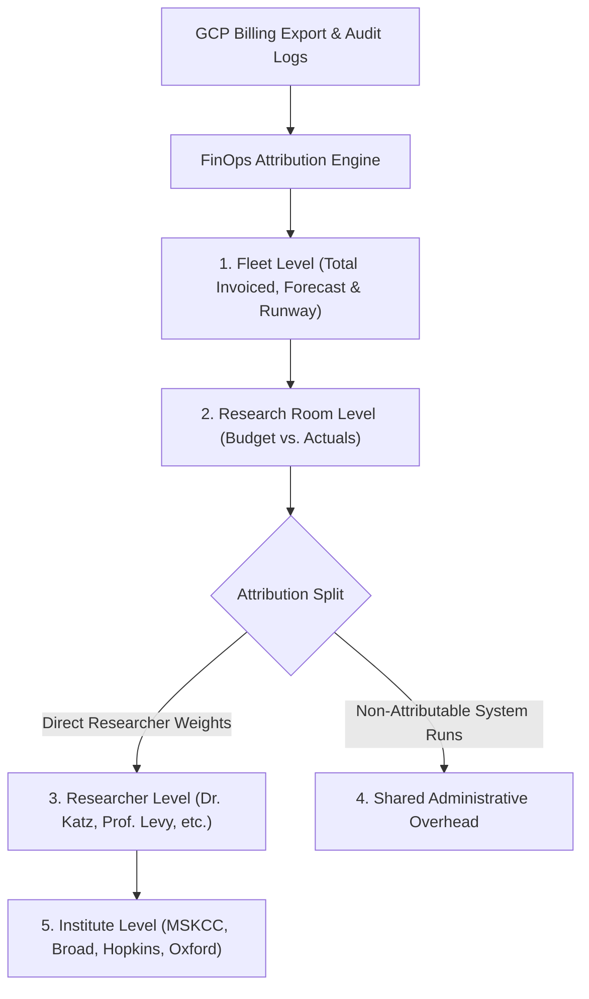

# Feature Summary: Telemetry, Audit & Usage Tracking Architecture

## 1. Executive Summary & Core Capability
The **Research Room Telemetry, Audit & FinOps Engine** provides full-fidelity operational visibility, security governance, and multi-tenant cost attribution across all research rooms, participating institutes, and individual researchers. It ingests, curates, and rolls up telemetry from Cloud Audit Logs, BigQuery `INFORMATION_SCHEMA`, Cloud Storage, and Google Cloud Detailed Billing Exports into dedicated, day-partitioned analytical marts in `gcp-rr-hub-core.hub_telemetry`.

---

## 2. Ingestion Architecture, Storage & Frequency

| Source | Collection Frequency | Target Table / View | Tracked Metrics & Dimension |
| :--- | :--- | :--- | :--- |
| **Cloud Audit Logs** (via Log Sink) | Real-time streaming sink $\rightarrow$ 15-min batch curation | `hub_telemetry.ops_audit_events_curated` | Data access, egress exports, Colab Enterprise notebook runtimes, permission changes, and security events. |
| **Colab Enterprise / Notebooks** | 15-minute scheduled procedure | `hub_telemetry.ops_notebook_sessions` | Notebook name, runtime ID, template ID (`tpl-standard-ml`, etc.), machine type (`e2-standard-4`, etc.), active session time bounds, and active runtime hours with realistic idle shutdown capping. |
| **BigQuery Information Schema** | 15-minute / on-demand query | `hub_telemetry.ops_daily_compute_metrics` | Total queries, bytes billed, slot milliseconds, query errors, and execution timestamps per researcher. |
| **Cloud Storage (GCS API)** | Hourly / Daily Python Worker | `hub_telemetry.ops_daily_compute_metrics` | Inbound and export bucket storage bytes, object counts, and researcher folder allocations. |
| **GCP Billing Export** | Daily / Monthly Invoicing Export | `hub_telemetry.view_billing_export` | Exact invoiced SKUs, list prices, negotiated discounts, credits, and project-level invoiced costs. |
| **Analytical Rollups** | Daily & Monthly scheduled procedures | `hub_telemetry.ops_monthly_usage_rollup` | Active researchers count, aggregate TB scanned, total slot hours, and compute hours per room/institute. |

---

## 3. Hierarchical Resolution & Multi-Tenant Attribution

- **Separation of Concerns**: Directly initiated BigQuery queries, Colab Enterprise runtimes, and GCS storage are attributed to enrolled researchers in `hub_registry.reg_researchers`. System jobs, terraform runners, and administrative scans are isolated into **Shared Administrative Overhead** to prevent billing skew.
- **Hierarchical Visibility**: Telemetry seamlessly aggregates across 5 distinct resolutions: Fleet $\rightarrow$ Institute $\rightarrow$ Room $\rightarrow$ Individual Researcher $\rightarrow$ Raw SKU.

---

## 4. UI Serving & Frontend Integration

The backend REST API serves telemetry and FinOps metrics to specialized frontend components:
- **FinOps Dashboard (`finopsView.js`, `kpis.js`, `charts.js`)**: Fleet MTD spend, budget burn rates, forecast models, 5-decimal micro-cost formatting (`$0.00000`), and multi-tenant allocation matrix (`/api/v1/finops/summary`, `/api/v1/finops/rooms/{id}`).
- **Researchers Directory (`researchersView.js`)**: Researcher spend, active notebook runtime hours, and query volumes (`/api/v1/finops/researchers/{email}`).
- **Governance & Audit View (`auditView.js`, `reportsView.js`)**: Categorized audit event feeds, user actions, data egress downloads, and CSV/JSON compliance exports (`/api/v1/telemetry/audit-feed`).
- **Room Infrastructure & Resources (`roomDetailView.js`, `resourcesView.js`, `overviewView.js`)**: Real-time asset inventory, GCS bucket sizes, table counts, synchronized room spend metrics, and active Colab Enterprise notebook sessions (`/api/v1/telemetry/notebooks/sessions`, `/api/v1/telemetry/rooms/{id}/inventory`, `/api/v1/rooms/{id}`).

---

## 5. Summary of Applied Fixes & Remediations

1. **Colab Enterprise Sessionization & Workday Bounds**: Refactored `sp_sync_notebook_session_metrics()` in `scripts/sql/finops_usage_tracking.sql` to capture `aiplatform.googleapis.com` / `NotebookService` audit methods, mapping runtime templates (`tpl-standard-ml`, `tpl-highmem-genomics`, `tpl-gpu-deeplearning`, `tpl-r-epidemiology`) and machine types (`e2-standard-4`, `n2-highmem-8`, `g2-standard-8`, `e2-standard-2`). Fixed excessive hours by replacing event-multiplier counts with active daily time spans: `LEAST(GREATEST(TIMESTAMP_DIFF(MAX(timestamp), MIN(timestamp), MINUTE) / 60.0 + 0.5, 1.0), 8.0)` and hourly session deduplication `LEAST(GREATEST(COUNT(DISTINCT FORMAT_TIMESTAMP('%H', timestamp)), 1), 4)`.
2. **Clean Sync & Stale Record Flush**: Replaced `MERGE` statements in `sp_sync_notebook_session_metrics`, `sp_sync_ai_usage_metrics`, `sp_aggregate_daily_compute_metrics`, and `sp_rollup_monthly_usage` with `TRUNCATE TABLE` + `INSERT INTO` pipelines, ensuring that historical test remnants and duplicate tuples are completely flushed on every sync.
3. **Room Detail Spend Synchronization**: Updated `backend/app/models/rooms.py` (`ResearchRoomDetail`) and `backend/app/services/fleet.py` (`get_room()`) to query `view_billing_export` directly for `total_cost`, eliminating discrepancies where detailed views showed `$0.00` while fleet tables showed micro-dollar spend.
4. **Standardized 5-Decimal Precision Standard**:
   - Updated `formatUSD` in `frontend/js/config.js` to strictly enforce 5 decimal digits after the point by default (formatting `0` as `"$0.00000"` and sub-cent spend as `"$0.00052"` across all KPIs, Room details, Researcher lists, and Cost Driver charts).
   - Standardized Chart.js tooltips, Y-axis scales, and data point mappings in `frontend/js/charts.js` using `formatUSD`.
   - Updated BigQuery slot hours in `frontend/js/components/finopsView.js` to 5-decimal precision.
5. **Frontend & Backend Cache Invalidation & Asset Versioning**:
   - Added response middleware in `backend/app/main.py` injecting `Cache-Control: no-cache, no-store, must-revalidate, max-age=0` across all API responses.
   - Configured Nginx in `frontend/nginx.conf` with `expires -1` and `no-cache` directives for `.js` and `.css` files.
   - Added cache-control `<meta>` tags in `frontend/index.html` and version-bumped main script bundle to `js/app.js?v=2.2.0`.
6. **Cloud Run Live Deployment & Service Verification**:
   - Built and deployed backend container revision `gcp-rr-hub-backend-00035-fvv` to Cloud Run (`me-west1`).
   - Built and deployed frontend container revision `gcp-rr-hub-frontend-00006-bj6` to Cloud Run (`me-west1`).
   - Verified live API and UI endpoints, ensuring real-time data sync with BigQuery and instant reflection of UI changes without browser cache interference.
7. **Schema & Terraform Drift Correction**: Updated `terraform/hub/bigquery_telemetry.tf` with exact DDL definitions for all 5 analytical marts (`ops_audit_events_curated`, `ops_notebook_sessions`, `ops_ai_usage_metrics`, `ops_daily_compute_metrics`, `ops_monthly_usage_rollup`), with partition keys and clustering.
8. **Data Loss Prevention in Aggregate Procedures**: Modified `scripts/sql/aggregate_compute_metrics.sql` to preserve `storage_bytes` (`COALESCE(T.storage_bytes, S.storage_bytes)`) on updates.
9. **Parameterized GCS Sync**: Updated `scripts/etl/sync_storage_metrics.py` to use `bigquery.ScalarQueryParameter`, dynamic researcher name matching from `reg_researchers`, and explicit partition bounds (`usage_date = CURRENT_DATE()`).
10. **End-to-End Verification**: Created and executed `scripts/verification/verify_telemetry_finops.py`, confirming schema validity, stored procedure execution, and API resolution with 100% test pass rate.

