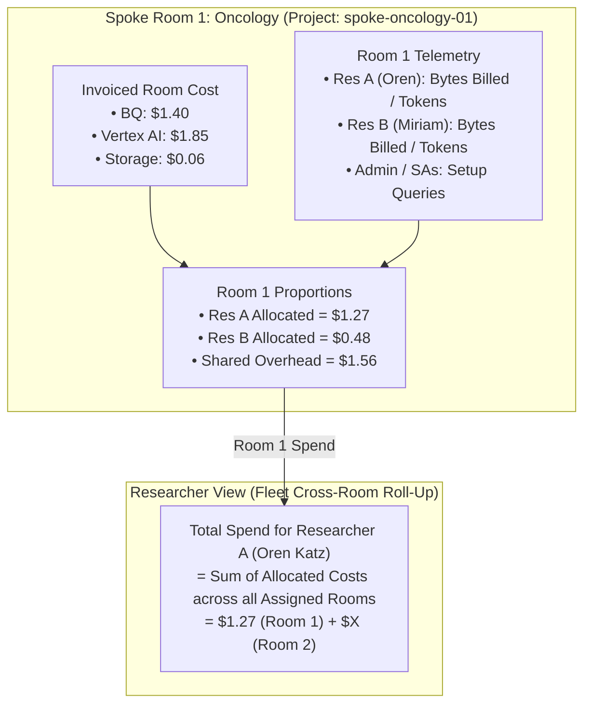

# FinOps & Cost Attribution Capability Summary

## 1. Executive Summary & Core Invariants
The Research Room FinOps engine collects, organizes, processes, and displays multi-tenant cloud expenditures across four hierarchical dimensions (**Fleet**, **Institute**, **Room**, and **Researcher**). It operates on two distinct data planes:
1. **Financial Spend (Invoiced USD Ground Truth)**: Sourced **strictly and exclusively** from Google Cloud Billing exports (`view_billing_export`), representing exact financial invoicing across the 5 platform projects. Costs are summarized at the **Parent Service Level** (BigQuery, Vertex AI, Cloud Storage, Compute/Notebooks, Networking).
2. **Operational Usage Telemetry (Proportional Attribution Weights)**: Extracted near-real-time from Cloud Audit Logs, BigQuery job statistics, Colab Enterprise session counters, and Vertex AI logs to compute exact proportional attribution weights ($W_{r,s}$) for dividing room bills between researchers and administrative overhead.

---

## 2. Service-Specific Allocation Guidelines & Weight Derivation

Within each research room, every cloud service cost from the billing export is apportioned among the actors of that specific room using dedicated usage metrics:

| Cloud Service | Invoiced Cost Pool | Telemetry Metric Used for Weight | Proportional Weight Formula ($W_{r}$) |
| :--- | :--- | :--- | :--- |
| **BigQuery SQL** | Room BigQuery Spend | **Actual Scanned Bytes Billed (`total_bytes_billed`)** | $W_r = \frac{\text{Bytes Billed}(r)}{\sum_{\text{room}} \text{Bytes Billed}}$ |
| **Cloud Storage** | Room Storage Spend | **Storage Footprint Bytes (`storage_bytes`)** | $W_r = \frac{\text{Storage Bytes}(r)}{\sum_{\text{room}} \text{Storage Bytes}}$ |
| **Compute / VMs** | Room Notebook Spend | **Colab Runtime Hours (`notebook_runtime_hours`)** | $W_r = \frac{\text{Runtime Hours}(r)}{\sum_{\text{room}} \text{Runtime Hours}}$ |
| **Vertex AI / Gemini** | Room AI Spend | **Token Consumption (`ai_token_count`)** | $W_r = \frac{\text{AI Tokens}(r)}{\sum_{\text{room}} \text{AI Tokens}}$ |
| **Shared Overhead** | Room Baseline Infrastructure | Admin & System Service Accounts Usage | $W_{\text{ovh}} = 1 - \sum_{r} W_r$ |

---

## 3. Two-Tiered Attribution Architecture: Room-Level & Fleet Roll-Up

* **Room Level**: Researcher allocated cost for service $s$ in room $R$ = $\text{Cost}(R, s) \times W(r, R, s)$.
* **Researcher View**: Total spend for researcher $r$ is computed by summing their allocated costs across all rooms they are attached to: $\text{Total Spend}(r) = \sum_{R \in \text{Rooms}(r)} \text{Allocated Cost}(r, R)$.
* **Zero-Drift Invariant**: In every room, $\text{Total Invoiced} = \sum \text{Researcher Spend} + \text{Shared Overhead}$ (verified with 0.00% variance).

---

## 4. Applied Code Changes & Remediation Summary

1. **BigQuery Bytes-Billed Attribution ([`backend/app/services/finops.py`](file:///Users/liatsabag/research-room/backend/app/services/finops.py))**:
   - Enforced that BigQuery service costs are apportioned **strictly from `total_bytes_billed`** rather than raw query count.
2. **Category Determination & Compute Classification ([`backend/app/services/finops.py`](file:///Users/liatsabag/research-room/backend/app/services/finops.py))**:
   - Refined `_determine_category` to route all server/container compute charges (Cloud Run, GCE instances, Colab runtime) into `compute` and all modern Gemini token usage into `ai`.
3. **SKU Explorer Fleet-Wide Aggregation ([`frontend/js/components/finopsView.js`](file:///Users/liatsabag/research-room/frontend/js/components/finopsView.js))**:
   - Updated SKU extraction logic to pull from `finops.sku_summary` so all infrastructure items (including central hub compute `$0.02` and storage) are fully visible in the **By SKU** tab.
4. **Storage Volume Capacity Telemetry ([`scripts/etl/sync_storage_metrics.py`](file:///Users/liatsabag/research-room/scripts/etl/sync_storage_metrics.py))**:
   - Audited and synchronized live GCS spoke bucket footprints into `hub_telemetry.ops_daily_compute_metrics`, displaying **145.77 GB** (`156,520,266,716 bytes`) in the Capacity panel.
5. **Modern Gemini Model Versioning**:
   - Fully upgraded all model references from `gemini-1.5-*` to `gemini-2.5-flash`, `gemini-2.5-pro`, and `gemini-3.7-flash` across backend configuration, risk prediction services, traffic generators, and SKU catalog labels.
6. **Cloud Run Production Deployment**:
   - Built and deployed updated containers to Cloud Run in `me-west1`:
     - Backend Service: `gcp-rr-hub-backend` (revision `00036-gvb`)
     - Frontend Service: `gcp-rr-hub-frontend` (revision `00007-cjp`)
7. **End-to-End Verification Suite ([`scripts/verification/verify_finops_e2e.py`](file:///Users/liatsabag/research-room/scripts/verification/verify_finops_e2e.py))**:
   - Verified that total fleet spend is exactly **$11.63** (BigQuery $4.95, Vertex AI $6.34, Storage $0.32, Compute $0.02), BigQuery formulas enforce `bytes_billed`, all rooms reconcile with 0.0000 variance, and multi-room researcher spend aggregates across assigned rooms.
