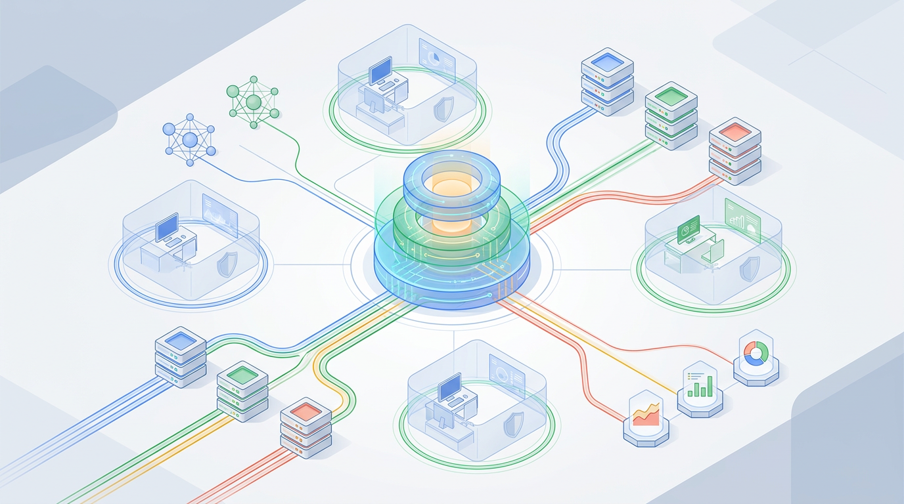
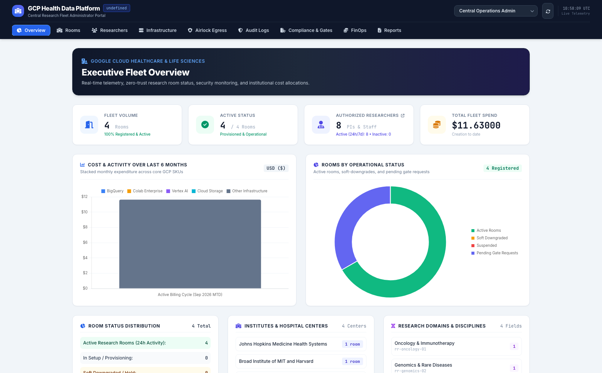
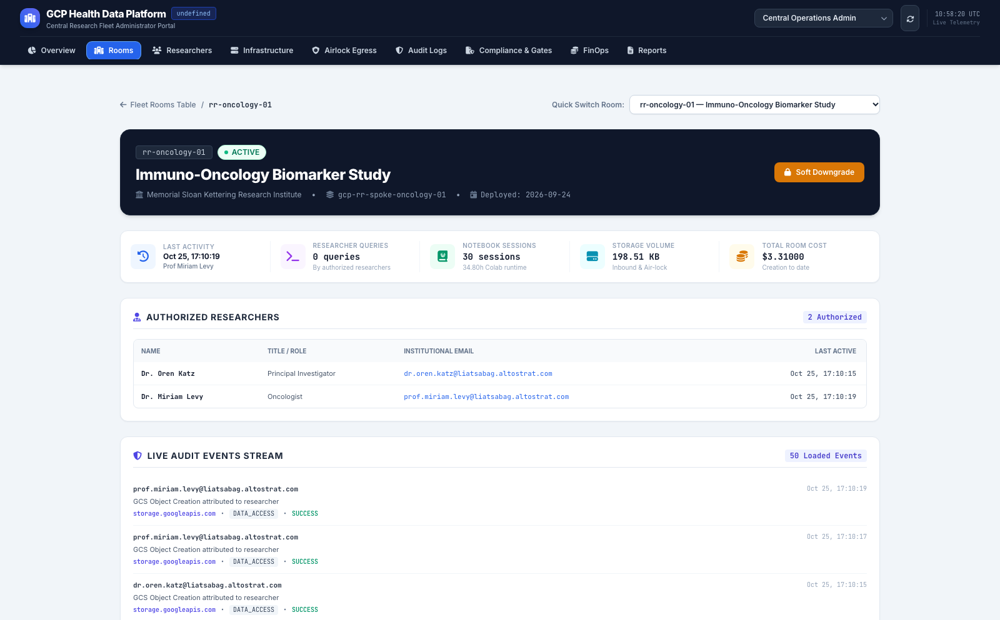
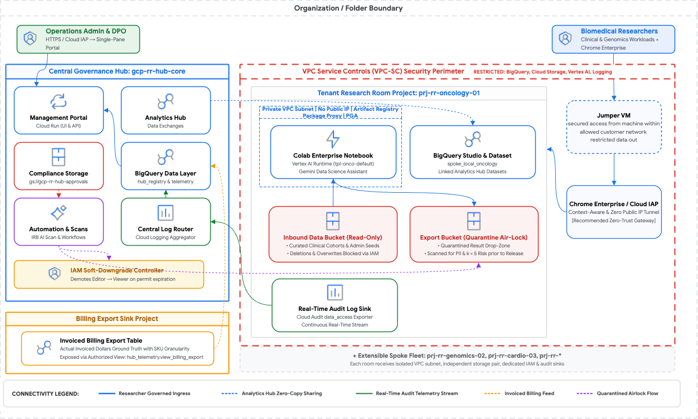
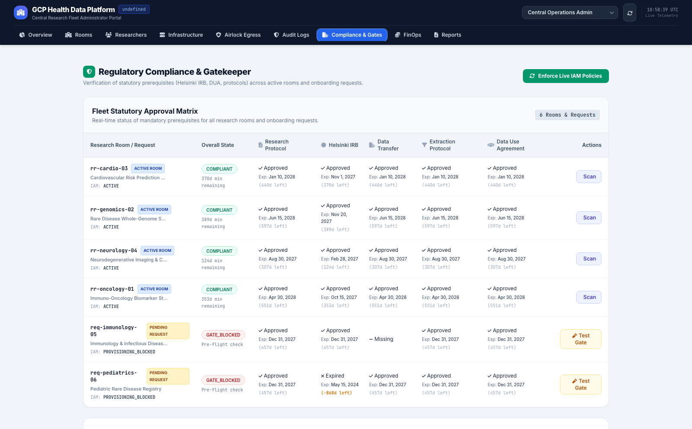
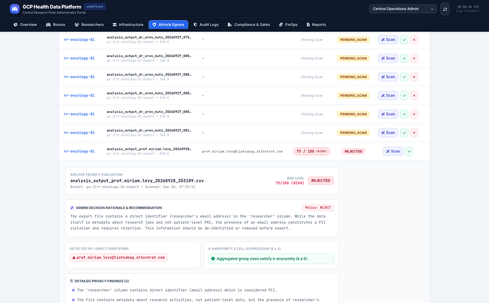
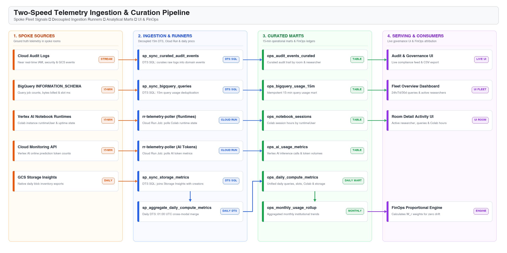
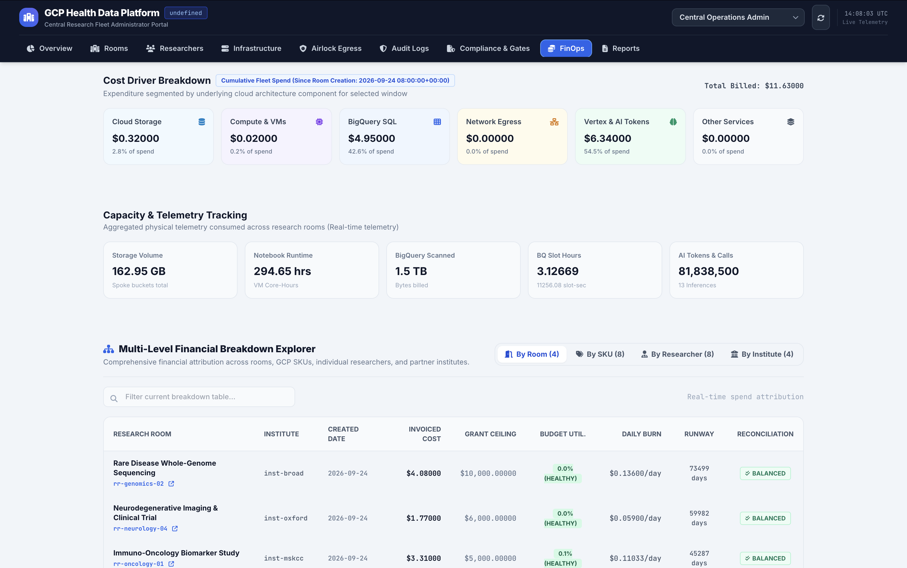
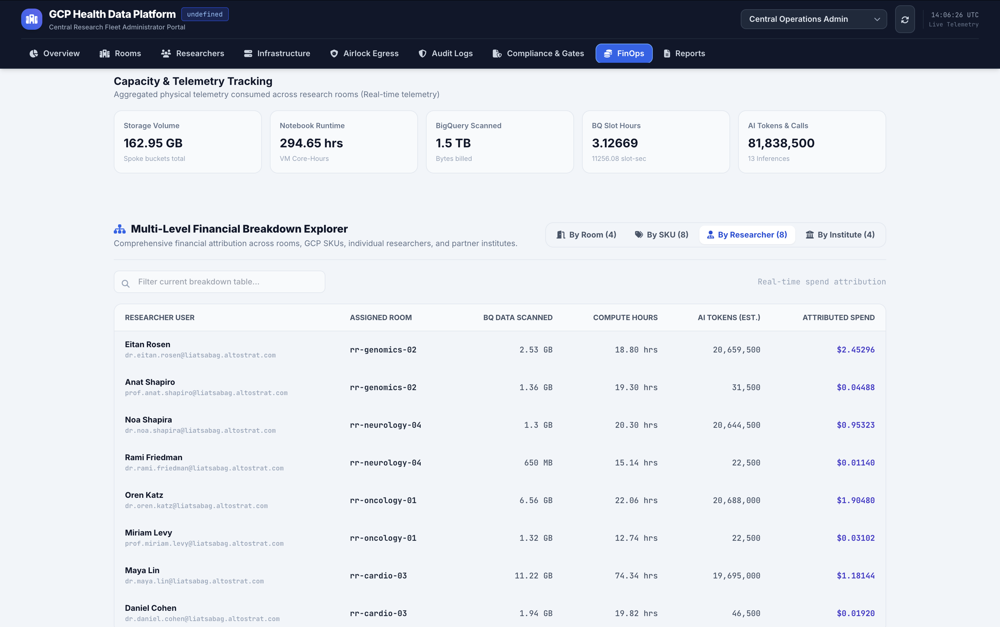

# The Zero-Trust Research Room: Enabling Secure, High-Performance Analytics on Protected Data

### *A practical guide to scaling collaboration on protected data while maintaining absolute control over security, compliance, and budget.*

---

---

## 1. The Operational Challenge: Transforming Cloud Blueprints into a Unified Research Platform

Google Cloud provides exceptional foundational building blocks for modern data analytics and secure collaboration: petabyte-scale analytics in **BigQuery**, zero-copy data sharing via **BQ Sharing**, cryptographic network isolation with **VPC Service Controls (VPC-SC)**, managed notebooks in **Colab Enterprise**, and rich **AI capabilities with Gemini**.

Google has also published valuable reference architectures and blueprints for deploying and constructing research environments on top of GCP. However, these are **general-purpose cloud infrastructure building blocks and architectural guides**, rather than a turnkey, out-of-the-box research operations platform. 

Operating a multi-tenant research environment in practice requires additional operational controls:
* **Centralized Governance & Fleet Orchestration**: Managing lifecycle states across multiple independent research workspaces from a single control plane.
* **Continuous Compliance & Policy Enforcement**: Tracking statutory permits (IRBs, DUAs, HIPAA) and automatically restricting access when permits lapse.
* **Automated Data Protection & Egress Control**: Inspecting candidate export files for PII and small cohort disclosure before data leaves the environment.
* **Multi-Tenant Cost Attribution (FinOps)**: Reconciling complex cloud billing exports down to specific research rooms and individual researchers.

To bridge this operational gap, I developed an open, reusable reference solution: the **Research Room Management Platform** — an enterprise-grade, multi-tenant **Trusted Research Environment (TRE)** engineered natively on Google Cloud. 

Designed not as a proprietary vendor product, but as an **extensible prototype and reusable blueprint with all code, infrastructure schemas, and automation scripts included**, it allows any organization to deploy, govern, and customize its own unified research platform.

---

## 2. What Is a "Research Room"?

A **Research Room** is an on-demand, isolated cloud workspace provisioned for a specific research study, clinical cohort, or cross-institutional initiative.

Rather than copying sensitive data to researcher laptops or unmonitored virtual machines, researchers enter an isolated Google Cloud workspace where they can use the full analytical power of modern cloud infrastructure while remaining within a cryptographic security perimeter:

* **Zero-Copy Data Sharing & Privacy-Preserving Collaboration**: Organizations can publish and subscribe to shared datasets across distinct projects without physical data duplication using [BigQuery Sharing](https://cloud.google.com/bigquery/docs/analytics-hub-introduction), or perform privacy-preserving, multi-party SQL analysis without raw data exchange using [BigQuery Data Clean Rooms](https://cloud.google.com/bigquery/docs/data-clean-rooms).
* **Collaborative Compute & Data Science Tooling**: Researchers work in managed [Colab Enterprise](https://cloud.google.com/colab/docs/introduction) and [BigQuery Studio Notebooks](https://docs.cloud.google.com/bigquery/docs/programmatic-analysis), running not only SQL but **Python with full support for popular data science and bioinformatics libraries**. These runtimes integrate **Gemini-powered Data Science Agent capabilities** that actively assist researchers with natural language SQL/Python generation, automated exploratory data analysis, intelligent charting, and inline code troubleshooting directly inside the workspace.
* **Machine Learning & AI**: Train and evaluate statistical and machine learning models in-place using [BigQuery ML (BQML)](https://cloud.google.com/bigquery/docs/bqml-introduction) or integrate multimodal foundation models directly within SQL queries using [BigQuery AI functions](https://docs.cloud.google.com/bigquery/docs/ai-introduction) powered by [Vertex AI](https://docs.cloud.google.com/gemini-enterprise-agent-platform/models), eliminating external compute transfers.
* **Continuous Usage Tracking & Auditing**: Every query-scanned byte (`total_bytes_billed`), Colab notebook session hour, AI token consumed (`ai_token_count`), and storage footprint is continuously recorded in near-real-time telemetry marts and Cloud Audit Logs.

The platform structures this workspace around the internationally recognized **"Five Safes"** framework: **Safe People**, **Safe Projects**, **Safe Settings**, **Safe Data** *(isolated project datasets and zero-copy sharing; note that row-level security and column masking can be added if required, but are not implemented here)*, and **Safe Outputs**.

---

### The Operational Perspective: Fleet vs. Room Workspace

The management platform provides distinct visibility for central administrators managing the whole organization versus research teams managing their specific study:

| Central Fleet Governance Plane | Dedicated Research Room Workspace |
| :---: | :---: |
|  |  |
| *High-level fleet health, total cloud spend, active room status, and cross-project compliance tracking.* | *Specific study view displaying assigned researchers, live budget burn, compute status, and linked datasets.* |

---

## 3. Master Target Architecture & Global Topology

The architecture organizes the Google Cloud environment into a centralized **Hub-and-Spoke topology**, enclosed within a **VPC Service Controls (VPC-SC)** security perimeter:

*Figure 1: Master Target Architecture Blueprint of the Managed Trusted Research Environment on Google Cloud.*

---

### Key Architectural Layers:

1. **Central Governance Hub Project (`gcp-rr-hub-core`)**:
   * **Control Plane & Relational Entity Architecture**: The central governance plane acts as the single source of truth, tracking sponsoring institutes, researchers, rooms, installed runtime packages, and operational compliance ledgers across relational registries (`hub_registry`) and operational telemetry datasets (`hub_telemetry`).
   * **Serving Plane (Cloud Run)**: Hosts the FastAPI REST backend and responsive single-page management portal (Nginx SPA) with tailored role dashboards for Operations Admins, Cloud Engineers, and Data Protection Officers.
   * **Central Data & Sharing Layer (BigQuery)**: Houses central catalogs, curated operational telemetry marts (`ops_audit_events_curated`, `ops_daily_compute_metrics`), and zero-copy **Analytics Hub** data exchanges.
   * **Central Compliance Storage**: A dedicated Cloud Storage bucket (`gs://gcp-rr-hub-approvals`) housing raw statutory agreements and PDF approval protocols.
   * **Central Log Router & Automation Plane**: Aggregates real-time Cloud Audit Logs streamed from all spoke projects and orchestrates scheduled background governance cycles via **Cloud Workflows** (`fleet-governance-cycle`).

2. **Tenant Research Room Spoke Projects (`gcp-rr-spoke-*`)**:
   * **Private Network Subnet**: Dedicated spoke VPC subnets configured with `disable_public_ip = true`, zero public internet egress, and Private Google Access routed to central Artifact Registry remote repositories for approved Python/R package mirrors (PyPI/CRAN).
   * **Governed Compute**: Colab Enterprise notebook runtimes running on dedicated machine types with project-isolated service accounts.
   * **In-Room Analytical Store**: Project-local BigQuery datasets combined with linked zero-copy dataset subscriptions published by the Hub.
   * **Dual Storage Buckets**: An `inbound` bucket for read-only curated input data, and an `export` bucket serving as a quarantine drop zone for proposed export artifacts.
   * **Audit Log Sink**: Continuous real-time streaming of all in-room API calls, queries, and notebook activity to the Hub's log sink router.

3. **Billing Export Sink Project**:
   * Captures the organization's official, partitioned Google Cloud Billing Export table, queried securely from the Hub via an authorized view (`view_billing_export`).

4. **Security Perimeter (VPC Service Controls)**:
   * Encloses the Hub data layer and all tenant Spoke projects inside an airtight boundary, restricting BigQuery, Cloud Storage, Vertex AI, and Logging APIs to prevent data exfiltration to external projects or untrusted internet endpoints.

---

## 4. Implementation Deep Dive: Core Building Blocks

### Pillar 1: Zero-Trust Analytical Perimeters & Workspace Ingress

Data teams require familiar programming tools without exposing corporate perimeters or clinical datasets to external networks. 

The platform isolates each research room within a dedicated GCP project and spoke VPC subnet with all public IP addresses disabled:

* **Device-Verified Ingress**: Access requires authenticated Google Cloud Identity accounts mapped to least-privilege IAM roles. Fronting the environment with **Identity-Aware Proxy (IAP)** and Context-Aware Access eliminates open public ports or bastions, binding ingress to verified corporate endpoints.
* **Private Google Access**: All workspace VPC subnets are configured with `disable_public_ip = true`. Calls to Google Cloud APIs (BigQuery, Cloud Storage, Vertex AI) resolve privately within Google's backbone over **Private Google Access**, never traversing the public internet.
* **Zero-Egress Package Proxy**: Direct public internet egress is disabled (`enableInternetAccess: false`). Instead of running open Cloud NAT gateways, spoke environments pull verified data science packages (such as Biopython, scikit-learn, or PyTorch) privately via **Artifact Registry Remote Repositories** over **Private Google Access**. This enforces zero internet egress while providing cached, vulnerability-scanned mirrors of PyPI and CRAN.

---

### Pillar 2: Policy-Driven AI Compliance Gating & Two-Tier IAM Lifecycle

Compliance agreements like Data Use Agreements (DUAs), Institutional Review Board (IRB) ethics approvals, and statutory transfer permits have strict, legally enforceable expiration horizons. Rather than relying on static calendar reminders or risking non-compliant data access, the platform implements an automated compliance evaluation engine paired with a **Two-Tier IAM Governance Lifecycle** and Human-in-the-Loop (HITL) oversight:

*Figure 2: Central compliance dashboard tracking 5-item regulatory checklists, approval expiration dates, and human-in-the-loop IAM soft-downgrade and suspension enforcement.*

1. **Multimodal Agreement Parsing in BigQuery SQL**: Unstructured PDF agreements stored in Cloud Storage are indexed as BigQuery Object Tables. A SQL stored procedure calls a BigQuery ML remote model backed by **Gemini models** (`ML.GENERATE_TEXT`), parsing legal text to extract approval authorities and statutory expiration dates directly into the regulatory checklist table (`ops_regulatory_checklist`).
2. **Two-Tier IAM Enforcement (Grace Window vs. Statutory Expiry)**:
   * **Tier 1: Pre-Expiration Grace Window (`SOFT_DOWNGRADED`)**: During the scheduled project closeout period (e.g., 30 days prior to DUA expiry), the room enters a read-only wrap-up state. Compute and modification permissions are immediately stripped (`roles/aiplatform.user`, `roles/notebooks.runner`, `roles/bigquery.dataEditor`, `roles/storage.objectAdmin`), while read-only viewer roles (`roles/bigquery.dataViewer`, `roles/storage.objectViewer`, `roles/bigquery.jobUser`, `roles/viewer`) are temporarily retained so investigators can inspect final analyses and stage candidate summary files for Air-Lock review.
   * **Tier 2: Hard Statutory Expiry (`SUSPENDED`)**: Once a DUA or IRB approval passes its statutory expiration date without active renewal, or upon immediate regulatory revocation, the room transitions to `SUSPENDED`. In this state, **all IAM permissions—including `dataViewer` and `objectViewer`—are completely revoked**, permanently severing all access to spoke project data and resources.
3. **Automated Horizon Detection with Human-in-the-Loop Oversight**: Automated Cloud Workflows continuously sweep the compliance horizon, alerting Data Protection Officers (DPOs) and queuing recommended actions. DPOs and central platform administrators maintain explicit one-click governance controls (`Soft Downgrade`, `Reactivate Access`, and `Suspend Room`) from the Central Administrator Portal, executing atomic Cloud Resource Manager IAM policy mutations with full immutable audit logging.

---

### Pillar 3: Governed Air-Lock Egress Review

To allow legitimate research outputs (such as aggregate statistics, summary charts, or trained model weights) to leave the clean room without risking data leakage, the platform implements a governed Air-Lock quarantine pipeline:

1. **Perimeter Holding Staging**: Each room contains an `inbound` bucket (read-only reference data) and an `export` bucket (`gs://rr-*-export/`). Researchers write candidate export artifacts into this holding bucket, but are strictly blocked by VPC Service Controls from downloading files directly or routing them to the internet.
2. **Two-Stage Defense-in-Depth Privacy Risk Screening**:
   * **Representative Snippet Sampling (8 KB / 35 Rows)**: Rather than streaming multi-gigabyte files through interactive API memory—which would cause serverless OOM crashes, exceed LLM context limits, and inflate token costs—the engine inspects a representative sample. In tabular datasets, schema headers and distribution patterns repeat identically across rows.
   * **Stage 1 (Deterministic Cloud DLP / SDP)**: Google Cloud Sensitive Data Protection evaluates regex and algorithmic infoTypes (`PERSON_NAME`, `EMAIL_ADDRESS`, `MEDICAL_RECORD_NUMBER`, `ISRAEL_NATIONAL_ID`, etc.) with zero hallucination.
   * **Stage 2 (Semantic Gemini AI & Small-Cell Detection)**: BigQuery ML invokes Vertex AI Gemini Flash to evaluate what traditional pattern-matching misses—quasi-identifier combinations and HIPAA small-cell disclosures ($1 \le k < 5$ rare disease counts).
3. **DPO Review & Decoupled Release**: Data Protection Officers inspect the file preview, column distributions, detected SDP infoTypes, and Gemini risk findings in the portal before granting approval or rejection. Downstream extraction (such as SFTP delivery or integration with external institutional portals) is decoupled as a customer integration hook.

*Figure 3: Expanded Gemini AI Privacy Assessment Card displaying detailed scan findings, including detected PII tokens, risk scoring, rationale, and policy decision controls.*

---

### Pillar 4: Two-Speed Telemetry Ingestion & Curation Engine

To deliver continuous observability across isolated spoke projects without manual log aggregation, the platform deploys an automated **Two-Speed Telemetry Engine**:

*Figure 4: Two-speed telemetry architecture synchronizing 15-minute operational usage and daily metric curation into BigQuery analytical marts.*

* **15-Minute Operational Loop**:
   * **BigQuery Queries**: Ingested directly from spoke `INFORMATION_SCHEMA.JOBS_BY_PROJECT` into `ops_bigquery_usage_15m` via scheduled stored procedure (`sp_sync_bigquery_queries`).
   * **Interactive Notebooks & AI Metrics**: Active Colab Enterprise runtime hours and Vertex AI inference tokens are polled directly from Vertex AI and Cloud Monitoring APIs by a scheduled Cloud Run job (`rr-telemetry-poller`).
   * **Audit Event Stream**: Cloud Audit Logs from all spoke projects are streamed via GCP Log Router sinks (`sk-rr-audit-to-hub`) directly into BigQuery and curated every 15 minutes (`ops_audit_events_curated`).
* **Daily Aggregation Loop**:
   * Daily physical storage snapshots from GCS Storage Insights are correlated with audit logs to identify dataset creators (`ops_storage_daily`).
   * At 01:00 UTC, a scheduled stored procedure (`sp_aggregate_daily_compute_metrics`) consolidates queries, compute hours, AI tokens, and storage bytes into unified daily analytical marts.

---

### Pillar 5: Multi-Tenant FinOps & Proportional Cost Attribution

Shared cloud research environments frequently suffer from billing opacity. When an organization receives a monthly Google Cloud invoice, attributing costs accurately across independent studies and individual researchers is historically difficult.

The platform's FinOps attribution engine bridges **ground-truth invoiced charges** from Google Cloud Billing exports (`view_billing_export`) with the physical **usage telemetry weights** collected in `ops_daily_compute_metrics`:

* **BigQuery SQL Spend**: Apportioned proportionally by **scanned bytes billed** (`total_bytes_billed`):
  $$\text{Researcher SQL Spend} = \text{Total BQ Invoice} \times \left( \frac{\text{Researcher Scanned Bytes}}{\sum \text{Fleet Scanned Bytes}} \right)$$
  ensuring lightweight queries pay fractions of a cent while heavy scans pay proportionally.
* **Interactive Compute Spend**: Apportioned by active **Colab runtime hours** (`notebook_runtime_hours`):
  $$\text{Researcher Compute Spend} = \text{Total Compute Invoice} \times \left( \frac{\text{Researcher Runtime Hours}}{\sum \text{Fleet Runtime Hours}} \right)$$
* **Vertex AI & Gemini Spend**: Apportioned by consumed **model tokens** (`ai_token_count`):
  $$\text{Researcher AI Spend} = \text{Total AI Invoice} \times \left( \frac{\text{Researcher AI Tokens}}{\sum \text{Fleet AI Tokens}} \right)$$
* **Cloud Storage Spend**: Apportioned by physical **storage volume** (`storage_bytes`):
  $$\text{Researcher Storage Spend} = \text{Total Storage Invoice} \times \left( \frac{\text{Researcher Storage Volume}}{\sum \text{Fleet Storage Volume}} \right)$$
* **Zero-Drift Balance Invariant**: Background administrative runners and central infrastructure are grouped into an unallocated overhead pool. The sum of individual researcher spend plus shared overhead matches the exact invoiced GCP dollar amount with zero mathematical drift:
  $$\text{Total Invoiced} \equiv \sum \text{Researcher Spend} + \text{Shared Overhead}$$

Costs are reconciled across four hierarchical reporting levels: **Fleet**, **Institute**, **Research Room**, and **Researcher**:

*Figure 5a: Central FinOps Explorer tracking cloud cost categories, physical telemetry capacity meters, and multi-level spend attribution across rooms, SKUs, researchers, and institutes with verified balanced reconciliation.*

*Figure 5b: Granular researcher breakdown attributing actual spend down to individual investigators based on scanned BigQuery bytes, Colab runtime hours, and AI tokens.*

---

## 5. The Value of Native Google Cloud Capabilities

Building this platform natively on Google Cloud provides distinct architectural advantages over traditional custom infrastructure:

1. **VPC Service Controls (VPC-SC)**: Solves data exfiltration at the Google API layer (`bigquery.googleapis.com`, `storage.googleapis.com`, `aiplatform.googleapis.com`). Enforces cryptographic boundaries that prevent unauthorized data movement even if valid credentials are leaked.
2. **BigQuery Analytics Hub & Data Clean Rooms**: Delivers zero-copy data sharing across independent spoke projects without physical data duplication, with BigQuery Data Clean Rooms enabling privacy-preserving multi-party analysis.
3. **Direct BigQuery Billing Export & Telemetry Joining**: Querying official billing exports alongside `INFORMATION_SCHEMA` and audit telemetry natively in BigQuery SQL eliminates expensive third-party FinOps software or dedicated ETL clusters.
4. **Multimodal Gemini Models in BigQuery ML**: Running Gemini inference directly within SQL over Cloud Storage Object Tables enables automated compliance agreement parsing and egress privacy screening without external OCR services.
5. **Serverless Hub Architecture (Cloud Run & Cloud Workflows)**: The central control plane and governance workflows run entirely serverless, keeping operational maintenance low and scaling down compute costs when governance cycles are idle.

---

## 6. Reusability: An Extensible Blueprint for Regulated Collaboration

While this platform was engineered around healthcare and biomedical compliance, its architecture is **fully domain-agnostic**:

* **Financial Services & Banking**: Secure enclaves where data science teams can analyze fraud patterns across customer records without exposing raw account numbers.
* **Cross-Organization Consortia**: Collaborative hubs where universities, enterprises, or government agencies share sensitive data under strict usage quotas and cost accounting.
* **Retail & Commercial Clean Rooms**: Collaborative environments where commercial partners combine first-party customer audiences under privacy-safe queries using BigQuery Data Clean Rooms.

The repository is modular: BigQuery schemas, Cloud Workflows definitions, FastAPI endpoints, and deployment automation scripts are completely parameter-driven. Spinning up a new research room requires only registering the room in the central catalog and running the automated provisioning script.

### Production Hardening: Architecture Recommendations vs. Current Prototype Scope

When evaluating this prototype for scaled enterprise adoption, two key architectural enhancements are recommended:

1. **Declarative Infrastructure as Code (IaC / Terraform)**:
   * **Recommendation**: In a full enterprise production environment, fleet lifecycle management, GCP Project Factory creation, and VPC Service Controls perimeter updates should be driven by declarative **Terraform modules via a GitOps CI/CD pipeline**.
   * **Scope in this Prototype**: **IaC / Terraform is not implemented in this project**. Instead, spoke workspaces, datasets, and IAM policies are provisioned via transparent Python Admin SDK automation scripts (`scripts/provisioning/`) to facilitate rapid prototyping, developer inspection, and direct API understanding.

2. **Row-Level Security (RLS) & Dynamic Data Masking**:
   * **Recommendation**: For multi-tenant organizations that share a single physical BigQuery table across cohorts with differing clearance levels, implementing **BigQuery Row-Level Security (RLS)** to filter rows and **Dataplex policy tags for column-level dynamic masking** (redacting MRNs, dates of birth, or sensitive identifiers) is recommended.
   * **Scope in this Prototype**: **Dynamic masking and row-level security can easily be implemented if required by specific studies, but are not implemented in this project**. Instead, isolation is enforced at the project, dataset, IAM role tier, and VPC-SC perimeter boundary.

---

## 7. Key Solution Takeaways

Operating a Trusted Research Environment does not require sacrificing researcher capability for security:

* **Unified Multi-Tenant Governance**: Eliminate administrative silos by managing all tenant research workspaces, access states, and audit trails from a single centralized control plane.
* **Zero Egress Risk with Governed Air-Lock**: Keep analytical datasets enclosed within private security perimeters, combined with an automated, AI-assisted quarantine review for legitimate research outputs before release.
* **Statutory Compliance & Governed Soft-Downgrades**: Enforce continuous AI verification of regulatory checklists (IRB, DUA, HIPAA) paired with human-in-the-loop IAM soft-downgrades and suspension to maintain analytical continuity while ensuring regulatory compliance.
* **Multi-Level Proportional FinOps**: Reconcile ground-truth cloud billing exports against physical consumption weights to allocate costs down to individual researchers with verified zero financial drift.
* **Zero-Copy Data Collaboration**: Publish and subscribe to shared datasets across independent projects via BigQuery Analytics Hub without copying petabytes of sensitive data.

---

### Repository Resources

Explore the full open-source reference implementation on GitHub at [managed-trusted-research-environments](https://github.com/liatsabag/managed-trusted-research-environments), where you can find the deep-dive technical architecture document and complete deployment guide.

---

**Keywords**: Google Cloud, Data Governance, FinOps, BigQuery, Vertex AI, Zero-Trust Architecture.
