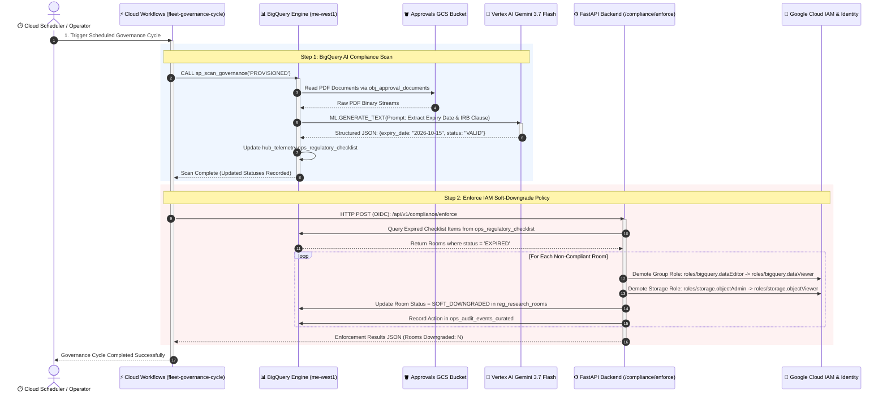
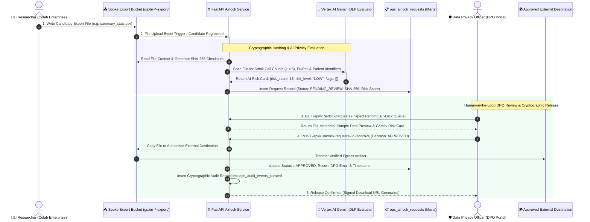
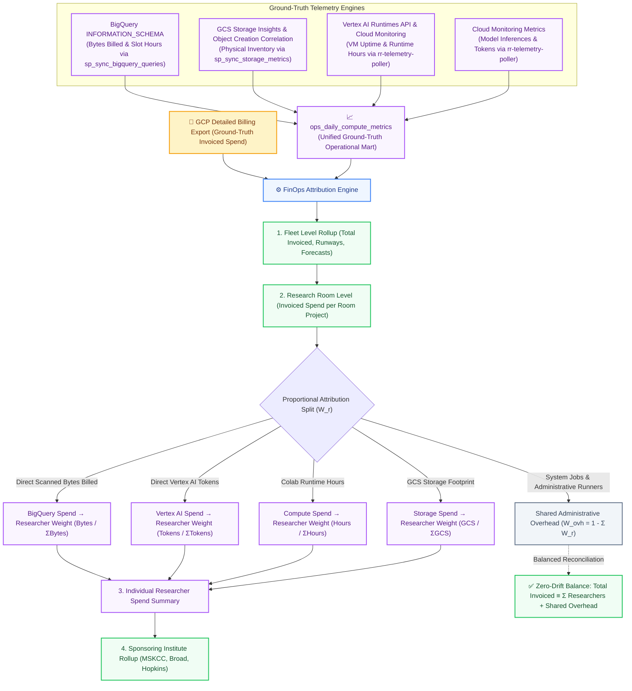
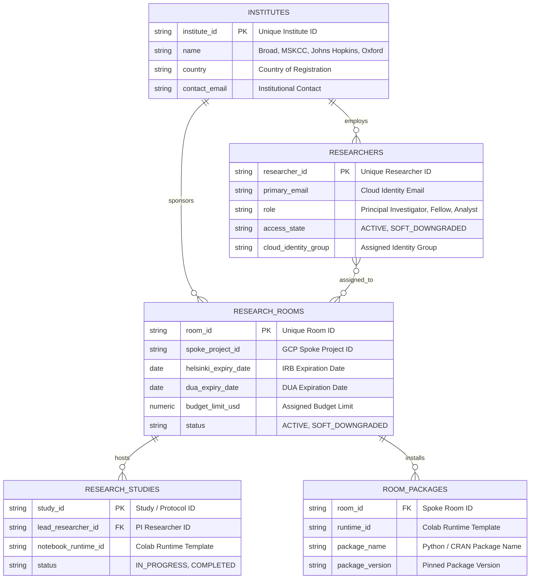

# GCP Health Data Platform — Technical Architecture & Visual Diagrams

This companion document provides detailed, high-contrast, multi-colored Mermaid diagrams illustrating the core technical workflows, networking boundaries, and automated pipelines of the **Google Cloud Multi-Tenant Trusted Research Environment (TRE)**.

---

## 1. Global Multi-Project System Topology & VPC-SC Security Perimeter

```mermaid
flowchart TD
    %% Global Styling
    classDef billingClass fill:#fef3c7,stroke:#f59e0b,stroke-width:2px,color:#78350f;
    classDef hubClass fill:#eff6ff,stroke:#3b82f6,stroke-width:2px,color:#1e3a8a;
    classDef vpcClass fill:#fee2e2,stroke:#ef4444,stroke-width:2px,stroke-dasharray: 5 5,color:#7f1d1d;
    classDef spokeClass fill:#f0fdf4,stroke:#22c55e,stroke-width:2px,color:#14532d;
    classDef aiClass fill:#faf5ff,stroke:#a855f7,stroke-width:2px,color:#581c87;
    classDef dbClass fill:#f8fafc,stroke:#64748b,stroke-width:1.5px,color:#0f172a;

    subgraph BillingSink["🏢 Google Cloud Billing Export Sink Project"]
        BillingTable[("📊 Partitioned GCP Billing Export Table<br/>• SKU IDs, List Prices, Negotiated Discounts<br/>• Invoiced Dollars Ground Truth")]:::billingClass
    end

    subgraph HubProject["🏢 Central Governance Hub Project (gcp-rr-hub-core)"]
        direction TB
        
        subgraph ServingPlane["Cloud Run Serving Plane (me-west1)"]
            FrontendSPA["🖥️ Central Admin Portal (Nginx SPA / Tailwind CSS)<br/>• Role Dashboards: Ops Admin, Cloud Engineer, DPO"]:::hubClass
            BackendAPI["⚙️ Governance REST API (FastAPI / Python 3.10)<br/>• Modules: /rooms, /finops, /telemetry, /airlock"]:::hubClass
        end

        subgraph AutomationPlane["Automated Governance & Telemetry Engines"]
            CloudWorkflow["⚡ Cloud Workflow: fleet-governance-cycle<br/>• Step 1: BigQuery AI Scan (sp_scan_governance)<br/>• Step 2: Cloud Run IAM Demotion (/compliance/enforce)"]:::hubClass
            DTS_Scheduler["⏰ BigQuery DTS Scheduled Queries (me-west1)<br/>• 15-min Operational Sync (sp_sync_curated_audit_events, sp_sync_bigquery_queries)<br/>• 24-hr Daily Storage & Rollup (sp_sync_storage_metrics, sp_aggregate_daily_compute_metrics, sp_rollup_monthly_usage)"]:::hubClass
            TelemetryPoller["🤖 Cloud Run Job: rr-telemetry-poller<br/>• Triggered every 15 min via Cloud Scheduler (rr-telemetry-poller-15m)<br/>• Polls Vertex AI Runtime API (locations/me-west1/notebookRuntimes)<br/>• Polls Cloud Monitoring API (GCE VM uptime & Vertex AI API calls)"]:::hubClass
        end

        subgraph HubDataLayer["BigQuery Central Data, AI & Registry Layer (me-west1)"]
            HubRegistry[("📁 Dataset: hub_registry<br/>• reg_institutes, reg_researchers, reg_research_rooms")]:::dbClass
            HubTelemetry[("📈 Dataset: hub_telemetry<br/>• ops_audit_events_curated, ops_notebook_sessions<br/>• ops_daily_compute_metrics, ops_monthly_usage_rollup")]:::dbClass
            BillingView[("👁️ Authorized View: view_billing_export")]:::billingClass
            GeminiRemote["🤖 BQ ML Remote Model: gemini_flash_model<br/>• Binds BigQuery SQL to Vertex AI Gemini 3.7 Flash"]:::aiClass
            ApprovalDocObj[("📑 Object Table: obj_approval_documents<br/>• Metadata index over unstructured PDF agreements")]:::dbClass
            SharedClinical[("🏥 Analytics Hub Data Exchanges<br/>• hub_shared_clinical & hub_shared_reference")]:::dbClass
        end

        HubApprovalsBucket[("🪣 Central Approvals GCS Bucket<br/>gs://gcp-rr-hub-approvals")]:::dbClass
        LogSinkRouter["📡 Central Cloud Logging Log Sink Router"]:::hubClass
    end

    subgraph VPCSC["🔒 VPC Service Controls Security Perimeter"]
        RestrictedAPIs["RESTRICTED SERVICES:<br/>• bigquery.googleapis.com<br/>• storage.googleapis.com<br/>• aiplatform.googleapis.com<br/>• logging.googleapis.com"]:::vpcClass
    end

    subgraph SpokeRooms["🔬 Tenant Spoke Research Rooms (gcp-rr-spoke-*)"]
        direction TB

        subgraph SpokeOncology["🔬 Spoke Room: rr-oncology-01"]
            VPC_Onco["Private VPC Subnet (10.10.1.0/24)<br/>• disable_public_ip = true | Cloud NAT"]:::spokeClass
            Colab_Onco["📓 Colab Enterprise (tpl-onco-default)<br/>• Shielded VM e2-standard-4"]:::spokeClass
            BQ_Onco[("Local Dataset & Linked Cohort")]:::dbClass
            GCS_In_1[("📥 Inbound Bucket (Read-Only)")]:::spokeClass
            GCS_Out_1[("📤 Export Bucket (Quarantine)")]:::spokeClass
        end

        subgraph SpokeGenomics["🧬 Spoke Room: rr-genomics-02"]
            VPC_Genom["Private VPC Subnet (10.10.2.0/24)<br/>• disable_public_ip = true | Cloud NAT"]:::spokeClass
            Colab_Genom["📓 Colab Enterprise (tpl-genom-default)<br/>• Shielded VM n2-highmem-8"]:::spokeClass
            BQ_Genom[("Local Dataset & Linked Panel")]:::dbClass
            GCS_In_2[("📥 Inbound Bucket (Read-Only)")]:::spokeClass
            GCS_Out_2[("📤 Export Bucket (Quarantine)")]:::spokeClass
        end
    end

    %% Flow Connections
    FrontendSPA --> BackendAPI
    BackendAPI --> HubDataLayer
    CloudWorkflow --> HubDataLayer & BackendAPI
    DTS_Scheduler --> HubTelemetry
    BillingTable --> BillingView --> HubTelemetry
    HubApprovalsBucket --> ApprovalDocObj --> GeminiRemote

    SharedClinical -.->|Linked Subscriptions| BQ_Onco & BQ_Genom
    HubProject <==> VPCSC <==> SpokeRooms
    SpokeRooms -->|Real-Time Audit Stream| LogSinkRouter --> HubTelemetry
```

---

## 2. Step-by-Step AI Compliance & IAM Soft-Downgrade Workflow

---

## 3. Step-by-Step Air-Lock Egress Review & Cryptographic Release Flow

---

## 4. Two-Tiered FinOps Proportional Attribution Flow

---

## 5. Entity Data Model & Relational Schema

