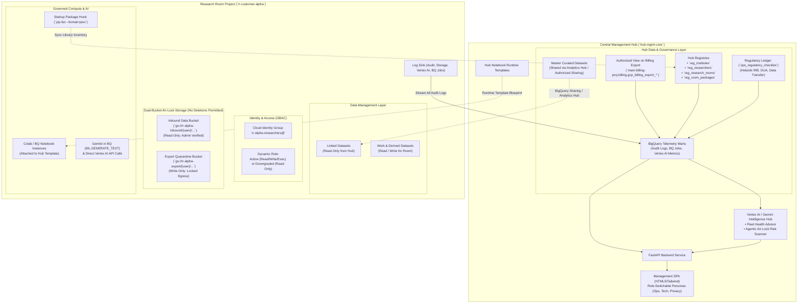
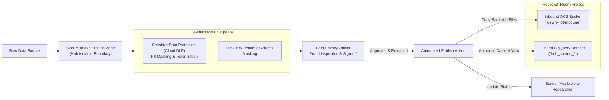
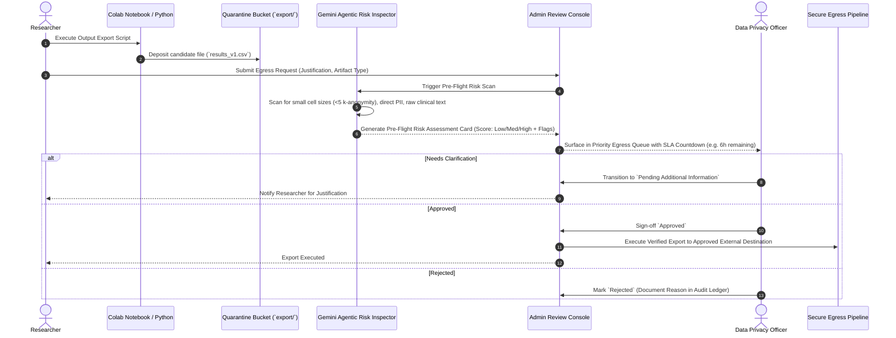

# Enterprise Architectural Standards & Workspace Rules
## GCP Multi-Tenant Research Environment Management & Monitoring Platform

**Document Version:** 2.0.0 (Customer Specification Reconciled)  
**Role:** Lead Solutions Architect  
**Architecture Pattern:** Hub-and-Spoke Isolated Trusted Research Environments (TRE) with Air-Lock Governance  

---

## 1. Executive Summary & Solution Context

This architecture establishes a scalable, secure, and multi-tenant governance, management, and observability platform on Google Cloud Platform (GCP). It enables centralized administrators to deploy, govern, monitor, and attribute costs across isolated **Customer Research Environments ("Research Rooms")** using BigQuery, Colab Enterprise / Vertex AI Notebooks, Google Cloud Storage (GCS), and Vertex AI / Gemini.



---

## 2. Reconciled Security, Governance & Regulatory Controls

### 2.1 Regulatory Gating & Soft-Policy Downgrade (Helsinki IRB / DUA)
* **Mandatory Checklist Items Tracked:**
  1. **Research Protocol:** Valid approved scientific protocol + proof attachment.
  2. **Helsinki (IRB) Ethics Approval:** Validity & expiration date + official approval certificate.
  3. **Data Transfer Committee Approval:** Statutory authority transfer approval.
  4. **Data Extraction Protocol:** Formal extraction query and dataset schema.
  5. **Data Use Agreement (DUA):** Executed legal terms and non-disclosure commitments.
* **Automated Compliance Check:** A daily backend task scans expiration dates in `ops_regulatory_checklist`.
* **Soft-Policy Downgrade on Lapse:** If any prerequisite expires:
  1. Room lifecycle status updates to `BLOCKED / COMPLIANCE_HOLD`.
  2. Write & Compute privileges (Colab runtime execution, BigQuery query creation, GCS writes) are **automatically revoked**.
  3. **Read-Only access is retained** for existing notebooks and audit logs, ensuring forensic continuity without violating data safety.

---

### 2.2 Data Pipeline & De-identification Staging Gate (Privacy & Compliance Officer)



1. **Pipeline Lifecycle Stages:** `Data Received` $\rightarrow$ `In Processing` $\rightarrow$ `De-identified (Anonymized)` $\rightarrow$ `Available to Researcher` $\rightarrow$ `Removed`.
2. **Access Lockdown:** Researchers have **zero access** to the room's data assets while in stages 1–3.
3. **Approval Gate:** The Data Privacy Officer clicks **"Approve & Release Sanitized Data"**, which automatically transfers sanitized files to `gs://rr-[id]-inbound/`, provisions the Linked BigQuery Dataset, and unlocks researcher access.

---

### 2.3 Air-Gapped Egress Review Lifecycle & AI Risk Inspector



* **5-Stage State Machine:** `Submitted` $\rightarrow$ `In Review` $\rightarrow$ `Pending Additional Information` $\rightarrow$ `Approved` / `Rejected` $\rightarrow$ `Export Executed`.
* **Dynamic SLA Tracking:** Real-time countdown timers on each request with priority badges (e.g. 7 high-priority requests).
* **Gemini Agentic Risk Inspector:** Automatically scans candidate files in the quarantine bucket for small cell sizes (potential re-identification on rare patient cohorts) or sensitive tokens, surfacing an automated risk score to assist the human reviewer.
* **Strict Air-Gap:** Direct download by researchers is permanently blocked by IAM and VPC Service Controls.

---

### 2.4 Analytical Package & Library Version Auditing

* **Internal Artifact Registry Mirror:** In air-gapped enclaves without public internet access, pre-approved Python wheels and analytical packages are pre-installed in Hub Runtime Templates or mirrored in Google Cloud Artifact Registry.
* **Startup Hook Inventory Sync:** When a runtime initializes, a background startup hook executes `pip list --format=json` and syncs the exact package inventory with `hub_registry.reg_room_packages`.
* **Auditing:** Administrators can inspect the exact version of every library installed in any active or historical research room.

---

## 3. Financial Attribution: Single Source of Truth & Proportional Allocation

### 3.1 The Single Source of Truth Principle
The exact GCP Monthly Invoice from the **Cloud Billing Export** is apportioned across Users and Shared/Admin overhead using **Usage Proportions (Weights)** derived from native telemetry:

$$\boxed{\text{User Cost for SKU } S = \text{Invoice Dollar Cost for SKU } S \times \left( \frac{\text{User's Metric Quantity for SKU } S}{\text{Total Project Metric Quantity for SKU } S} \right)}$$

$$\boxed{\text{Shared / Admin Cost for SKU } S = \text{Invoice Dollar Cost for SKU } S \times \left( \frac{\text{Admin Metric Quantity for SKU } S}{\text{Total Project Metric Quantity for SKU } S} \right)}$$

$$\sum \text{User Costs} + \text{Shared Admin Cost} = \mathbf{100\% \text{ of Project Invoice for SKU } S}$$

---

### 3.2 Service & SKU Attribution Matrix

| Service | Specific Billing SKU Example | Usage Metric Used for Weight | Telemetry Source | Direct vs Shared Overhead |
| :--- | :--- | :--- | :--- | :--- |
| **BigQuery SQL** | `Analysis` (On-Demand) or `Slots` (Capacity) | **Bytes Billed / Scanned** or **Slot ms** | Spoke `INFORMATION_SCHEMA.JOBS_BY_PROJECT` (via `sp_sync_bigquery_queries`) | • **User:** Ad-hoc queries by `user_email`<br/>• **Shared:** System setup & baseline datasets. |
| **Colab Enterprise** | `Custom VM / GPU Runtime Uptime` | **Active Running Hours** of runtime session | Vertex AI Runtimes API + Cloud Monitoring VM Uptime (via Cloud Run `rr-telemetry-poller`) | • **User:** Sessions started by researcher (`runtimeUser`).<br/>• **Shared:** Base template warm-ups & admin tests. |
| **GCS Storage** | `Standard Storage` (GB/Month) | **Active Stored Volume (Bytes)** in export bucket | GCS Storage Insights physical inventory export correlated with `storage.objects.create` (via `sp_sync_storage_metrics`) | • **User:** Output files created by researcher.<br/>• **Shared:** Inbound verified bucket + admin files. |
| **Vertex AI / Gemini** | `Generative AI Input/Output Tokens` | **Inference Calls & Estimated Tokens** | Cloud Monitoring API `serviceruntime.googleapis.com/api/request_count` (via Cloud Run `rr-telemetry-poller`) | • **User:** Prompts/models run by researcher.<br/>• **Shared:** Admin evaluation & baseline tests. |
| **Cloud Logging** | `Log Volume / Streaming Sinks` | **100% Shared / Admin** | Billing Export line items | **100% Shared Platform Overhead**. |
| **Cloud Audit Logs** | `Audit Trail & Governance` | **Audit Events Only** | Log Router Sinks to BigQuery (via `sp_sync_curated_audit_events`) | **Audit Trail / Compliance Only** (not used for compute/query/AI metrics). |

---

## 4. Hub Operational Registry & Directory Schemas

### `hub_registry.reg_institutes`
```sql
CREATE TABLE `hub_registry.reg_institutes` (
    institute_id STRING NOT NULL,          -- e.g. 'hosp_a', 'weizmann', 'technion'
    institute_name STRING NOT NULL,        -- 'Medical Center A'
    country STRING DEFAULT 'Israel',
    primary_contact_name STRING,
    primary_contact_email STRING,
    billing_reference_code STRING,
    created_at TIMESTAMP DEFAULT CURRENT_TIMESTAMP()
);
```

### `hub_registry.reg_researchers`
```sql
CREATE TABLE `hub_registry.reg_researchers` (
    user_email STRING NOT NULL,            -- Primary Key (matches Cloud Identity email)
    researcher_id STRING NOT NULL,         -- e.g. 'res-1021'
    full_name STRING NOT NULL,             -- 'Dr. A. Cohen'
    academic_title STRING,                 -- 'Lead Clinical Investigator'
    phone_number STRING,                   -- '+972-50-1234567'
    institute_id STRING NOT NULL,          -- Foreign Key -> reg_institutes.institute_id
    department STRING,                     -- 'Endocrinology'
    is_active BOOLEAN DEFAULT TRUE,
    created_at TIMESTAMP DEFAULT CURRENT_TIMESTAMP()
);
```

### `hub_registry.reg_research_rooms`
```sql
CREATE TABLE `hub_registry.reg_research_rooms` (
    research_id STRING NOT NULL,           -- e.g. 'RM-1021'
    project_id STRING NOT NULL,            -- e.g. 'rr-diabetes-metrics-1021'
    room_display_name STRING NOT NULL,     -- 'Diabetes Metrics Research'
    customer_name STRING NOT NULL,         -- 'Health Data Platform'
    institute_id STRING NOT NULL,
    lead_researcher_email STRING,
    room_status STRING DEFAULT 'Active',   -- 'Active', 'Provisioning', 'Suspended', 'Closed', 'Blocked'
    data_pipeline_status STRING,           -- 'Data Received', 'In Processing', 'De-identified', 'Available to Researcher'
    tables_count INT64 DEFAULT 0,
    inbound_bucket_name STRING,
    export_bucket_name STRING,
    monthly_budget_ils NUMERIC,
    created_at TIMESTAMP DEFAULT CURRENT_TIMESTAMP()
);
```

### `hub_registry.reg_room_packages`
```sql
CREATE TABLE `hub_registry.reg_room_packages` (
    research_id STRING NOT NULL,
    runtime_id STRING NOT NULL,
    package_name STRING NOT NULL,          -- e.g. 'pandas', 'scikit-learn', 'torch'
    package_version STRING NOT NULL,       -- e.g. '2.2.1', '1.4.2', '2.2.0+cu121'
    installed_at TIMESTAMP DEFAULT CURRENT_TIMESTAMP()
);
```

### `hub_telemetry.ops_regulatory_checklist`
```sql
CREATE TABLE `hub_telemetry.ops_regulatory_checklist` (
    item_id STRING NOT NULL,
    research_id STRING NOT NULL,
    item_type STRING NOT NULL,             -- 'Protocol', 'Helsinki_IRB', 'Data_Transfer', 'DUA', 'Extraction_Protocol'
    item_name STRING NOT NULL,
    status STRING NOT NULL,                -- 'Approved', 'Pending', 'Expired', 'Missing'
    approval_date DATE,
    expiration_date DATE,
    approver_name STRING,
    document_uri STRING,
    comments STRING,
    last_updated TIMESTAMP DEFAULT CURRENT_TIMESTAMP()
);
```

---

## 5. Management Portal UI Architecture & Multi-Persona Navigation

### 5.1 Technology Stack & Deployment Topology
* **Frontend:** Single Page Application (SPA) built with Semantic HTML5, Tailwind CSS, ES6 Modules, Chart.js.
* **Backend:** Python FastAPI microservice utilizing `google-cloud-bigquery`, `google-cloud-storage`, and BigQuery ML Gemini remote models.
* **Deployment Topology & Architectural Recommendation:**
  > [!NOTE] Architectural Recommendation: Separate Services for Production Microservices
  > - **Production Microservices Recommendation:** In a decoupled enterprise production topology, we **recommend separate services**:
  >   1. **Frontend Service (`gcp-rr-hub-frontend`):** Static web tier hosted on Google Cloud Storage + Cloud CDN, Firebase Hosting, or dedicated Cloud Run Nginx container.
  >   2. **Backend Service (`gcp-rr-hub-backend`):** Dedicated FastAPI Cloud Run service behind Cloud Load Balancing / API Gateway with Google Identity-Aware Proxy (IAP).
  > - **Current Phase Operational Topology (Unified Cloud Run):** For the current operational and prototype phase, the application is deployed as a **unified single Cloud Run service** where FastAPI mounts and serves the static frontend assets at `/` alongside the API routers at `/api/v1/*`. This eliminates cross-origin CORS overhead and simplifies continuous deployment.

### 5.2 Role-Switchable Persona Navigation in UI
The top bar features an interactive **Persona Selector** allowing administrators to dynamically switch operational perspectives:
1. **Central Operations Admin:** Focuses on Fleet KPIs, Onboarding Rooms & Researchers, Tracking Helsinki/DUA Expiration Horizons, and Generating Executive Reports.
2. **Technical Cloud Administrator:** Focuses on Dual-Bucket Storage Inventories, Colab Runtime Templates, BigQuery Datasets, and System Audit Logs.
3. **Privacy & Egress Reviewer:** Focuses directly on Inbound De-identification Staging Gates and the Air-Lock Egress Queue with Agentic Pre-Flight Risk Cards.

---

## 6. Code Generality, Parameterization & Sanitization Standards

1. **Zero Hardcoded Identifiers:** All project IDs, dataset names, and domains are dynamically injected via environment variables (`app/core/config.py`).
2. **Sanitized Generic Placeholders:** All code, examples, documentation, and mock data use sanitized, generic placeholders (`hub-mgmt-demo`, `rr-customer-alpha`, `user@example.edu`, `hospital_a`, `medical_center_b`).
3. **Horizontal Scalability:** The backend dynamically discovers active research rooms from `reg_research_rooms`. Adding 100 new rooms requires zero code alterations.

---

## 7. Workspace Standards & Implementation Roadmap

```text
demo-gcp-research-hub/
├── backend/
│   ├── app/
│   │   ├── main.py              # FastAPI server
│   │   ├── core/
│   │   │   └── config.py        # Central Pydantic BaseSettings (100% Parameterized)
│   │   ├── api/                 # Endpoints: /rooms, /telemetry, /costs, /airlock, /ai-advisor
│   │   ├── services/            # BigQuery, Monitoring, Gemini, IAM, Storage
│   │   └── models/              # Pydantic data schemas
│   ├── requirements.txt
│   └── Dockerfile
├── frontend/
│   ├── index.html               # Modern Light SPA Entrypoint (Bilingual LTR/RTL)
│   ├── css/style.css            # Clean Tailwind / Custom styling
│   └── js/app.js                # State management, Live gauges, Charts, AI Stream
├── terraform/
│   ├── hub/                     # Hub Datasets, Registry, Templates, Views, Sinks
│   └── modules/room/            # Spoke Room Module (Dual Buckets, Datasets, IAM, Sinks)
└── docs/
    └── ARCHITECTURE.md          # Architectural Blueprint
```
