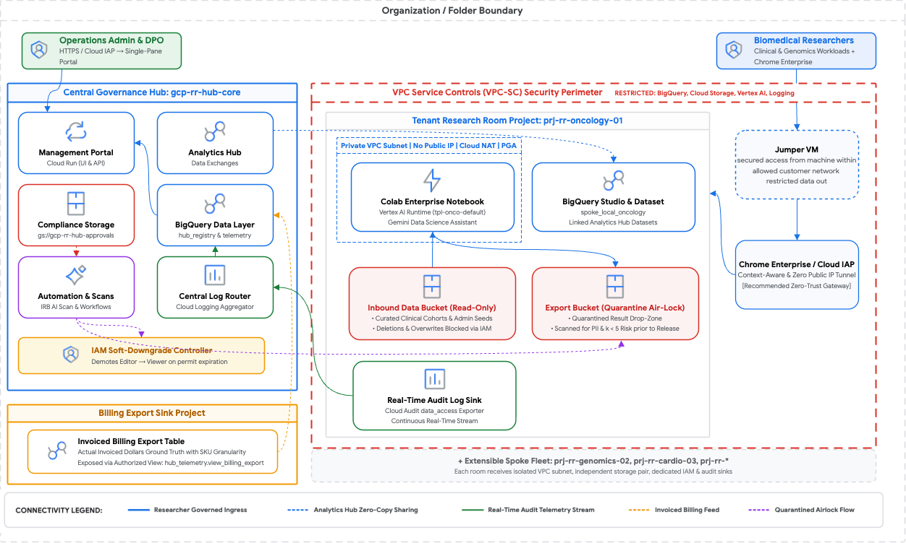
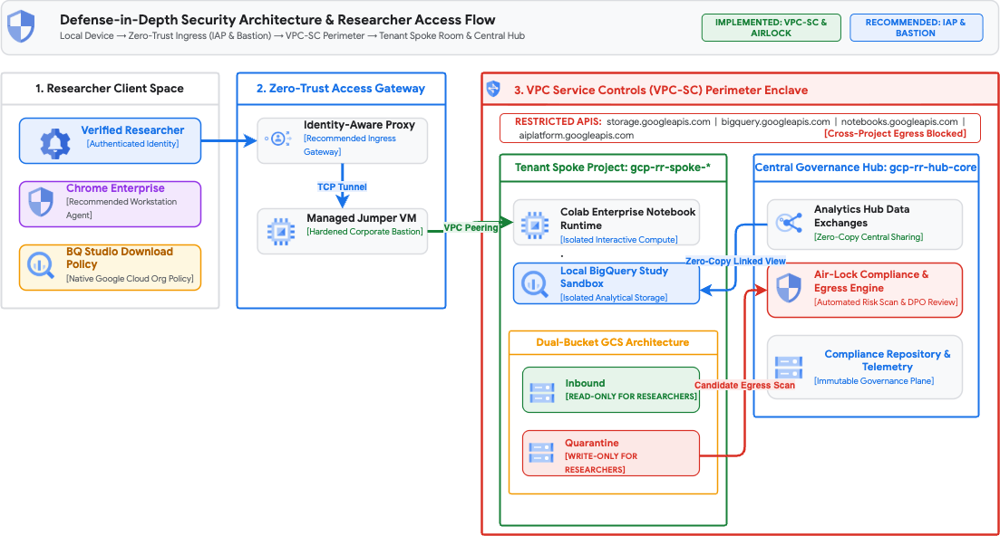
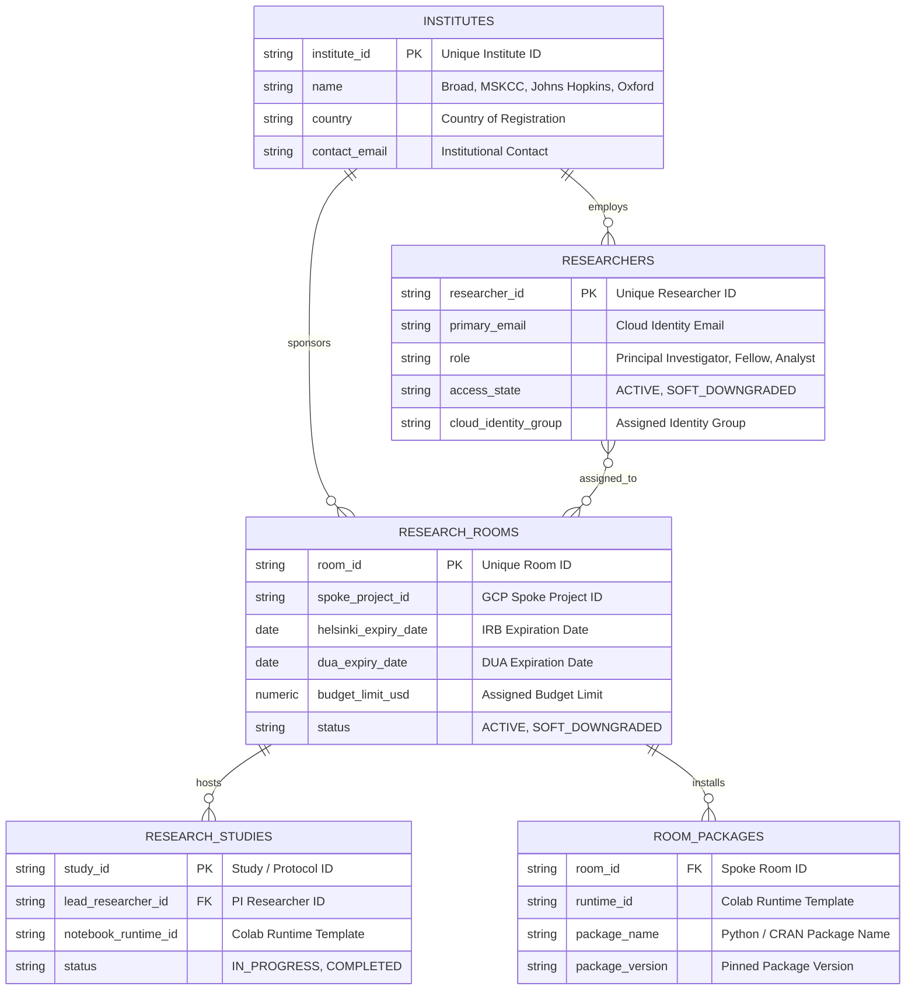
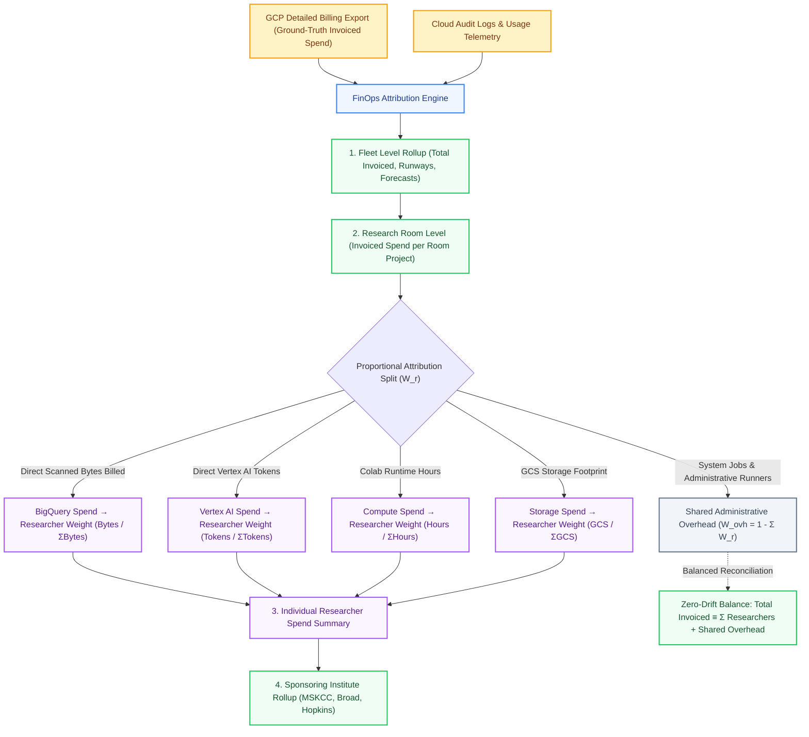
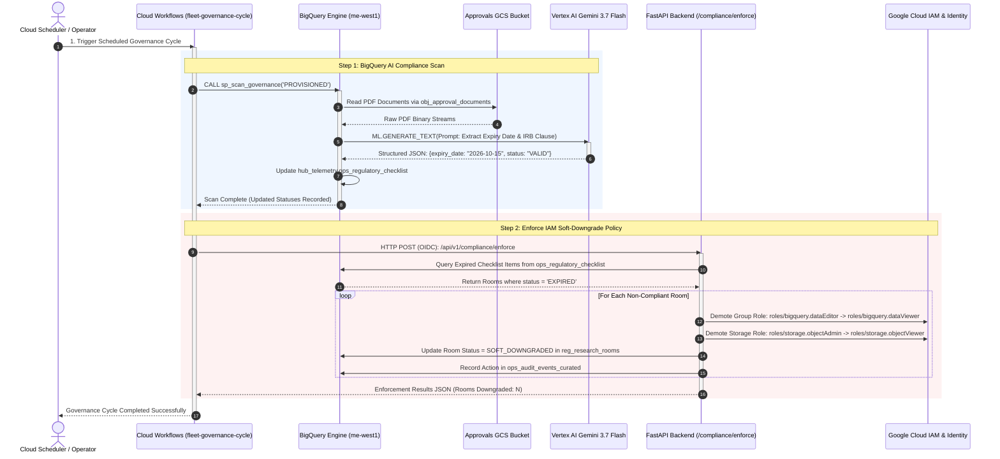
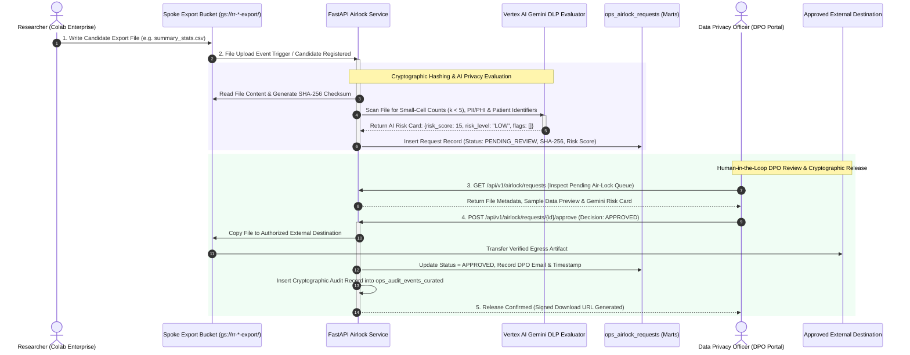

# System Architecture & Technical Specification

**GCP Multi-Tenant Trusted Research Environment (TRE) & Research Room Governance Platform**  
*Master Technical Manual & Reference Architecture*  
*Document Version:* `4.3.0`

---

## 1. Project Goal, Core Capabilities & Platform Value

### 1.1 Goal & Primary Objective
The goal of this platform is to provide a centralized administrative control plane to deploy, govern, monitor, and financially manage isolated research environments ("Research Rooms") on Google Cloud.

There is high demand for such solutions across public sector entities and regulated environments, including health authorities, government ministries, higher education and research consortia, and financial institutions.

The primary objective of a **Trusted Research Environment (TRE)**—often referred to as a **Secure Data Environment (SDE)**—is to enable authorized researchers to conduct analysis on sensitive, regulated datasets (such as clinical cohorts, EHR records, genomics, and government registries) while ensuring that data remains strictly under custodian control and within defined organizational boundaries.

#### Alignment with the "Five Safes" Framework
To achieve this objective in an understandable and auditable manner, the platform aligns with the internationally recognized **Five Safes** principles:
* **Safe People**: Ensuring only verified, authorized researchers gain access through Cloud Identity groups, multi-factor authentication, and Context-Aware Access.
* **Safe Projects**: Ensuring data use is restricted to approved scientific protocols, with automated monitoring of Institutional Review Board (IRB) ethics approvals and Data Use Agreements (DUAs).
* **Safe Settings**: Providing a secure analytical perimeter (VPC Service Controls, private subnets without public IPs, and Identity-Aware Proxy) that prevents unauthorized data exfiltration.
* **Safe Data**: Ensuring datasets are protected through automated column-level policy tagging, dynamic masking, and zero-copy data sharing.
* **Safe Outputs**: Screening analytical results, aggregate tables, and models through an automated privacy airlock ($k < 5$ small-cell count detection) before digital release by a Data Protection Officer (DPO).

---

### 1.2 Required TRE Capabilities & Native GCP Building Blocks
A complete research environment requires several foundational analytical capabilities. Google Cloud provides powerful, native building blocks to support each:

1. **Zero-Copy Data Sharing**:
   * *Requirement*: Sharing large-scale curated datasets across distinct projects without duplicating physical storage or incurring synchronization overhead.
   * *Native GCP Building Blocks*: [BigQuery Analytics Hub](https://cloud.google.com/bigquery/docs/analytics-hub-introduction) for publishing and subscribing to data exchanges, and [BigQuery Data Clean Rooms](https://cloud.google.com/bigquery/docs/data-clean-rooms) for privacy-preserving, multi-party SQL analysis without raw data exchange.
2. **Collaborative Compute & Data Science Tooling**:
   * *Requirement*: Providing researchers with standard programming environments (Python, R, SQL) and reproducible runtimes inside private network boundaries, augmented by conversational AI.
   * *Native GCP Building Blocks*: [BigQuery Studio Notebooks powered by Colab](https://cloud.google.com/bigquery/docs/create-notebooks-bigquery-studio), [Colab Enterprise](https://cloud.google.com/colab/docs/introduction), and [Vertex AI Workbench](https://cloud.google.com/vertex-ai/docs/workbench/introduction), delivering managed, secure Jupyter notebook instances. These runtimes integrate **Gemini-powered Data Science Agent capabilities** that actively assist researchers with natural language SQL/Python generation, automated exploratory data analysis (EDA), multi-step statistical workflow synthesis, intelligent chart plotting, and in-line code troubleshooting directly within the workspace.
3. **Scalable In-Database Analytics & AI/ML**:
   * *Requirement*: Running high-throughput queries, multimodal analysis, and machine learning models directly within the data warehouse to eliminate external compute transfers.
   * *Native GCP Building Blocks*: [BigQuery](https://cloud.google.com/bigquery/docs/introduction) provides serverless, petabyte-scale SQL analytics, real-time transformations, and multimodal analysis over structured tables and unstructured assets (PDF clinical reports, medical images, audio) using BigLake object tables. Native integration with Vertex AI brings [BigQuery AI functions](https://cloud.google.com/bigquery/docs/generate-text) (such as `ML.GENERATE_TEXT` and vector embeddings with Gemini) directly into SQL queries. Furthermore, [BigQuery ML (BQML)](https://cloud.google.com/bigquery/docs/bqml-introduction) allows researchers to train and evaluate statistical and machine learning models (classification, regression, clustering, time-series forecasting) or deploy imported custom TensorFlow, XGBoost, and ONNX models directly inside the warehouse.
4. **Perimeter Isolation & Exfiltration Prevention**:
   * *Requirement*: Enforcing a cryptographic boundary around cloud storage and APIs so data cannot be moved outside authorized projects, while enforcing zero-trust user and device posture policies.
   * *Native GCP Building Blocks*: [VPC Service Controls (VPC-SC)](https://cloud.google.com/vpc-service-controls/docs/overview) to define security perimeters, [BeyondCorp Enterprise](https://cloud.google.com/beyondcorp-enterprise/docs/overview) with [Context-Aware Access](https://cloud.google.com/access-context-manager/docs/overview) and [Identity-Aware Proxy (IAP)](https://cloud.google.com/iap/docs/concepts-overview) for device-verified, zero-trust researcher ingress without open public ports, [Private Google Access](https://cloud.google.com/vpc/docs/private-google-access) for private Google API routing, and [Cloud Storage (GCS)](https://cloud.google.com/storage/docs) for encrypted object storage.

---

### 1.3 Blueprints and the Operational Challenge
Google Cloud offers multiple reference architectures and automated blueprints to help implement these building blocks securely (such as the *Secure Data Warehouse Blueprint*, the *Vertex AI Workbench Perimeter Blueprint*, and reference patterns for [secure, scalable research environments on Google Cloud](https://cloud.google.com/blog/topics/public-sector/secure-scalable-discoverable-research-environment-simplified-chargeback?e=48754805)).

However, operating a multi-tenant research environment in practice requires additional operational controls:
* **Centralized Governance & Fleet Orchestration**: Managing lifecycle states across multiple independent research workspaces.
* **Continuous Compliance & Policy Enforcement**: Tracking IRB permits and DUAs and automatically restricting access when permits lapse.
* **Automated Data Protection & Egress Control**: Inspecting egress files for PII and small cohort disclosure before export.
* **Multi-Tenant Cost Attribution (FinOps)**: Reconciling complex cloud billing exports down to specific research rooms and individual researchers.

While Google Cloud provides comprehensive infrastructure services to support these requirements—such as [Sensitive Data Protection / Cloud DLP](https://cloud.google.com/sensitive-data-protection/docs), [Cloud Logging](https://cloud.google.com/logging/docs), [Cloud Monitoring](https://cloud.google.com/monitoring/docs), [Cloud Billing Exports](https://cloud.google.com/billing/docs/how-to/export-data-bigquery), and [IAM](https://cloud.google.com/iam/docs)—**these are general-purpose cloud infrastructure services rather than a domain-specific research operations platform**. From the perspective of a Research Operations Administrator, Data Custodian, or Data Protection Officer, there is no out-of-the-box research console. Navigating, configuring, and correlating these disparate cloud services requires deep cloud engineering expertise and custom integration scripts.

#### The Visibility & Management Gap
For example, if a healthcare authority, government agency, or university wants to answer essential operational questions:
* *Which research rooms are currently active, and what datasets are they accessing?*
* *Are all active research rooms compliant with current ethics approvals, or have any IRBs expired?*
* *What exact portion of the monthly cloud bill was derived by a specific researcher across BigQuery SQL queries, Colab notebook sessions, Vertex AI tokens, and storage?*

Answering these questions without a unified platform requires manually cross-referencing disparate log sinks, constructing ad-hoc SQL queries over raw billing exports, auditing IAM policies across multiple projects, and navigating separate administrative consoles.

---

### 1.4 The Purpose & Value of this Platform
This project provides a **kickstart reference platform that bridges these native GCP building blocks and blueprints into a unified TRE management solution**. 

By establishing a centralized control plane, the platform delivers:
* **Unified Hub-and-Spoke Management**: A single management hub (`gcp-rr-hub-core`) that orchestrates and monitors decentralized tenant research rooms (`gcp-rr-spoke-*`).
* **Automated AI Compliance & Soft-Downgrades**: Continuous scheduled verification of IRB and DUA documents using Gemini AI, with automatic IAM soft-downgrades (demoting write/compute permissions to read-only) upon approval expiration.
* **Governed Egress Air-Lock**: A dual-bucket quarantine workflow with automated small-cell ($k < 5$) and PII risk scoring, followed by DPO digital release.
* **Two-Tiered Proportional FinOps**: An automated attribution engine that maps invoiced Google Cloud Billing exports directly to individual researchers based on telemetry weights (scanned bytes, AI tokens, compute hours, storage footprint) with verified zero financial drift.
* **Lightweight Administrative UI**: A single-pane-of-glass management portal providing tailored views for Operations Administrators, Cloud Engineers, and Data Protection Officers.

---

## 2. Master Target Architecture & Global Topology

### 2.1 Master Target Architecture Diagram
The architecture organizes the Google Cloud environment into a **Hub-and-Spoke topology**. The Central Governance Hub manages fleet governance, compliance, and cost attribution across isolated Tenant Spoke Rooms protected inside a unified VPC Service Controls security perimeter.

---

### 2.2 Global Resource Spaces & Boundaries

1. **Central Governance Hub Project (`gcp-rr-hub-core`)**:
   * **Management Portal**: Cloud Run service hosting the unified web administration interface and governance API.
   * **Central Data & Sharing Layer**: BigQuery datasets for platform registries, curated telemetry, and zero-copy Analytics Hub data exchanges.
   * **Central Storage**: Dedicated Cloud Storage bucket for statutory agreements and compliance documentation.
   * **Central Log Router**: Aggregated Cloud Logging receiver collecting audit telemetry across all tenant rooms.

2. **Tenant Research Room Spoke Projects (`gcp-rr-spoke-*`)**:
   * **Private Network Subnet**: Dedicated VPC subnet (`10.10.x.0/24`) with `disable_public_ip = true`, Cloud NAT, and Private Google Access.
   * **Governed Compute**: Colab Enterprise / Vertex AI workbench environments with integrated Gemini Data Science Agent.
   * **In-Room Analytical Store**: Local BigQuery dataset combined with zero-copy linked subscriptions from the Hub.
   * **Dual Storage Buckets**: Inbound bucket (read-only curated source data) and Export bucket (quarantined drop-zone for results).
   * **Audit Log Sink**: Continuous real-time streaming of workspace audit events to the Hub.

3. **Billing Export Sink Project**:
   * Houses the central Google Cloud Billing Export table, queried securely from the Hub via an authorized view.

4. **Security Perimeter (VPC Service Controls)**:
   * Encloses the Hub data layer and all Spoke projects to restrict BigQuery, Cloud Storage, Vertex AI, and Logging APIs, preventing data exfiltration to unauthorized projects or the public internet.

---

### 2.3 User Personas & Data Flows

* **User Flows**:
  * **Operations & Privacy Administrators (DPO)** connect via HTTPS through Cloud Identity-Aware Proxy (IAP) to the Central Management Portal.
  * **Biomedical Researchers** connect via BeyondCorp Enterprise and IAP tunnels directly to their assigned notebook runtimes without public IPs.

* **Data & Telemetry Flows**:
  * **Inbound Data Flow**: Master cohorts and reference datasets are published via Analytics Hub in the Hub and linked read-only in tenant rooms.
  * **In-Room Analysis**: Researchers query data and run analytics in-place via BigQuery and Colab notebooks.
  * **Governed Outbound Egress**: Export artifacts are deposited in the quarantine bucket, evaluated by the airlock compliance scanner, reviewed by the DPO, and released upon approval.
  * **Telemetry & Billing Streams**: Workspace audit logs stream to the Hub for telemetry marts, while billing export data feeds the proportional cost attribution engine.

---

## 3. Tenant Workspaces, Security Perimeter & Workloads

### 3.1 Multi-Project Tenant Isolation
Each research study operates within a dedicated GCP Spoke Project (`gcp-rr-spoke-*`). This provides:
* **Hard Resource Isolation**: Compute instances, scratch storage, and ephemeral datasets are strictly segregated between studies.
* **Autonomous IAM Boundaries**: Permissions granted in one room do not carry over to another study.
* **Direct Cost Encapsulation**: Cloud resource usage is tagged with the project ID at the infrastructure layer, enabling precise FinOps attribution.

---

### 3.2 Roles & Personas Matrix

Platform access is organized around four core user personas with clear separation of duties and minimum required operational boundaries:

| Persona | Primary Focus & Domain | Key Responsibilities & Capabilities |
| :--- | :--- | :--- |
| **Researcher** | Spoke Research Rooms (`gcp-rr-spoke-*`) | • Executes interactive analytical queries and data science workloads in Colab Enterprise and BigQuery Studio. • Ingests and stages reference datasets from the Inbound GCS bucket into local study datasets. • Builds derived cohort tables, models, and analytical aggregates within the project's local BigQuery sandbox. • Queries shared institutional datasets via zero-copy Analytics Hub listings. • Stages candidate export artifacts (summary tables, model weights, figures) into the write-only quarantine bucket for egress evaluation. |
| **Operations Admin** | Central Hub (`gcp-rr-hub-core`) | • Provisions, configures, and manages the lifecycle of tenant research rooms and researcher accounts. • Monitors fleet-wide infrastructure health, runtime availability, and daily operational telemetry. • Triggers and inspects automated governance and data-sync cycles (Cloud Workflows, scheduled queries). • Analyzes cost allocations, budget consumption, and proportional FinOps attribution across spoke projects. |
| **Data Protection Officer (DPO)** | Central Hub & Compliance Management | • Monitors institutional ethics approvals, data sharing agreements (DSA), IRB/Helsinki certifications, and document expiration statuses. • Executes on-demand manual compliance scans and AI risk assessments over agreement documents and study configurations. • Dynamically downgrades room access levels (e.g., enforcing soft-downgrade / read-only status) upon compliance anomalies or agreement expirations. • Inspects quarantined egress candidates, reviews AI/DLP privacy scan cards, and formally approves or rejects cryptographic export release. |
| **Data Engineer** | Central Hub & Data Exchanges | • Designs, builds, and maintains central master clinical and reference data pipelines. • Publishes curated institutional data exchanges via BigQuery Analytics Hub listings for zero-copy spoke room subscription. • Manages schema evolutions, ELT pipeline transformations, and data quality standards across platform datasets. |

---

### 3.3 Security Architecture & VPC-SC Perimeter

#### Defense-in-Depth Architecture & Researcher Access Flow

*Zoom-in on platform security controls and the complete researcher protection lifecycle: Local Client Device with Chrome Enterprise → Zero-Trust Ingress (IAP & Jumper VM) → VPC Service Controls (VPC-SC) Boundary → Isolated Spoke Research Room Enclave & Central Hub.*

#### Core Security Components & Defense-in-Depth Guidelines

* **Verified Researcher Persona & Authentication**:
  All platform access requires authenticated Google Cloud Identity accounts mapped to least-privilege spoke IAM roles. Anonymous or public access is blocked by default across all platform APIs and consoles.
* **Context-Aware Access (CAA) & Managed Devices `[Recommended to add]`**:
  Layering **Context-Aware Access (CAA)** via BeyondCorp / Cloud Identity Premium ensures access is restricted exclusively to corporate-managed, encrypted devices on approved IP ranges, blocking logins from personal or unmanaged endpoints even with valid credentials.
* **VPC Service Controls (VPC-SC) Perimeter & Multi-Tenant IAM Boundary**:
  * **API Perimeter Enforcement**: Enforces a strict boundary across both the Central Hub and all Spoke projects for sensitive Google APIs (`bigquery.googleapis.com`, `storage.googleapis.com`, `aiplatform.googleapis.com`, `notebooks.googleapis.com`). Unmanaged transfers, cross-perimeter exports, or copying data to external/unauthorized Google Cloud projects are strictly blocked at the API layer.
  * **Shared Perimeter & Spoke Isolation**: While spokes share the perimeter, IAM remains strictly scoped per project. Tenants in Spoke A have no IAM permissions in Spoke B, preventing any cross-tenant data access.
  * **Frictionless Hub Operations**: Placing the Central Hub and Spokes in the same perimeter enables Hub service accounts (e.g., Air-Lock scanner, Cloud Workflows) to run compliance evaluations and lifecycle operations across spokes without perimeter boundary friction.
* **Dual-Bucket Storage Architecture**:
  * **Inbound Bucket (`gs://rr-*-inbound`)**: Provisioned as read-only for researchers. Contains approved reference data, raw genomic/clinical sequences, and permitted scripts.
  * **Export Quarantine Bucket (`gs://rr-*-export`)**: Write-only staging area where researchers place candidate files (model weights, summary charts, aggregated tables). Files remain strictly locked inside the perimeter until evaluated and cleared by the Air-Lock service and signed off by the DPO.
* **Restricting BigQuery Query Result Downloads**:
  In BigQuery Studio, users can typically query data and download results locally. To prevent unauthorized mass exports at the console layer, Google Cloud BigQuery supports disabling query result downloads (see [Restricting Downloading Query Results](https://docs.cloud.google.com/bigquery/docs/export-file#restrict_downloading_query_results)). This option can be enforced organization-wide so researchers can only explore data within the managed BigQuery environment and cannot bypass storage quarantine via direct browser file downloads.
* **Device-Side Protection with Chrome Enterprise Core / Premium `[Recommended to add]`**:
  While VPC Service Controls prevents network-level and API-level data exfiltration between cloud projects and to external storage endpoints, it does not inspect or restrict client-side interactions on the researcher's local device (such as copying data to clipboard, print-screen, taking screenshots, or browser cut/paste). Enforcing **Chrome Enterprise** on approved researcher workstations closes this gap by disabling clipboard transfers, disallowing file downloads to local disks, enforcing watermark overlays, and restricting URL navigation exclusively to approved TRE console endpoints.
* **Zero-Trust Access with Identity-Aware Proxy (IAP) & Jumper VMs `[Recommended to add]`**:
  To ensure that all access originates solely from approved devices and verified corporate IP ranges, it is recommended to front the research environment with **Identity-Aware Proxy (IAP)** and managed **Jumper / Bastion VMs** with Context-Aware Access (CAA). This eliminates public IP exposure (`disable_public_ip = true`), binds access to verified device certificates, and provides a fully audited access gateway into the platform.

---

### 3.4 Governed Compute & Data Workloads

1. **BigQuery Studio & Colab Enterprise Notebooks**:
   * Researchers execute interactive SQL, Python, and R workflows within secure managed runtimes configured without public external IP addresses.
   * Internal egress travels via Private Google Access (`restricted.googleapis.com`), ensuring communication remains entirely on Google's private network.
2. **Local Research Datasets & Inbound Ingestion**:
   * Each Spoke Research Room includes dedicated **local BigQuery datasets**.
   * Researchers can freely upload and stage data from their Inbound GCS bucket into local tables, generate derived analytical cohorts, and execute intermediate data processing directly in their isolated study sandbox.
3. **Zero-Copy Analytics Hub Data Sharing & Extensibility**:
   * Curated clinical and institutional datasets from the Central Hub are exposed to Spoke Rooms as Analytics Hub shared listings.
   * Spoke projects query these shared listings as linked datasets with zero physical data duplication or egress overhead.
   * **Extensible Security Layers**: To extend this implementation for sensitive studies, additional granular controls can be configured directly on the shared BigQuery views and listings:
     * **Row-Level Security (RLS)** to filter cohorts based on researcher institute or IRB approval scope.
     * **Column-Level Access & Policy Tags** (via Dataplex) to mask or redact specific sensitive fields (e.g., patient MRNs, dates of birth).
4. **Air-Lock Quarantine & Governed Export**:
   * Output artifacts destined for external publication are written to the local quarantine bucket.
   * The automated governance engine and DPO review workflow evaluate the candidate files against compliance policies before any release outside the environment is granted.

---

## 4. Platform Entity Data Model & Schema

### 4.1 Relational Entity Architecture
The central governance plane tracks institutes, researchers, rooms, studies, and runtime packages within the `hub_registry` dataset.

---

### 4.2 Core Registry & Operations Schemas

#### 1. `hub_registry.reg_institutes`
Stores registered healthcare and academic organizations sponsoring research rooms.
* `institute_id` (STRING, PK): Short identifier (e.g. `broad`, `mskcc`, `hopkins`).
* `name` (STRING): Legal institutional title.
* `country` (STRING): Jurisdiction of incorporation.
* `contact_email` (STRING): Administrative sponsor contact.
* `billing_reference_code` (STRING): Institutional ERP chargeback code.

#### 2. `hub_registry.reg_researchers`
Maintains verified researchers and their identity group mappings.
* `researcher_id` (STRING, PK): Unique investigator identifier (e.g. `res-1021`).
* `primary_email` (STRING): Cloud Identity email address matching authenticated IAM principal.
* `first_name`, `last_name` (STRING): Identity names.
* `institute_id` (STRING, FK): References `reg_institutes.institute_id`.
* `room_id` (STRING, FK): Primary active research room assignment.
* `access_state` (STRING): Current authorization state (`ACTIVE`, `SOFT_DOWNGRADED`, `REVOKED`).
* `cloud_identity_group` (STRING): Assigned Google Workspace group for group-based access control (GBAC).

#### 3. `hub_registry.reg_research_rooms`
Tracks the global state, budgets, and security configurations of all tenant research rooms.
* `room_id` (STRING, PK): Primary room code (e.g. `rr-oncology-01`).
* `spoke_project_id` (STRING): Dedicated GCP project ID hosting the room.
* `institute_id` (STRING, FK): Sponsoring institution.
* `lead_researcher_id` (STRING, FK): Principal Investigator identifier.
* `status` (STRING): Room lifecycle status (`ACTIVE`, `PROVISIONING`, `SOFT_DOWNGRADED`, `DECOMMISSIONED`).
* `helsinki_expiry_date` (DATE): Ethics approval expiration deadline.
* `dua_expiry_date` (DATE): Data Use Agreement expiration deadline.
* `budget_limit_usd` (NUMERIC): Hard monthly budget ceiling in USD.
* `inbound_bucket_name`, `export_bucket_name` (STRING): Dual-bucket storage endpoints.

#### 4. `hub_telemetry.ops_regulatory_checklist`
Maintains the compliance ledger for regulatory verification across active and onboarding rooms.
* `item_id` (STRING, PK): Item reference (e.g. `rr-oncology-01-HELSINKI_IRB`).
* `room_id` (STRING, FK): Target research room ID.
* `room_type` (STRING): Environment context (`PROVISIONED` vs `ONBOARDING_GATE`).
* `item_type` (STRING): Statutory category (`RESEARCH_PROTOCOL`, `HELSINKI_IRB`, `DATA_TRANSFER`, `EXTRACTION_PROTOCOL`, `DUA`).
* `status` (STRING): Evaluated state (`APPROVED`, `PENDING_REVIEW`, `EXPIRED`, `MISSING`).
* `approval_date`, `expiration_date` (DATE): Verified validity dates.
* `document_uri` (STRING): Secure GCS URI pointing to the source PDF agreement.

---

## 5. Central Telemetry & Automated Ingestion Pipelines

### 5.1 Real-Time Audit Log Aggregation
Spoke projects configure real-time Cloud Logging sinks routing data access audit logs (`cloudaudit.googleapis.com/data_access`) to the central hub dataset (`hub_telemetry.raw_audit_logs`). The filter aggregates usage across BigQuery queries, Cloud Storage access, Colab notebook sessions, and Vertex AI API calls.

---

### 5.2 15-Minute Audit Curation Pipeline (`sp_sync_curated_audit_events`)
A scheduled BigQuery routine executes every 15 minutes, parsing raw audit log JSON payloads and extracting:
* **Caller Principal**: `authenticationInfo.principalEmail`
* **Target Service & Method**: `serviceName`, `methodName`
* **Query Performance**: `totalBilledBytes`, `totalSlotMs`
* **AI Consumption**: `tokenCount`
* **Execution Status**: Success vs Error codes

Parsed records populate `hub_telemetry.ops_audit_events_curated`, creating a structured audit trail for real-time dashboards and cost attribution.

---

### 5.3 24-Hour Daily Compute Aggregation (`sp_aggregate_daily_compute`)
A daily aggregation procedure calculates total daily query counts, billed bytes, notebook uptime hours, AI tokens, and slot hours per researcher and room:
* Summarizes previous-day activity into `hub_telemetry.ops_daily_compute_metrics`.
* Powers the monthly telemetry marts (`ops_monthly_usage_rollup`), feeding the FinOps attribution engine with exact proportional weights.

---

## 6. Two-Tiered Proportional FinOps Attribution Engine

### 6.1 FinOps Attribution Flow

---

### 6.2 Service & SKU Classification Matrix

The engine (`backend/app/services/finops.py`) classifies raw GCP billing line items into 5 standardized cost driver categories:

| Standard Cost Driver | Matching GCP Service Descriptions & SKU Patterns | Telemetry Metric Used for Proportional Weight ($W_{r,s}$) |
| :--- | :--- | :--- |
| **BigQuery SQL** | `BigQuery`, `Analysis`, `BigQuery Slots`, `BigQuery BI Engine` | **Total Scanned Bytes Billed** (`total_bytes_billed`) or **Slot Hours** |
| **Compute Engine** | `Compute Engine`, `Custom Instance Core/RAM`, `Colab Runtime` | **Active Notebook Session Runtime Hours** (`notebook_runtime_hours`) |
| **Cloud Storage** | `Cloud Storage`, `Standard Storage`, `Regional Storage` | **Active Storage Volume Bytes** (`storage_bytes`) |
| **Vertex AI / Gemini** | `Vertex AI`, `Generative AI`, `Gemini`, `Prediction` | **Total Input + Output AI Tokens** (`ai_token_count`) |
| **Shared Overhead** | `Cloud Logging`, `Cloud Monitoring`, `Networking`, `Cloud NAT` | **Assigned 100% to Room / Fleet Administrative Overhead** |

---

### 6.3 Mathematical Formulation & Zero-Drift Balance Proof

For each cloud resource category $s \in \{\text{BigQuery}, \text{Vertex AI}, \text{Compute}, \text{Storage}\}$, the researcher attribution weight $W_{r,s}$ is derived from recorded telemetry:

$$W_{r, \text{BQ}} = \frac{\text{Bytes Billed}(r)}{\sum_{i \in \text{Room}} \text{Bytes Billed}(i)}$$
$$W_{r, \text{AI}} = \frac{\text{Tokens Consumed}(r)}{\sum_{i \in \text{Room}} \text{Tokens Consumed}(i)}$$
$$W_{r, \text{Compute}} = \frac{\text{Colab Runtime Hours}(r)}{\sum_{i \in \text{Room}} \text{Colab Runtime Hours}(i)}$$
$$W_{r, \text{Storage}} = \frac{\text{Storage Bytes}(r)}{\sum_{i \in \text{Room}} \text{Storage Bytes}(i)}$$

#### Mathematical Proof of Zero-Drift Invariant
Let $C_{\text{Invoiced}}$ be total invoiced project spend from `view_billing_export`, where $C_{\text{Invoiced}} = \sum_{s} C_s$.  
For each researcher $r$, allocated cost is:
$$\text{Cost}(r) = \sum_{s} \left( C_s \times W_{r,s} \right)$$
Summing across all researchers in the room:
$$\sum_{r} \text{Cost}(r) = \sum_{r} \sum_{s} \left( C_s \times W_{r,s} \right) = \sum_{s} C_s \left( \sum_{r} W_{r,s} \right)$$
Unassigned operational spend is assigned to shared administrative overhead:
$$\text{Cost}_{\text{Overhead}} = \sum_{s} C_s \left( 1 - \sum_{r} W_{r,s} \right)$$
Summing researcher spend and overhead yields exact equality with the invoiced total:
$$\sum_{r} \text{Cost}(r) + \text{Cost}_{\text{Overhead}} \equiv \sum_{s} C_s \equiv C_{\text{Invoiced}}$$

The platform verifies this invariant on every FinOps execution, guaranteeing zero financial drift ($|\text{Variance}| \le \$0.00000$).

---

## 7. Automated AI Compliance & Soft-Downgrade Engine

### 7.1 Statutory Checklist & Document Intelligence
The platform tracks five mandatory regulatory prerequisites:
1. **Research Protocol**: Valid approved scientific protocol attachment.
2. **Helsinki (IRB) Ethics Approval**: Expiration date and official ethics certificate.
3. **Data Transfer Committee Approval**: Statutory data exchange authorization.
4. **Data Extraction Protocol**: Formal extraction query and schema definition.
5. **Data Use Agreement (DUA)**: Executed legal terms and non-disclosure commitments.

Unstructured PDF documents stored in `gs://gcp-rr-hub-approvals` are indexed by BigQuery Object Tables (`obj_approval_documents`). The BQ ML remote model (`gemini_flash_model`) evaluates clauses and extracts expiration dates directly via SQL `ML.GENERATE_TEXT` calls, populating `hub_telemetry.ops_regulatory_checklist`.

---

### 7.2 Automated Compliance Workflow & Soft-Downgrade Policy

#### Soft-Downgrade Behavior
When an ethics approval or DUA expires:
* Compute and write privileges are revoked (`roles/bigquery.dataEditor` $\rightarrow$ `roles/bigquery.dataViewer`, `roles/storage.objectAdmin` $\rightarrow$ `roles/storage.objectViewer`).
* Running notebook compute is paused.
* **Read-only access is preserved** so researchers can inspect past queries and code without violating compliance or losing work.

---

## 8. Governed Egress Air-Lock Flow

### 8.1 Step-by-Step Egress Air-Lock Workflow

---

### 8.2 Privacy Screening & $k$-Anonymity Verification Engine
The automated screening service (`backend/app/services/gemini_risk_service.py`) evaluates egress candidates against strict statistical re-identification rules:

1. **Small-Cell Count Suppression ($k < 5$)**:
   * Inspects frequency distribution columns. If any cell has an aggregated count $1 \le n < 5$, the file is flagged for small-cell privacy disclosure.
2. **Direct Identifier & Quasi-Identifier Detection**:
   * Scans for National ID numbers, Social Security numbers, telephone patterns, email addresses, and unstructured clinical notes.
3. **Risk Scoring Formulation**:
   * Evaluates aggregate risk: $\text{Score} = \min(100, \sum \text{Weights}(\text{Flag}_i))$. Files with scores $\ge 60$ receive a `HIGH` risk rating with automatic warning prompts surfaced to the DPO.
4. **Cryptographic Checksum Verification**:
   * Calculates a SHA-256 digest at quarantine. When approved, the release handler verifies that the checksum in the destination bucket matches the approved digest.

---

## 9. Fleet Provisioning & Workspace Deployment `[Recommended to add]`

### 9.1 Declarative Spoke Room Provisioning Pipeline
In full-scale production deployments, provisioning of new research rooms is orchestrated via automated infrastructure-as-code:
* **GCP Project Factory**: Automated project creation under the dedicated folder hierarchy with billing attachment and baseline IAM.
* **Shared VPC Subnet Allocation**: Dynamic non-overlapping `/24` CIDR assignment and Cloud NAT gateway peering.
* **Pre-Baked Notebook Runtimes**: Provisioning Vertex AI Workbench / Colab Enterprise runtime templates with institutional Conda packages and locked network policies.
* **VPC-SC Perimeter Enrolment**: Programmatic addition of the new spoke project into the access policy service perimeter.

---

### 9.2 Startup Hook & Package Synchronization
When a Colab Enterprise runtime initializes, a startup hook executes `pip list --format=json` and syncs the package inventory with the backend. The backend ingests this list into `hub_registry.reg_room_packages`, providing full library version auditability across the research fleet.

---

## 10. Central Governance REST API Plane

### 10.1 Backend Microservice Architecture
The backend is built with **FastAPI (Python 3.10)**, utilizing asynchronous execution, Pydantic v2 data validation schemas, in-memory LRU caching, and native Google Cloud client libraries (`google-cloud-bigquery`, `google-cloud-storage`, `google-cloud-workflows`).

---

### 10.2 Comprehensive API Endpoint Catalog

| Router | HTTP Method | Endpoint Path | Primary Caller | Description |
| :--- | :--- | :--- | :--- | :--- |
| **Fleet** | `GET` | `/api/v1/rooms` | UI / Ops Admin | Returns all rooms with lifecycle status, lead researcher, and MTD spend. |
| **Fleet** | `POST` | `/api/v1/rooms` | UI / Ops Admin | Registers a new research room in `reg_research_rooms`. |
| **Fleet** | `GET` | `/api/v1/rooms/{id}` | UI / Ops Admin | Returns detailed room metadata, member roster, and linked datasets. |
| **Fleet** | `POST` | `/api/v1/rooms/{id}/downgrade` | UI / Security | Manually triggers an IAM soft-downgrade on a specific room. |
| **FinOps** | `GET` | `/api/v1/finops/summary` | UI / FinOps | Fleet-wide invoiced spend, budget runways, and service cost drivers. |
| **FinOps** | `GET` | `/api/v1/finops/rooms/{id}` | UI / Ops Admin | Itemized researcher-level cost attribution with zero-drift reconciliation. |
| **FinOps** | `GET` | `/api/v1/finops/institutes` | UI / Executive | Invoiced spend rolled up by sponsoring institutional partner. |
| **Compliance** | `GET` | `/api/v1/compliance/horizons` | UI / Security | 30/60/90-day forecast of expiring IRB ethics certificates and DUAs. |
| **Compliance** | `POST` | `/api/v1/compliance/enforce` | Workflows / DTS | Scheduled engine: scans `ops_regulatory_checklist` and demotes lapsed rooms. |
| **Compliance** | `POST` | `/api/v1/compliance/onboarding-gate` | UI / Custodian | Validates whether all 5 statutory checklist items are satisfied for onboarding. |
| **Airlock** | `GET` | `/api/v1/airlock/requests` | UI / DPO | Retrieves pending egress review queue with Gemini AI risk assessment cards. |
| **Airlock** | `POST` | `/api/v1/airlock/requests/{id}/approve` | UI / DPO | Approves export and generates cryptographically signed egress release. |
| **Airlock** | `POST` | `/api/v1/airlock/requests/{id}/reject` | UI / DPO | Rejects export request with documented compliance justification. |
| **Telemetry** | `GET` | `/api/v1/telemetry/overview` | UI / Cloud Eng | Returns aggregate query counts, active notebook instances, and storage GB. |
| **Reports** | `GET` | `/api/v1/reports/executive-summary` | UI / Executive | Generates high-level multi-tenant fleet governance and spend summary. |

---

## 11. Unified Management Portal

### 11.1 Frontend Architecture
The management portal is a lightweight, single-page application (SPA) built with Semantic HTML5, Tailwind CSS, ES6 JavaScript modules, and Chart.js. It connects to the FastAPI backend via JSON REST APIs.

---

### 11.2 Role-Switchable Personas & Dashboards

1. **Central Operations Administrator View**:
   * **Fleet Health KPI Banner**: Real-time counts of Active, Soft-Downgraded, and Blocked research rooms.
   * **Research Room Catalog**: Interactive data table displaying room names, lead researchers, budget utilization gauges, and IRB status badges.
   * **Onboarding Wizard**: Step-by-step room registration interface verifying institutional sponsorship and initial budget limits.

2. **Technical Cloud Administrator & FinOps View**:
   * **Financial Runway Tracker**: Live budget burn gauges showing projected exhaustion dates based on current run rates.
   * **Itemized Researcher Attribution**: Drill-down modal displaying exact proportional cost breakdowns per user across BigQuery, Vertex AI, Compute, and Storage.
   * **Infrastructure Telemetry**: System metrics for active Colab runtimes, daily BigQuery scanned bytes, and storage capacities.

3. **Data Protection Officer (DPO) & Privacy View**:
   * **Air-Lock Egress Queue**: Prioritized list of candidate export files awaiting privacy sign-off.
   * **AI Pre-Flight Risk Cards**: Visual risk meters highlighting detected small-cell counts ($k < 5$) or sensitive patterns.
   * **One-Click Cryptographic Release**: Secure approval action that records DPO audit credentials and triggers signed file transfer.
