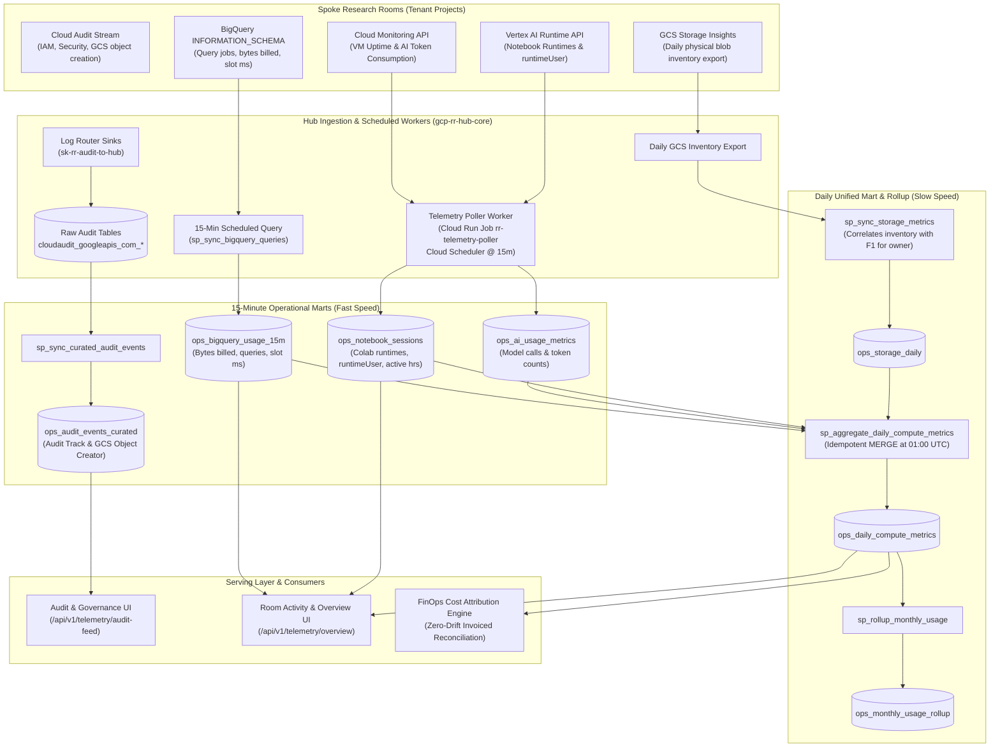

# Chapter 5: Central Telemetry & Automated Ingestion Pipelines
*Target Integration: `/Users/liatsabag/.gemini/antigravity/brain/8ec2aa6b-d111-478c-9225-7ddbee4ced55/preview_architecture.md` (Lines 315–441)*

---

## 5. Central Telemetry & Automated Ingestion Pipelines

Platform telemetry operates across a multi-modal ingestion plane, continuously collecting usage, performance, storage, and security telemetry from the distributed research room fleet into centralized BigQuery analytical marts (`hub_telemetry`).

The architecture implements a decoupled **Two-Speed Telemetry Engine**:
1. **15-Minute Operational Loop**: Near real-time operational sync across three distinct pipelines:
   * **BigQuery Queries**: Ingested directly from spoke `INFORMATION_SCHEMA.JOBS_BY_PROJECT` into `ops_bigquery_usage_15m` via BigQuery Scheduled Query (`sp_sync_bigquery_queries`).
   * **Colab Notebooks & Vertex AI Metrics**: Polled directly from the Vertex AI Runtimes API (`runtimeUser`) and Cloud Monitoring API by an autonomous Cloud Run Job (`rr-telemetry-poller`) triggered every 15 minutes by Cloud Scheduler into `ops_notebook_sessions` and `ops_ai_usage_metrics`.
   * **Audit & Security Stream**: Streamed via Log Router sinks into raw audit tables, then curated into `ops_audit_events_curated` exclusively for audit trail visualization and GCS object creation attribution.
2. **Daily Unified FinOps Mart & Rollup Loop**: Daily physical storage inventory snapshot via GCS Storage Insights into `ops_storage_daily` (correlated with audit logs for creator identity), followed by a daily rollup stored procedure (`sp_aggregate_daily_compute_metrics`) at 01:00 UTC that performs non-destructive, idempotent joins into `ops_daily_compute_metrics` and monthly rollup views (`ops_monthly_usage_rollup`) for zero-drift financial reconciliation against GCP Billing.

---

### 5.1 Telemetry Sources & Ingestion Matrix

Rather than relying on a single telemetry channel or attempting impossible REST polling from SQL stored procedures, the platform synthesizes data across four foundational GCP sources:

| Service / Domain | Measured Metric(s) | True Ground Source | Frequency | Collection Process & Runner | Target Schema / Table |
| :--- | :--- | :--- | :--- | :--- | :--- |
| **BigQuery Analytics** | Query count, total bytes billed/processed, slot millisecond runtime | Spoke Project BigQuery `INFORMATION_SCHEMA.JOBS_BY_PROJECT` | Every 15 min | BigQuery Stored Procedure (`sp_sync_bigquery_queries`) triggered via BigQuery Scheduled Query | `hub_telemetry.ops_bigquery_usage_15m` |
| **Colab Enterprise (BigQuery Studio)** | Active session hours, session starts/stops, notebook names, machine shapes (`e2-standard-4`, `n2-highmem-8`), `runtimeUser` | Vertex AI Notebook Runtimes API (`aiplatform.notebookRuntimes.list`) + Cloud Monitoring VM uptime | Every 15 min | Autonomous Telemetry Poller Cloud Run Job (`rr-telemetry-poller`) triggered via Cloud Scheduler (`rr-telemetry-poller-15m`) | `hub_telemetry.ops_notebook_sessions` |
| **Vertex AI & Gemini APIs** | Total inference calls, successful/failed calls, input/output token counts | Cloud Monitoring API (`aiplatform.googleapis.com/prediction/online/token_count`) | Every 15 min | Autonomous Telemetry Poller Cloud Run Job (`rr-telemetry-poller`) triggered via Cloud Scheduler (`rr-telemetry-poller-15m`) | `hub_telemetry.ops_ai_usage_metrics` |
| **Cloud Storage (GCS)** | Physical bytes stored, object/file counts per bucket & researcher | GCS Storage Insights daily inventory export (CSV/Parquet in GCS) correlated with `storage.objects.create` for creator identity | Daily (Inventory drop); Merged at 01:00 UTC | Automated GCS Storage Insights &rarr; BigQuery External Table (`ops_storage_daily`) & Ownership Correlation (`sp_sync_storage_metrics`) | `hub_telemetry.ops_storage_daily` |
| **Platform Audit & Governance** | Data access, IAM modifications, egress scans, user identity attribution | Cloud Audit Logs (`protoPayload.@type = AuditLog`) | Real-time stream (sink); Curated every 15 min | GCP Log Router Sinks (`sk-rr-audit-to-hub`) &rarr; 15-min Curation Procedure (`sp_sync_curated_audit_events`) | `hub_telemetry.ops_audit_events_curated` |
| **Unified Daily Mart** | Unified compute, storage, query slot hours, AI inference, and storage bytes per researcher | `ops_bigquery_usage_15m`, `ops_notebook_sessions`, `ops_ai_usage_metrics`, `ops_storage_daily` | Daily (01:00 UTC) | Scheduled BigQuery Stored Procedure (`sp_aggregate_daily_compute_metrics`) | `hub_telemetry.ops_daily_compute_metrics` |
| **Monthly FinOps Rollup** | Monthly query volume (TB), slot hours, notebook hours, average active researchers per room/institute | `ops_daily_compute_metrics` | Monthly (1st of month) | Scheduled BigQuery Stored Procedure (`sp_rollup_monthly_usage`) | `hub_telemetry.ops_monthly_usage_rollup` |

---

### 5.2 Two-Speed Pipeline Architecture

The end-to-end pipeline operates on two decoupled cadences to satisfy both fast operational UI responsiveness and consistent financial reconciliation:



---

### 5.3 Detailed Pipeline Mechanics: How It Actually Works

#### 5.3.1 Raw Audit Stream Collection: Cloud Logging Sinks to BigQuery
* **Provisioning Mechanism (`scripts/provision_log_sinks.py`)**:
  During tenant room provisioning, a GCP Log Router Sink named `sk-rr-audit-to-hub` is created across each spoke project via `gcloud logging sinks create` with the filter:
  ```text
  protoPayload.@type="type.googleapis.com/google.cloud.audit.AuditLog"
  ```
* **Destination & Permissions**:
  The sink points directly to the Hub dataset: `bigquery.googleapis.com/projects/gcp-rr-hub-core/datasets/hub_telemetry`.
  The script automatically retrieves the sink's unique `writerIdentity` service account and grants it `roles/bigquery.dataEditor` on `hub_telemetry`.
* **Underlying Service & Ingestion**:
  Google Cloud Logging directly streams logs into BigQuery partition tables (`cloudaudit_googleapis_com_data_access`, `cloudaudit_googleapis_com_activity`, `cloudaudit_googleapis_com_system_event`) in near real-time with sub-minute latency without requiring an intermediate message broker.

#### 5.3.2 15-Minute BigQuery Query Usage Sync (`sp_sync_bigquery_queries`)
* **Execution & Source**:
  Executed every 15 minutes by BigQuery Scheduled Queries. Scans `INFORMATION_SCHEMA.JOBS_BY_PROJECT` across all active spoke projects.
* **Lookback Window & Boundary Deduplication**:
  To guarantee complete capture across distributed job completion times and scheduled trigger jitter, the query scans a **30-minute lookback window** (`creation_time >= TIMESTAMP_SUB(CURRENT_TIMESTAMP(), INTERVAL 30 MINUTE)`).
* **Idempotent Merge**:
  Results are merged into `hub_telemetry.ops_bigquery_usage_15m` using an idempotent `MERGE` keyed on `(usage_date, room_id, user_email)`:
  * When matched, metrics are updated with the latest cumulative totals.
  * When not matched, a new record is inserted.
  * **Result**: Zero duplicate rows, zero query job omissions.

#### 5.3.3 Colab Enterprise (BigQuery Studio) Runtime Attribution (`telemetry_poller.py` via Cloud Run Job)
* **The Attribution Challenge**:
  Researchers launch and run Colab Enterprise notebooks hosted inside BigQuery Studio. Cloud labels cannot be reliably enforced upon notebook creation or runtime assignment by ad-hoc user action.
* **Resolution via Direct API Polling**:
  1. **Runtime User Attribution**: In Colab Enterprise, Vertex AI automatically sets the `runtimeUser` field on the underlying Compute Engine instance / notebook runtime to the researcher's authenticated email (e.g. `dr.eitan.rosen@liatsabag.altostrat.com`).
  2. **Direct Vertex AI API Ingestion**: The autonomous Telemetry Poller Cloud Run Job (`rr-telemetry-poller`) directly queries the Vertex AI Notebook Runtime API (`aiplatform.notebookRuntimes.list`) and Cloud Monitoring VM uptime across each spoke project every 15 minutes, fetching active runtime names, status, and machine shapes (`e2-standard-4`, `n2-highmem-8`).
  3. **Autonomous Scheduling Deployment**:
     * **Container**: `me-west1-docker.pkg.dev/gcp-rr-hub-core/cloud-run-source-deploy/telemetry-poller:latest`
     * **Compute Runner**: Serverless Cloud Run Job `rr-telemetry-poller` (1 CPU, 1GiB RAM) running under service account `468155375703-compute@developer.gserviceaccount.com`.
     * **Scheduler**: Triggered every 15 minutes (`*/15 * * * *`) by Cloud Scheduler job `rr-telemetry-poller-15m` via authenticated HTTP POST with OAuth identity verification.
  4. **Target Table**: Idempotently merged directly into `hub_telemetry.ops_notebook_sessions` keyed by `(session_date, room_id, user_email, runtime_id)`.

#### 5.3.4 Vertex AI & Gemini Inference Tracking (`telemetry_poller.py` via Cloud Run Job)
* **Execution & Source**:
  Executed every 15 minutes by the `rr-telemetry-poller` Cloud Run Job.
* **Metric Polling**:
  Directly polls the Google Cloud Monitoring API for `aiplatform.googleapis.com/prediction/online/token_count` across each active spoke project.
* **Target Mart**:
  Persisted directly into `hub_telemetry.ops_ai_usage_metrics` (partitioned by `usage_date`, clustered by `room_id, user_email`).

#### 5.3.5 Physical Cloud Storage Attribution Without Bucket Restructuring (`sp_sync_storage_metrics`)
* **The Challenge**:
  Restructuring GCS buckets to force rigid path hierarchies (e.g. `gs://bucket/users/{email}/...`) breaks existing code, data loading pipelines, and third-party tools. Furthermore, GCS Storage Insights inventory files report physical object sizes, paths, and storage classes, but do *not* report file owner identities.
* **The Two-Step Correlation Solution**:
  1. **Daily Inventory Drop**: GCS Storage Insights generates a daily snapshot of all physical blobs, storage classes, and bytes per bucket, landing automatically in BigQuery as `ops_storage_daily`.
  2. **Audit Log Join for Ownership Attribution**: The stored procedure `sp_sync_storage_metrics` correlates the active Storage Insights inventory with `storage.objects.create` events from `cloudaudit_googleapis_com_data_access` using `(bucket_name, object_name)`. The authenticated `principalEmail` is extracted as the immutable creator of that object.
  3. **Fallback Attribution**: Objects created by automated ETL pipelines or system accounts default to `shared-system-overhead`, guaranteeing that 100% of physical bucket bytes are accounted for without misattributing project costs.

#### 5.3.6 Daily Compute Aggregation & Monthly Rollups (`sp_aggregate_daily_compute_metrics` & `sp_rollup_monthly_usage`)
* **Elimination of Destructive TRUNCATE**:
  Legacy scripts used `TRUNCATE TABLE ops_daily_compute_metrics`, causing storage metrics and historical records to vanish between runs.
  The modernized procedure replaces all deletions with an **atomic, idempotent `MERGE`**:
  ```sql
  MERGE `hub_telemetry.ops_daily_compute_metrics` T
  USING combined_daily_sources S
  ON T.usage_date = S.usage_date 
     AND T.room_id = S.room_id 
     AND T.user_email = S.user_email
  WHEN MATCHED THEN
      UPDATE SET
          query_count = S.query_count,
          total_bytes_billed = S.total_bytes_billed,
          total_slot_hours = S.total_slot_hours,
          notebook_runtime_hours = S.notebook_runtime_hours,
          ai_inference_count = S.ai_inference_count,
          ai_token_count = S.ai_token_count,
          -- Preserves current storage count without resetting to zero
          storage_bytes = COALESCE(S.storage_bytes, T.storage_bytes, 0)
  WHEN NOT MATCHED THEN
      INSERT (...) VALUES (...);
  ```
* **Daily Aggregation Schedule (`sp_aggregate_daily_compute_metrics`)**:
  Executes daily at 01:00 UTC via BigQuery Scheduled Query `rr-telemetry-daily-finops-rollup`. Joins the 15-minute operational marts with `ops_storage_daily` to produce the definitive single row per `(usage_date, room_id, user_email)`.
* **Monthly Rollups (`sp_rollup_monthly_usage`)**:
  Aggregates daily marts into monthly institutional trends:
  * Computes average active researchers: $\frac{\text{Count Distinct}(user\_email)}{\text{Count Distinct}(usage\_date)}$.
  * Total query volume in Terabytes: $\frac{\sum total\_bytes\_billed}{1024^4}$.
  * Total notebook hours and total slot hours per room and sponsoring institute.
  * Populates `hub_telemetry.ops_monthly_usage_rollup` (partitioned by `usage_month`, clustered by `room_id, institute_id`).

---

### 5.4 Consuming Applications: Serving UI Endpoints & FinOps Engine

The curated telemetry marts power both real-time operational user interfaces and the downstream financial accounting model:

1. **Audit & Governance UI (`/api/v1/telemetry/audit-feed`)**:
   Serves `ops_audit_events_curated` directly to the Governance & Audit Dashboard (`auditView.js`), providing administrators with real-time filtering by category, researcher, room, and severity, with one-click CSV export for external ethics and compliance auditors.
2. **Room Activity & Live Inventory (`/api/v1/telemetry/rooms/{id}/activity`)**:
   Queries `ops_daily_compute_metrics` and `ops_notebook_sessions` to display live room statistics, active researcher names, last active session timestamps, cumulative queries, and notebook execution hours (`roomDetailView.js`).
3. **Fleet Overview & Real-Time Monitoring (`/api/v1/telemetry/overview`)**:
   Combines live queries from spoke `INFORMATION_SCHEMA.JOBS_BY_PROJECT` and `ops_bigquery_usage_15m` with `ops_daily_compute_metrics` to display 24-hour, 7-day, and 30-day active researcher counts, query counts, and byte scan volumes.
4. **FinOps Proportional Cost Attribution Engine (Chapter 6)**:
   Extracts `ops_daily_compute_metrics` to derive exact proportional researcher resource weights ($W_{r,\text{BQ}}$, $W_{r,\text{Compute}}$, $W_{r,\text{Storage}}$, $W_{r,\text{AI}}$) for zero-drift financial reconciliation against GCP invoiced billing.
