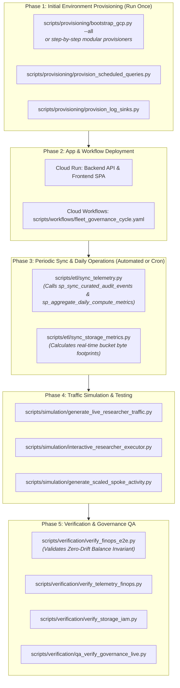

# Operational Scripts & Tooling Guide

This directory contains automated provisioning, simulation, synchronization (ETL), verification, and DDL scripts for the **GCP Multi-Tenant Trusted Research Environment (TRE)** platform.

---

## 🧭 Master Operations Lifecycle & When to Run What

The diagram and table below summarize the execution order, triggers, and prerequisites across all operational phases:



---

## 📋 Comprehensive Script Catalog & Runbook Matrix

| Script | Category | When to Run / Trigger | Prerequisites | Key Command / Options |
| :--- | :--- | :--- | :--- | :--- |
| **`provisioning/bootstrap_gcp.py`** | Provisioning | **Initial Deployment**: Sets up the entire fleet (Hierarchy, BigQuery, Storage, Identities, Runtimes). | GCP credentials with Owner/Editor & IAM permissions. | `python3 scripts/provisioning/bootstrap_gcp.py --all` |
| **`provisioning/provision_storage.py`** | Provisioning | **Storage Setup**: Creates dual-buckets (`inbound`, `export`) and uploads sample data and mock IRBs. | GCP Storage Admin. | `python3 scripts/provisioning/provision_storage.py` |
| **`provisioning/provision_bigquery.py`** | Provisioning | **Data Setup**: Deploys `hub_registry`, `hub_telemetry`, and spoke local clinical datasets. | BigQuery Admin. | `python3 scripts/provisioning/provision_bigquery.py` |
| **`provisioning/provision_identity.py`** | Provisioning | **IAM Setup**: Creates Cloud Identity groups and binds Hub & Spoke IAM policies. | Cloud Identity & IAM Security Admin. | `python3 scripts/provisioning/provision_identity.py` |
| **`provisioning/provision_runtime_templates.py`** | Provisioning | **Compute Setup**: Provisions spoke VPC subnets (`disable_public_ip=true`) and Colab templates. | Compute & Vertex AI Admin. | `python3 scripts/provisioning/provision_runtime_templates.py` |
| **`provisioning/provision_notebooks.py`** | Provisioning | **Notebook Setup**: Generates domain-specific Jupyter research templates in GCS. | Storage Object Admin. | `python3 scripts/provisioning/provision_notebooks.py` |
| **`provisioning/provision_scheduled_queries.py`** | Provisioning | **DTS Setup**: Schedules 15-minute audit sync and 24-hour daily rollup queries in BigQuery DTS. | BigQuery DTS Admin. | `python3 scripts/provisioning/provision_scheduled_queries.py` |
| **`provisioning/provision_log_sinks.py`** | Provisioning | **Logging Setup**: Routes cross-project `cloudaudit.googleapis.com` events from spokes into Hub. | Logging Admin on Spoke projects. | `python3 scripts/provisioning/provision_log_sinks.py` |
| **`provisioning/provision_analytics_hub.py`** | Provisioning | **Analytics Hub Setup**: Creates data exchange listings for zero-copy research sharing. | Analytics Hub Admin. | `python3 scripts/provisioning/provision_analytics_hub.py` |
| **`provisioning/grant_service_account_user.py`** | Provisioning | **Permission Fix**: Grants `roles/iam.serviceAccountUser` to room researchers if notebook start fails. | IAM Admin. | `python3 scripts/provisioning/grant_service_account_user.py` |
| **`provisioning/cleanup_gcp.py`** | Provisioning | **Teardown**: Cleans up research room GCP resources during decommissioning. | Project Owner. | `python3 scripts/provisioning/cleanup_gcp.py --all` |
| **`etl/sync_telemetry.py`** | ETL & Sync | **Telemetry Sync**: Manually triggers BigQuery stored procedures and synchronizes storage metrics. | BigQuery Data Editor. | `python3 scripts/etl/sync_telemetry.py` |
| **`etl/sync_storage_metrics.py`** | ETL & Sync | **Storage Calculation**: Calculates actual byte footprints across all GCS buckets into `ops_daily_compute_metrics`. | Storage Viewer & BigQuery Data Editor. | `python3 scripts/etl/sync_storage_metrics.py` |
| **`etl/seed_billing_export.py`** | ETL & Sync | **Billing Seeding**: Ingests ground-truth GCP Billing Export records into BigQuery billing mart. | BigQuery Data Editor on billing project. | `python3 scripts/etl/seed_billing_export.py` |
| **`etl/backfill_audit_history.py`** | ETL & Sync | **Audit Backfill**: Ingests historical synthetic audit events for backtesting and historical dashboards. | BigQuery Data Editor. | `python3 scripts/etl/backfill_audit_history.py --days 30` |
| **`simulation/generate_live_researcher_traffic.py`** | Simulation | **Live Traffic Generation**: Simulates active multi-tenant researcher queries, Vertex AI inferences, and DLP egress requests. | BigQuery Job User & Vertex AI User. | `python3 scripts/simulation/generate_live_researcher_traffic.py --scans 5 --tokens 2000` |
| **`simulation/generate_scaled_spoke_activity.py`** | Simulation | **Load Testing**: Generates high-volume BigQuery queries and Colab runtime activity across all 5 spokes. | BigQuery Job User. | `python3 scripts/simulation/generate_scaled_spoke_activity.py --cycles 3` |
| **`simulation/interactive_researcher_executor.py`** | Simulation | **Single-Room Simulation**: Runs an interactive step-by-step workload for a specific research room. | Spoke Researcher IAM. | `python3 scripts/simulation/interactive_researcher_executor.py --room rr-oncology-01` |
| **`simulation/run_researcher_workload.py`** | Simulation | **Workload Runner**: Executes headless SQL and storage workloads under a specific researcher persona. | Spoke Researcher IAM. | `python3 scripts/simulation/run_researcher_workload.py --researcher r-elena-rostova` |
| **`verification/verify_finops_e2e.py`** | Verification | **FinOps Mathematical Verification**: Proves that Total Invoiced GCP Spend matches allocated researcher costs + shared overhead with 0.00% drift. | BigQuery Data Viewer. | `python3 scripts/verification/verify_finops_e2e.py` |
| **`verification/verify_telemetry_finops.py`** | Verification | **Telemetry Mart QA**: Validates table schemas, stored procedures, and backend FinOps aggregation. | BigQuery Data Viewer. | `python3 scripts/verification/verify_telemetry_finops.py` |
| **`verification/verify_storage_iam.py`** | Verification | **Security & IAM QA**: Verifies read-only permissions on inbound buckets and write-only on export buckets. | Storage & IAM Viewer. | `python3 scripts/verification/verify_storage_iam.py` |
| **`verification/qa_verify_governance_live.py`** | Verification | **Governance QA**: Tests Gemini 3.7 Flash DUA parsing, Helsinki IRB expiry, and IAM soft-downgrade. | BigQuery & Storage Viewer. | `python3 scripts/verification/qa_verify_governance_live.py` |
| **`verification/verify_live_gcp.py`** | Verification | **End-to-End Fleet Health**: Validates full GCP topology against `fixtures/fleet_topology.json`. | Viewer on Hub & Spokes. | `python3 scripts/verification/verify_live_gcp.py` |
| **`dev_server.py`** | Local Dev | **Local Full-Stack Server**: Runs the FastAPI backend and frontend SPA together on port 3000. | Local Python virtual environment. | `python3 scripts/dev_server.py` |

---

## 🚀 Common Operational Workflows

### 1. New Deployment from Scratch (Zero to Production)
```bash
# 1. Complete cloud bootstrap (Creates GCS, BigQuery, IAM, VPCs, Runtimes)
python3 scripts/provisioning/bootstrap_gcp.py --all

# 2. Deploy scheduled BigQuery DTS sync jobs
python3 scripts/provisioning/provision_scheduled_queries.py

# 3. Deploy cross-project Cloud Logging sinks
python3 scripts/provisioning/provision_log_sinks.py

# 4. Deploy Analytics Hub data exchanges
python3 scripts/provisioning/provision_analytics_hub.py

# 5. Verify live infrastructure health
python3 scripts/verification/verify_live_gcp.py
```

### 2. Multi-Tenant Demo & Traffic Simulation
```bash
# 1. Generate live multi-tenant researcher queries & AI token activity
python3 scripts/simulation/generate_live_researcher_traffic.py --scans 5 --tokens 2000

# 2. Synchronize real-time GCS storage footprints into telemetry
python3 scripts/etl/sync_storage_metrics.py

# 3. Trigger BigQuery data curation stored procedures
python3 scripts/etl/sync_telemetry.py
```

### 3. Financial Closeout & FinOps Invariant Proof
```bash
# Verify that all billed costs match room allocations with 0.00% drift
python3 scripts/verification/verify_finops_e2e.py
```

---

## 📁 Directory Structure

```
scripts/
├── README.md                      # This Operational & CLI Reference Guide
├── dev_server.py                  # Local Full-Stack Development Server
├── fixtures/
│   └── fleet_topology.json        # Central Source-of-Truth Fleet Specification
├── provisioning/                  # Automated GCP Resource Provisioning
│   ├── bootstrap_gcp.py
│   ├── cleanup_gcp.py
│   ├── grant_service_account_user.py
│   ├── provision_analytics_hub.py
│   ├── provision_bigquery.py
│   ├── provision_identity.py
│   ├── provision_log_sinks.py
│   ├── provision_notebooks.py
│   ├── provision_runtime_templates.py
│   ├── provision_scheduled_queries.py
│   └── provision_storage.py
├── simulation/                    # Traffic & Researcher Workload Generators
│   ├── generate_live_researcher_traffic.py
│   ├── generate_scaled_spoke_activity.py
│   ├── interactive_researcher_executor.py
│   ├── researcher_login_run.sh
│   └── run_researcher_workload.py
├── verification/                  # Invariant Tests, Security & QA Suites
│   ├── qa_verify_governance_live.py
│   ├── test_finops_verification.py
│   ├── verify_finops_e2e.py
│   ├── verify_governance_scans.py
│   ├── verify_live.py
│   ├── verify_live_gcp.py
│   ├── verify_specs.py
│   ├── verify_storage_iam.py
│   └── verify_telemetry_finops.py
├── etl/                           # Synchronization & Data Seeding Utilities
│   ├── approval_generators.py
│   ├── backfill_audit_history.py
│   ├── data_generators.py
│   ├── seed_billing_export.py
│   ├── sync_storage_metrics.py
│   └── sync_telemetry.py
├── sql/                           # BigQuery DDLs, Procedures & Authorized Views
│   ├── aggregate_compute_metrics.sql
│   ├── curate_audit_events.sql
│   ├── finops_usage_tracking.sql
│   ├── schema_billing_export.sql
│   ├── schema_hub_shared.sql
│   ├── schema_registry.sql
│   ├── schema_spoke_local.sql
│   ├── schema_telemetry.sql
│   ├── sp_scan_governance.sql
│   ├── view_ai_usage_metrics.sql
│   ├── view_billing_export.sql
│   └── view_notebook_session_metrics.sql
└── workflows/                     # Google Cloud Workflows Definitions
    └── fleet_governance_cycle.yaml
```
